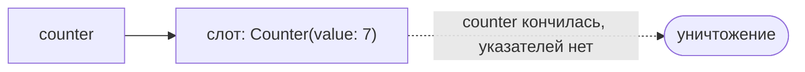
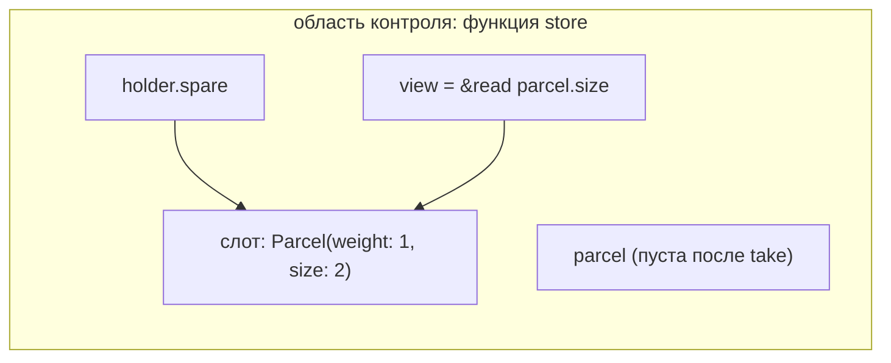
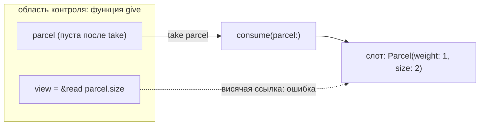
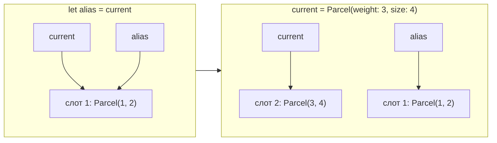
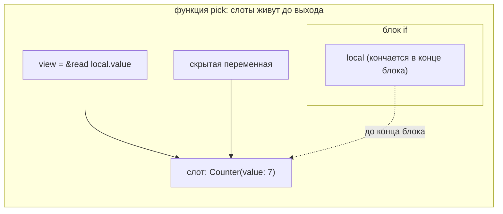
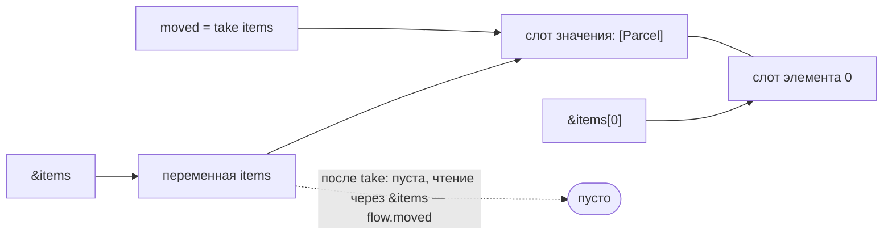
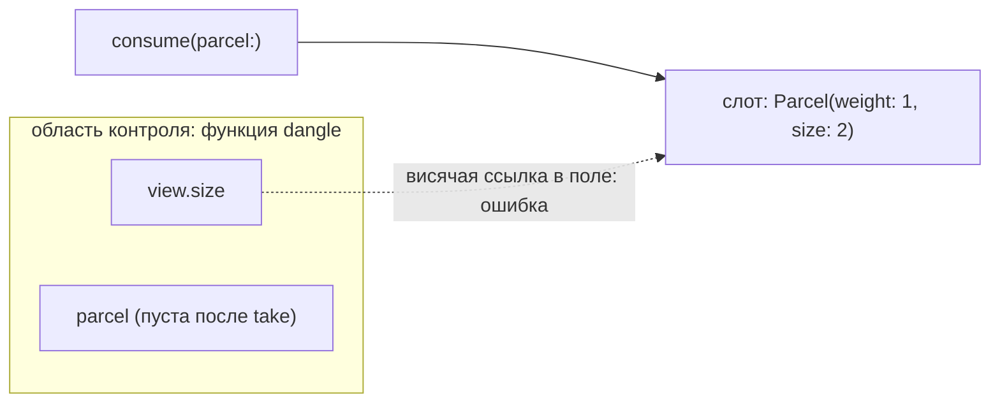
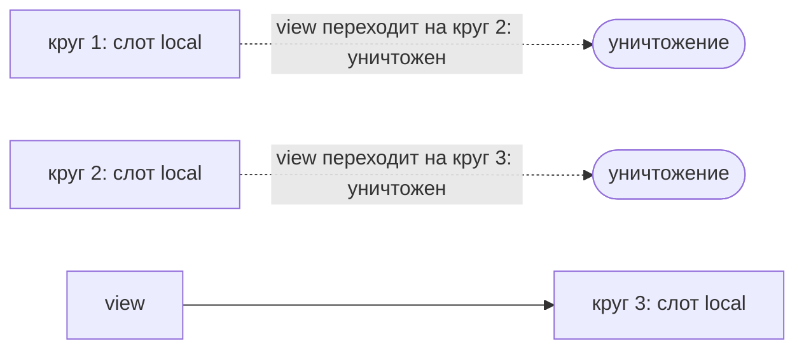
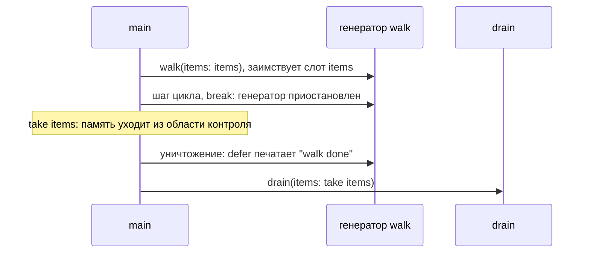
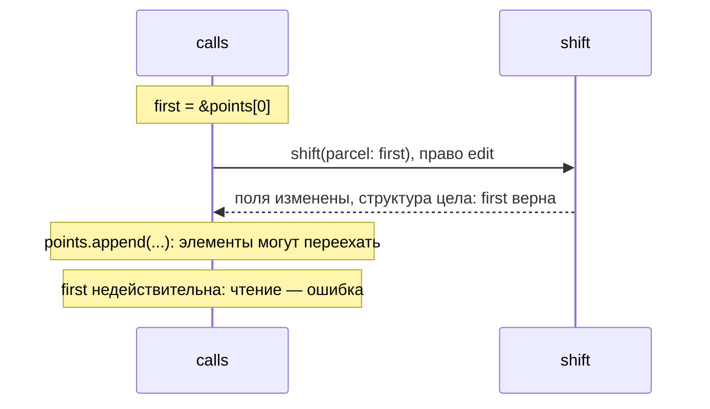

# Безопасная работа с памятью: алгоритм FLOW

[Память](README.md) · [Владение и доступ](../types/ownership.md) · [Правила доступа к памяти](memory-rules.md)

Алгоритм Efen FLOW позволяет гарантировать безопасную работу с памятью, уничтожение памяти и отсутствие висячих
указателей. Третья версия алгоритма основывается лишь на нескольких принципах и нескольких понятиях, из которых
получается богатый набор сложных правил.

Примеры ниже используют такие объявления:

```efen
struct Parcel {
    var weight: Int
    var size: Int
}

struct Counter {
    var value: Int
}

struct Holder {
    var inner: Counter
    var spare: Parcel?
}

fn makeCounter() -> own Counter {
    return Counter(value: 7)
}

fn consume(parcel: own Parcel) {
    // функция принимает обязанность уничтожить parcel
}
```

## Время жизни

Время жизни — знание о том, когда память будет уничтожена.

```efen
fn show() {
    let counter = makeCounter()   // память Counter создана, её держит counter
    print(counter.value)
}                                 // counter кончилась: на память никто не указывает, она уничтожается
```

FLOW знает точку уничтожения из текста функции: счётчика во время выполнения нет.



## Область контроля

Область контроля — это совокупность кода, которая знает о том, какая переменная хранит указатель на какую память, и
знает время жизни памяти. Обычно область контроля — это либо функция, либо `layout`.

Память, записанная в контейнер, который сам остаётся в области контроля, из неё не выходит:

```efen
fn store() {
    var holder = Holder(inner: makeCounter(), spare: null)
    let parcel = Parcel(weight: 1, size: 2)
    let view = &read parcel.size   // ссылка в часть значения parcel
    holder.spare = take parcel     // память перешла в поле holder, но holder — переменная функции
    print(view)                    // допустимо: память в области контроля, view идёт за значением в holder.spare
}
```



## Принцип выхода из области контроля

Если память по тем или иным причинам покидает область контроля, FLOW обязан доказать и обеспечить отсутствие висячих
ссылок.

```efen
fn give() {
    let parcel = Parcel(weight: 1, size: 2)
    let view = &read parcel.size
    consume(parcel: take parcel)   // память покидает область контроля: ею распоряжается consume
    print(view)                    // ошибка: view указывает в память, которая ушла из функции
}
```



Память покидает область контроля, когда её контейнер становится доступен коду, о котором функция этого не знает:
параметру `own`, вызову без сводки, полю, которое переживёт функцию, результату на выходе.

## Память без ссылок уничтожается

Память, на которую никто не ссылается, уничтожается. Время жизни рассчитывается алгоритмом FLOW, а компилятор
вызывает деструктор, если возможно.

```efen
fn rebind() {
    var current = Parcel(weight: 1, size: 2)
    let alias = current                   // alias указывает на ту же память
    current = Parcel(weight: 3, size: 4)  // current получает новую память; прежнюю держит alias
    print(alias.weight)                   // 1
}                                         // alias кончилась: прежняя память уничтожается здесь
```

Если бы `alias` не было, прежнее значение `current` уничтожилось бы в строке записи. Так же, как псевдоним, прежнюю
память держит ссылка внутрь значения, взятая в этой функции (`let weight = &current.weight`): пока ссылка может
быть использована, память жива. Параметр с источником пришёл снаружи: функция не знает, куда он указывает, и
памяти он не держит.



## Модель слотов

FLOW использует модель слотов. Слот — логическая виртуальная ячейка памяти, на которую можно указывать. FLOW следит
за тем, какие переменные указывают на слот. Если слот удерживает память, но на него больше никто не указывает,
память освобождается. Если слот теряет память, в таком случае FLOW обязан гарантировать, что нет висячих указателей.

Слот живёт в пределах функции, а не блока. Переменная блока кончается, а слот её значения остаётся, пока в него
указывает ссылка:

```efen
fn pick(fallback: read Counter, ready: Bool) {
    var view = &read fallback.value
    if ready {
        let local = makeCounter()
        view = &read local.value    // ссылка в слот значения local
    }                               // local кончилась; слот держит скрытая переменная, связанная с view
    print(view)                     // допустимо
}
```



Слот теряет память при `take` его части. До выхода из функции слот получает новое значение:

```efen
fn rotate(holder: mut Holder) {
    let previous = take holder.inner                     // слот holder.inner потерял память
    holder.inner = Counter(value: previous.value + 1)    // записан снова: висячих указателей нет
}
```

## Ссылки

FLOW позволяет использовать ссылки на переменные или на элементы структур данных. Ссылка на переменную работает так
же, как и в C, при условии, что FLOW может доказать безопасность памяти для неё. То есть FLOW чётко знает время
жизни и гарантирует, что память не может выйти из области контроля.

Ссылка на переменную (`&items`) называет переменную. Ссылка на элемент или поле (`&items[0]`, `&parcel.size`) указывает в память значения и
идёт за ним:

```efen
fn follow() {
    var items = [Parcel(weight: 1, size: 2)]
    let whole = &items           // ссылка на переменную items
    let head = &items[0]         // ссылка на элемент
    let moved = take items       // значение перешло в moved
    print(head.weight)           // допустимо: head идёт за значением
    print(whole)                 // ошибка flow.moved: переменная items пуста
}
```

Ссылка на переменную живёт не дольше переменной:

```efen
fn outlive(fallback: read Counter) {
    var view = &read fallback
    {
        let local = makeCounter()
        view = &read local       // ссылка на переменную local
    }                            // local кончилась
    print(view.value)            // ошибка: переменной, которую называет view, больше нет
}
```



Ссылку можно сохранить в поле структуры. Источник пишется в типе поля, и FLOW проверяет ссылку в каждой точке,
где её читают:

```efen
struct View<Src: Origin> {
    let size: read<Src> Int
}

fn inspect() {
    let parcel = Parcel(weight: 1, size: 2)
    let view = View(size: parcel.size)         // поле с правом берёт место: хранит ссылку в часть parcel
    print(view.size)                           // допустимо: значение parcel в области контроля
}

fn dangle() {
    let parcel = Parcel(weight: 1, size: 2)
    let view = View(size: parcel.size)
    consume(parcel: take parcel)               // память parcel покидает область контроля
    print(view.size)                           // ошибка: поле view.size указывает в ушедшую память
}
```



## Выход из области контроля: обязательства

Если память выходит из области контроля, ссылка должна быть уничтожена, а свойство структуры обязано быть или
обнулено, либо заменено на другое значение. FLOW жёстко следит за этим требованием.

Опциональное поле `take` обнуляет само:

```efen
fn release(holder: mut Holder) {
    if let taken = take holder.spare {    // holder.spare получает null
        consume(parcel: take taken)
    }
}
```

Обязательное поле заменяют до выхода. Выход с пустым полем — ошибка, и сообщение предлагает оба исправления:

```efen
fn refill(holder: mut Holder) throws IOError {
    let previous = take holder.inner
    save(previous)               // ошибка: IOError выходит, holder.inner пусто
    holder.inner = makeCounter()
}
```

```text
error[flow.moved]: `holder.inner` is left moved when `refill` exits by `IOError`
help: give it a new value before the function exits
help: or state that it may stay empty on this exit: `ensures throws IOError ==> taken(holder.inner)`
```

## Циклы

Цикл ничего не меняет в принципах: FLOW обходит тело, пока знание о слотах не перестанет расти. От каждой точки
создания в цикле жив не больше чем один слот прошлых кругов; прежний уничтожается, когда на него больше никто не
указывает.

```efen
fn latest(fallback: read Counter) {
    var view = &read fallback.value
    var round = 0
    while round < 3 {
        let local = makeCounter()
        view = &read local.value    // view указывает в слот значения этого круга; слот прошлого круга уничтожается
        round += 1
    }
    print(view)                     // допустимо: слот последнего круга живёт до выхода из функции
}
```



Обход `for … in mut points` разрешает менять структуру `points`; `take` привязки удаляет элемент:

```efen
fn clean(points: mut [Parcel]) {
    for parcel in mut points {
        if parcel.weight < 0 {
            consume(parcel: take parcel)   // элемент удалён из points, память ушла в consume
        }
    }
}
```

Обычный обход тоже допускает изменение структуры, если курсор после него не используется:

```efen
fn grow(points: mut [Parcel]) {
    for parcel in points {
        if parcel.weight == 0 {
            points.append(Parcel(weight: 1, size: 1))   // элементы могут переехать
            break                                       // допустимо: обход дальше не идёт
        }
    }
}

fn growAll(points: mut [Parcel]) {
    for parcel in points {
        points.append(Parcel(weight: parcel.weight, size: parcel.size))   // ошибка: следующий шаг обхода читает переехавшие элементы
    }
}
```

## Генераторы

Генератор хранит заимствование своего источника в кадре. Пока он жив, память источника не может выйти из области
контроля: перед таким событием FLOW уничтожает приостановленный генератор, и его очистка выполняется там же.

```efen
generator walk(items: [Int]) yield Int {
    defer {
        print("walk done")
    }
    for item in items {
        yield item
    }
}

fn drain(items: own [Int]) {
    print(items.count)
}

fn main {
    var items = [5, 6]
    let walker = walk(items: items)
    for item in walker {
        break
    }
    drain(items: take items)     // сначала "walk done": генератор уничтожен до того, как items ушла
}
```



Использовать генератор после этого — ошибка:

```efen
fn reuse() {
    var items = [5, 6]
    let walker = walk(items: items)
    drain(items: take items)     // память items покидает область контроля, walker уничтожен
    for item in walker {         // ошибка: генератор уничтожен строкой выше
        print(item)
    }
}
```

## Вызов функции со ссылкой

Ссылку передают аргументом: функция получает слот, на который ссылка указывает, с правом своего параметра. Право
`edit` разрешает писать значения, но не меняет структуру, поэтому ссылка остаётся верной:

```efen
fn shift(parcel: edit Parcel) {
    parcel.weight = parcel.weight + 1
}

fn calls() {
    var points = [Parcel(weight: 1, size: 2), Parcel(weight: 3, size: 4)]
    let first = &points[0]
    shift(parcel: first)                          // функция пишет поля элемента через ссылку
    print(first.weight)                           // 2: ссылка верна, структура points не менялась
    points.append(Parcel(weight: 5, size: 6))     // изменение структуры: элементы могут переехать
    print(first.weight)                           // ошибка: ссылка first недействительна после append
}
```



Функция может вернуть ссылку в память параметра. Источник пишется в типе результата, и вызывающий знает, чью память
держит ссылка:

```efen
fn firstOf(list: edit [Parcel]) -> edit<list> Parcel {
    return &list[0]
}

fn rename() {
    var points = [Parcel(weight: 1, size: 2)]
    let head = firstOf(list: points)
    head.weight = 10             // пишет в points[0]
    print(points[0].weight)      // 10
}
```

Правила для отдельных форм (`replace`, параметры, `out`, генераторы, классы, `layout`) выводятся из этих принципов и
собраны в [таблице правил доступа к памяти](memory-rules.md) и в статье о [владении](../types/ownership.md).
