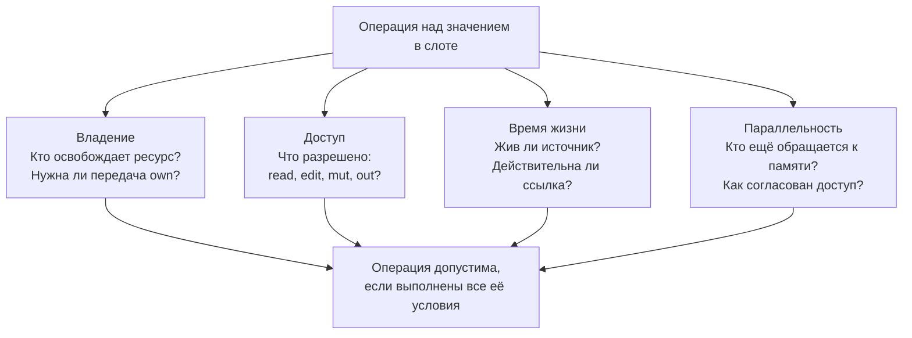

# Владение и доступ к значениям

[Документация](../README.md) · [Словарь](../glossary.md) · [Память и компоновка](../memory/README.md) · [Представления в памяти](../representations.md) · [Правила доступа к памяти](../memory/memory-rules.md)

Владение определяет, кто отвечает за освобождение ресурса. Права доступа
определяют, какие операции разрешены над ним: чтение, изменение данных,
изменение структуры памяти или заполнение ещё не записанного слота.
Заимствование предоставляет доступ без передачи владения.

Для допустимой операции нужны подходящие права, живой источник данных
и совместимость с доступом другого кода. При работе в нескольких потоках
дополнительно проверяется отсутствие гонок и соблюдение правил синхронизации.

## Основные понятия

| Понятие | Что означает |
|---|---|
| Владелец | Имеет `own`: исключительное владение — обязанность уничтожить ресурс или передать её дальше, и ссылок у других нет |
| Якорь | Имеет `anchor`: обязанность уничтожить ресурс, при которой другие держат на него невладеющие указатели |
| Слот | Хранилище ресурса: переменная, поле или элемент |
| Связывание | Имя, через которое программа обращается к значению или слоту |
| Заимствование | Доступ без передачи обязанности освободить ресурс |
| Ссылка | Локальный псевдоним слота, созданный через `&` |
| Origin | Источник слота, от которого зависит допустимость доступа |
| `take` | Явная передача владения из исходного слота |

## Общая модель

У одной операции есть несколько независимых условий. Наличие владельца
не означает, что ресурс можно одновременно менять из нескольких потоков,
а право чтения не продлевает время жизни ресурса.



Например, чтение поля через ссылку требует читающего доступа и действительной
ссылки. Если другой поток может одновременно записать в это поле, одного
`read` недостаточно: нужен разрешённый способ совместного доступа.

## Порядок чтения

1. [Права владения и доступа](#права-владения-и-доступа) и [связывания](#слоты-и-связывания).
2. [Копирование, клонирование и передача владения](#копирование-клонирование-и-передача-владения).
3. [Параметры функций](#параметры) и [извлечение через `take`](#явное-извлечение).
4. [Ссылки](#ссылки-только-внутри-функции) и [время их допустимого использования](#что-делает-ссылку-недействительной).
5. [Параллельный доступ](#права-при-параллельном-выполнении).
6. [Управляемое хранение](#управляемое-хранение-managed) — для реализации моделей памяти.

## Права владения и доступа

В исходном коде используются следующие права:

| Право | Что разрешает | Чего само по себе не даёт |
|---|---|---|
| `read` | Читать значение | Записывать данные или передавать владение |
| `edit` | Менять данные в допустимых слотах и создавать новые слоты | Перемещать или уничтожать существующие слоты |
| `mut` | Менять данные и структуру памяти, в том числе перемещать и уничтожать существующие слоты | Получать владение или обращаться к той же памяти из нескольких потоков без согласования; исключение — функция `layout`, которая доказывает, что на память элемента никто не ссылается, и переводит его в `own` ([освобождение](../memory/layout-algorithm.md#что-описывает-layout)) |
| `out` | Записать значение в ещё не инициализированный слот | Читать прежнее значение, которого в слоте ещё нет |
| `own` | Исключительное владение: всё, что даёт `anchor`, и других ссылок на значение нет, кроме ссылок внутри функции, которые умирают до уничтожения или передачи | Автоматически получать любые права доступа или разрешение на совместную запись |
| `anchor` | Уничтожить значение или передать обязанность его уничтожить, пока на значение указывают невладеющие указатели `layout`. Якорь — крайняя точка времени жизни: FLOW доказывает, что ни одно имя её не переживает. Якорь у значения один в каждый момент; он передаётся через `tie` (`take` остаётся для `own`) и бывает полем, параметром, результатом или локальной переменной ([якорь](../memory/layout-reference.md#якорь-anchor)) | Исключительность: Z3 не получает факта «ничего не одолжено» |

`edit` сохраняет существующие слоты в памяти. Это позволяет менять данные,
не делая ссылки на эти слоты недействительными. `mut` допускает и операции,
после которых такие ссылки могут стать недействительными.

### Составляющие права

Для проверки прав компилятор раскладывает их на более мелкие составляющие.
Это внутреннее разложение прав, описанных выше:

| Составляющая | Что учитывает компилятор |
|---|---|
| `own` | Право уничтожить значение или передать обязанность уничтожения, исключительно |
| `anchor` | Право уничтожить значение или передать обязанность уничтожения, при невладеющих указателях на значение |
| `read` | Право читать содержимое |
| `write` | Право изменять содержимое |
| `split` | Право выделять независимые части владения |
| `inspect` | Право различать объекты по их идентичности без доступа к содержимому |

`edit` сочетает запись с созданием новых слотов, сохраняя существующие.
`mut` допускает запись и все операции над структурой памяти, включая перенос
и уничтожение слотов ([`edit` и `mut` в `layout`](../memory/layout-reference.md#edit-и-mut-в-layout)). `out` описывает запись
в слот без значения. Слов `write`, `split` и `inspect` в языке нет: это имена внутри компилятора. Программист пишет
`read`, `edit`, `mut`, `own`, `out` и `anchor`; запись значений даёт `edit`, изменение структуры — `mut`.

Владеющее поле выражается через `own`; компилятор выводит связь жизни значения с
содержащим его слотом из контекста и не отключает проверки перемещения.

Пометка `shared` правом не является: это свойство объявления типа
([общая память](../shared.md#пометка-shared)).

`mut` даёт полное право: запись и изменение структуры. Он не
исключительный внутри тела функции; на границе вызова пишущий параметр память ни с кем не делит
([области доступа](access-regions.md#совместимость)). Нового права `mut` не создаёт.

`edit` — режим доступа, при котором существующие слоты не перемещаются и не
уничтожаются. Значения в них менять можно. Создавать новые слоты тоже можно, как
и записывать указатели на эти новые слоты. Ни один существующий слот не исчезает
и не переезжает, поэтому ссылки в структуру остаются годными. `mut` даёт больше:
он может переместить и уничтожить существующие слоты (см. «Что делает ссылку
недействительной»). `edit` строже `mut` и шире `read`; нового права он тоже
не создаёт.

Поэтому `LinkedList.append` — операция `edit`: она добавляет узел и ничего не
двигает. Перестановка узлов, при которой ни один узел не перенесён и не уничтожен (разворот списка, поворот
дерева, перенос записи в начало списка давности), — тоже `edit`. `Vector.append` — операция `mut`: при росте она перевыделяет буфер и
перемещает элементы.

```efen
fn zero(values: edit Vector<Int>) {
    for value in edit values {
        value = 0             // допустимо: меняется значение элемента
    }
    values.append(1)          // ошибка: append может переместить элементы
}

fn push(list: edit LinkedList<Int>) {
    list.append(1)            // допустимо: новый узел, старые остаются в своих слотах
}

fn grow(values: mut Vector<Int>) {
    values.append(1)          // допустимо: mut разрешает изменить структуру
}
```

Право `edit fn` определяет его сводка: к выходу метода каждый существующий слот `self` лежит на своём адресе и
не уничтожен. Вне кода представления данных запись значения, которое владеет памятью (строка, вектор),
уничтожает старую память и под `edit` запрещена. Под `edit` запрещена и запись `null` или другого случая в
опциональное значение или вариант с данными случая, владеют эти данные памятью или нет: прежние данные перестают
существовать. Перечисление, случаи которого данных не несут, пишется под `edit`. Внутри кода представления
данных `edit fn` записывает поля-значения и невладеющие указатели, создаёт слоты (запись в неинициализированный
элемент области, новый узел в пустое владеющее поле) и переставляет якоря через `tie`, пока каждый узел остаётся в
той же структуре. Так `LinkedList.append` и разворот списка остаются `edit fn`. Запись поверх непустого владеющего
поля (`node.next = makeNode()` при непустом `node.next`) — ошибка: прежний узел остался бы без владельца. `mut`
требуют узел, отданный из структуры, выдача слота `lend`, освобождение, смена вида и перевыделение области. Полная
таблица операций — в статье о компоновке ([`edit` и `mut` в `layout`](../memory/layout-reference.md#edit-и-mut-в-layout)).

## Слоты и связывания

Слот хранит ресурс, несёт объявленные права и режим управления. На один слот может указывать несколько имён, но
владеет значением одно: остальные имена служат псевдонимами и хранят заимствование
([связывание существующего значения](#связывание-существующего-значения)). Значение отдаёт только владелец. Для
`managed`-слота проверка заимствований этого не отслеживает.

Обычное неизменяемое связывание получает `own + read`. Оно также получает
`write`, если сам тип допускает изменение:

```efen
let file: FileHandle
```

`let` запрещает перепривязку имени, но не обязательно изменение объекта.
Слот `immutable T` не даёт `write` ни через одно имя ([неизменяемый слот](#неизменяемый-слот-immutable-t)).
CoW-тип при записи сначала выполняет предусмотренное
типом отделение копии.

### Связывание существующего значения

`let` без `&`, `copy` и `take` связывает значение одним из двух способов, по его типу:

- тип `ImplicitlyCopyable` (`Int`, `Float`, `Bool` и другие типы модулей языка) копируется: такая копия не выделяет
  память. Строку `conforms ImplicitlyCopyable` пишут только модули языка, и в пользовательском типе она вызывает
  ошибку;
- любой другой тип, в том числе структура из одних чисел, получает псевдоним: второе имя того же значения, а не
  копию. Тихой копии структуры в языке нет: копию даёт только `copy`, передачу владения только `take`.

Невладеющий указатель `layout` (`S.Item` без `own` и `anchor`) и ссылка связываются копированием адреса, как
значение первого случая: `let q = p.next` создаёт новый указатель, а не псевдоним поля
`p.next`. Оба типа принадлежат языку, поэтому
правило о строке `conforms ImplicitlyCopyable` остаётся в силе. Чтение слота `own` или `anchor` с элементом
`layout` без `tie` и `take` тоже даёт невладеющий указатель
([запись и тип указателя](../memory/layout-reference.md#ссылки), правило 5).

Объект класса без `conforms ArcClass` относится ко второму случаю: `let b = a` даёт псевдоним, а не второго
владельца. У объекта класса со счётчиком `let b = a` даёт второго владельца
([управление памятью](../classes.md#управление-памятью)).

```efen
let n = item.count          // Int: копия, запись item.count = 5 её не меняет
let p = shape.origin        // Point: псевдоним значения shape.origin, не копия
let q = copy shape.origin   // своя копия Point
let t = doc.title           // String: псевдоним значения doc.title
let c = copy doc.title      // своя копия
doc.title.append("!")       // ошибка: append может перевыделить буфер строки, а t используется ниже
print(t)
```

Так же связывают образцы `let`, `if let`, `match` и `is` ([деструктуризация](../destructuring.md)).

Правила псевдонима:

1. Псевдоним хранит заимствование значения, от которого получен, с правом пути к этому значению. Псевдоним поля
   параметра `read` только читает; псевдоним поля параметра `edit` пишет значения. Запись через псевдоним, передача
   его пишущему параметру и изменение структуры через него требуют этого права. `&псевдоним` берёт то же право.
2. Псевдоним элемента коллекции, привязка `for` и переменная ветки `match` хранят заимствование элемента. Запись
   элемента целиком и его `take` это заимствование заканчивают.
3. Изменение структуры значения делает псевдоним недействительным, как ссылку: вызов, который переносит или
   уничтожает слоты источника, допустим, если псевдоним после него не используется. Использование после такого
   вызова вызывает ошибку. Запись поля через недействительный псевдоним тоже считается использованием.
4. `take` псевдонима вызывает ошибку: значение отдаёт только владелец. Имя `var`, которое на каждом пути владеет
   своим значением (получило его от вызова или от `take`), псевдонимом не служит, и `take` его забирает.
5. Запись `var`-псевдонима целиком переставляет имя на другое значение. Права она не требует и в значении прежнего
   владельца ничего не меняет.
6. Получатель, который владеет, принимает значение, а не слот. Аргумент `own`, запись поля, элемента или параметра
   целиком, элемент литерала массива, поле `capture` и значение в `return`, `throw` и `yield` принимают результат
   вызова, литерал, `take`, `copy` или значение типа без единственного владельца: число, ссылку, объект со
   счётчиком, невладеющий указатель `layout`, значение `ImplicitlyCopyable`. Чтение чужого слота в такой позиции
   (`consume(a)`, `return doc.title`) вызывает ошибку: пишут `take` или `copy`.
7. `return x`, `throw x` и `yield x` с именем локальной переменной, привязки или параметра `own`, которое владеет
   значением, переносят значение, как `take x`. После них имя не используется, а его псевдонимы недействительны.
   Псевдоним в такой позиции вызывает ошибку по правилу 6.

### Неизменяемый слот: `immutable T`

`immutable T` — свойство слота: значение в нём и всё, до чего оно достаёт, не меняется ни на один байт от
заморозки до уничтожения. Неизменяемость глубокая; полностью её проверяет компилятор. Какие типы допускают
заморозку (`Freezable`) и как устроен `readonly class`, описывает [неизменяемость](../immutability.md).

```efen
var hosts = Vector<String>()
hosts.append("primary")
let first = &hosts
let table: immutable Vector<String> = take hosts    // заморозка
defer table.release()                               // роль уничтожения: единственный вызов own у замороженного
first.append("x")                                   // ошибка: ссылка first кончилась при заморозке
table.append("y")                                   // ошибка: table — immutable Vector<String>
```

- **Заморозка `take`.** `take x` из `own T` в слот `immutable T` — отдельное событие FLOW. Оно кончает все
  ссылки, псевдонимы, ссылки в результатах и итераторы функции, которые начинаются в `x`. Ошибка, если жива
  структура, которая заимствует `x` или его часть, или если `x` видит живая корутина, `background`, `offload` или объект
  `shared layout`. Обычный `take` ссылку на слот сохраняет ([явное извлечение](#явное-извлечение)), поэтому у
  заморозки своё правило. Другие точки заморозки — новое значение (конструктор, литерал, `copy`) и `const`.
- **Путь.** Путь через `immutable` тоже `immutable`: у `table: immutable Vector<String>` элемент `table[0]` —
  `immutable String`. Ссылка, которую возвращает `read fn` с источником в замороженном значении, тоже `immutable`.
- **Копия.** Копия `ImplicitlyCopyable` без кучи теряет `immutable`: `var limit = config.timeout` — `Int`. `copy`
  замороженного значения даёт `own T`. Других путей от `immutable T` к `T` нет.
- **Запрещено.** Присваивание поля, метод с `edit`, `mut` или `own self`, заимствование `edit` и `mut`, аргумент `out`,
  `take` части. `take` всего значения в другой слот `immutable T` разрешён.
- **Слот `var`.** Слот `var` типа `immutable T` перезаписывают только целиком другим замороженным значением; старое
  уничтожается.
- **Уничтожение.** Владелец `own immutable T` уничтожает значение и вызывает роль деструктора, в том числе
  `explicit`, когда FLOW доказал, что заимствований нет. Это единственный разрешённый `own` метод, и он последний.
  У структуры из `layout` ролью уничтожения служит её освобождающая функция (`release`): владелец замороженной
  коллекции вызывает её, и `defer table.release()` допустим
  ([ничего не теряется](../memory/layout-reference.md#74-ничего-не-теряется)).
- **Параметр.** `own immutable T` принимает замороженное значение во владение. Одолженный параметр пишут `T`: он и
  так только читается и принимает `immutable T`; запись `immutable T` у одолженного параметра — ошибка стиля.

## Копирование, клонирование и передача владения

В Efen есть три явных действия с существующим значением. Копирование
создаёт независимое значение, клонирование может разделять с источником
данные в памяти, а передача владения меняет владельца существующего ресурса.

| Действие | Запись | Что получается | Что происходит с источником | Требование |
|---|---|---|---|---|
| Глубокое копирование | `copy x` | Новое независимое значение со своими экземплярами данных, которыми владеет источник | Остаётся у прежнего владельца | `Copyable` |
| Поверхностное копирование, или клонирование | `clone x` | Копия верхнего уровня с общими данными в куче | Сохраняется; время жизни общих данных учитывает тип | `Cloneable` |
| Передача владения, или перемещение | `take x` | Тот же ресурс у нового владельца | Исходное имя больше не владеет ресурсом; опциональный слот получает `null` | `Movable` |

Для перемещения используется `take`; отдельного оператора `move` в этих
правилах нет. Передача владения не обязательно физически переносит байты:
[живая ссылка на слот может сохраняться](#явное-извлечение).

```efen
let independent = copy tree      // независимое дерево
let anotherOwner = clone handle // общие данные; тип учитывает их владельцев
let transferred = take resource // resource больше не владеет значением
```

Примеры предполагают, что типы поддерживают соответствующие контракты.
`copy` и `clone` не взаимозаменяемы. Например, для дерева без общего владения
`clone tree` недопустим. Если копия требует выделения памяти, `copy` может
выбросить `AllocationError`.

Обычное связывание `let b = a` подчиняется отдельным правилам:
`ImplicitlyCopyable` копируется неявно; для остальных типов возникает
псевдоним того же значения. У класса с подсчётом ссылок появляется второй
владелец. Подробности приведены в разделе
[«Связывание существующего значения»](#связывание-существующего-значения).

`Movable`, `Copyable` и `Cloneable` не следуют друг из друга.
`ImplicitlyCopyable` требует `Copyable`, но не даёт `Movable`.
Клонирование создаёт ещё одного владельца общих данных, но само по себе
не разрешает доступ к ним из другого потока. Это отдельно проверяется
по правилам параллельного выполнения.

Полные правила операторов описаны в статье
[о контрактах копирования и перемещения](../runtime/value-operations.md#контракты-копирования-и-перемещения).

## Параметры

Параметр без `own`, `mut`, `edit` и `out` только читается: функция не пишет в него и не
вызывает его мутирующие методы, включая переходы состояния. Обязанность
освободить значение остаётся у вызывающего. Исключение — замыкание вида `own` (`() own -> Void`): функция
вызывает его один раз через `(take f)()`, и у вызывающего аргумент считается переданным
([вид замыкания](../closure.md#права-вызова-замыкания)). Права параметра объявляет
сигнатура, а не вывод по телу: по ней видно, что функция объект не меняет.

```efen
fn checksum(buffer: Buffer) -> UInt64 {
    return hash(buffer)       // чтение допустимо
}

fn reset(buffer: Buffer) {
    buffer.clear()            // ошибка: мутирующий метод у параметра без mut
}

fn fill(buffer: mut Buffer) {
    buffer.clear()            // mut даёт полное право, включая изменение структуры
}
```

Изменение тела, которому нужны более широкие права, требует изменить сигнатуру.
Расширение прав параметра меняет публичный контракт.

Явная передача владения остаётся частью сигнатуры:

```efen
fn consume(file: own FileHandle) {
    // функция принимает обязанность уничтожить file
}
```

### Владение, которое функция забирает не всегда

Параметр `own T?` со строкой `ensures taken(x) == (условие)` — владение, которое переходит к функции не всегда.
Условие стоит на результате и пишется через `==`: при ложном условии значение остаётся у вызывающего, функция не
уничтожает его и не передаёт дальше. На выходе исключением значение тоже остаётся у вызывающего; если функция
забирает его и на этом выходе, она пишет строку `ensures throws E ==> taken(x)`
([условия функции](../conditions.md#условия-функции-только-requires-и-ensures)).

```efen
fn resize(memory: own Pointer?, size: Int) -> own Pointer?
    throws AllocationError, CopyError
    ensures taken(memory) == (result != null)
    ensures throws CopyError ==> taken(memory)
{
    guard let moved = allocate(size) else {
        return null                    // memory остаётся у вызывающего
    }
    guard let old = take memory else {
        return moved
    }
    copy(from: old, to: moved)         // CopyError: old уже забран — строка throws это разрешает
    free(take old)
    return moved
}

var block: own Pointer? = allocate(100)
if let bigger = resize(memory: block, size: 4096) {
    block = take bigger                // здесь компилятор знает, что block пуст
}
```

`&own T` — ошибка компиляции, как любой `&` в типе: право в типе пишут словом. Функция, которая кладёт новое значение в переменную вызывающего, получает её как
`mut`: `fn posix_memalign(out: mut Pointer?, alignment: Int, size: Int) -> Int32`. Передать значение или
адрес, решает компилятор: функции с условным `take` ничего не пишут в переменную вызывающего, и C видит
`void*`; функция с `mut` пишет, и C видит `void**`.

- Компилятор проверяет каждый путь функции: на путях, где условие строки верно, значение забрано; на
  остальных — нет. Недоказанная строка `taken` — ошибка.
- Вызывающий знает точно: после успеха или `catch e: CopyError` переменная пуста, после `null` или
  `catch e: AllocationError` цела.
- `throws E` в строке `ensures throws E ==> taken(x)` называет только исключение из списка `throws` функции.
- Для результата-варианта условие называет случай: `ensures taken(x) == (result is .moved)`.

Выходной слот внешней функции объявляется одной из двух форм, голым — никогда:

- `p: mut T?` (и `self?` у метода) — пуст перед вызовом, записан на каждом возврате, вызывающий проверяет слот;
- `p: out T` со строкой `ensures written(p) == (условие)` (у метода — `written(self)`) — записан ровно там, где
  условие верно, на остальных путях не записан и не читается.

Так для любого сырого типа (`pid: out Pid` и `ensures written(pid) == (result == 0)`) и для массивов:
`fds: mut [File?]` (элементы пусты перед вызовом, проверяются после) или `fds: out [File]` со строкой
`ensures written(fds) == (…)`
([конструкторы внешнего объекта](../classes.md#конструкторы-внешнего-объекта)).

Строка бывает и у получателя: `own fn sqlite3_close -> Int32` со строкой
`ensures taken(self) == (result == SQLITE_OK)`. Такой метод вызывают на владеющем опциональном слоте без `take`
(`db.sqlite3_close()`); после вызова слот пуст ровно там, где условие верно, как у параметра `own T?` со строкой
`taken`. Безусловный `own fn` вызывается как `(take x).m()`.

Метод `own fn`, который забирает объект, но не уничтожает его (`pthread_detach`), допустим, только если объект не
держит ни одного слота Efen; значения `own` в его полях `layout` уходят с объектом.

Условная передача владения записывается через `ensures taken(...)`;
условная запись — через `ensures written(...)`. Блоки `{ }` после параметра
для этого не используются ([условия функций](../conditions.md#условия-функции-только-requires-и-ensures)).

## Явное извлечение

`take` передаёт `own` из опционального свойства и записывает туда `null`:

```efen
class Queue {
    var pending: own Job?

    fn detach -> Job? {
        return take self.pending
    }
}
```

Обычное чтение владеющего поля не копирует и не перемещает значение: оно даёт
заимствование с правами, допустимыми в точке доступа. Передача владения из поля
всегда требует явного `take`:

```efen
let pointer = node.pointer       // заимствование
let pointer = take node.pointer  // передача own
```

Compiler-known операция `replace(place, value)` сама является явным действием
передачи владения: она потребляет владеющий второй аргумент, помещает его в
`place` и возвращает прежнее владеющее значение. Поэтому отдельный `take value`
в этой форме не пишется:

```efen
let previous = replace(node.value, value)
```

Это узкая семантика `replace`, а не общее разрешение неявно передавать `own` в
обычные вызовы.

`take` целой локальной переменной разрешён для `Movable`. После перемещения
прежнее значение через `let` больше недоступно; `var` снова становится доступен после
присваивания нового значения. Забирается имя, которое владеет значением: `take` псевдонима вызывает ошибку
([связывание существующего значения](#связывание-существующего-значения), правило 4).

`take` поля, которое не опционально, разрешён у корня, который один владеет значением: у параметра, который функция
вправе менять, и у локальной переменной, получившей значение от вызова, от `take` или от `tie`. Элемент `layout` под
локальным `own` или `anchor` с забранным полем после этого только стирается
([удаление элемента](../memory/layout-reference.md#переход-к-владению-as-own), правило 4). У псевдонима, элемента
коллекции, привязки `for` и поля потока такой `take` вызывает ошибку. Пока поле пусто, действуют три правила:

1. Поле и объект целиком не читают и не передают. Ссылка на поле и замыкание, которое захватило объект, не
   используются. Заимствования забранного значения закончились на строке `take`.
2. К выходу, на котором объект остаётся у вызывающего, поле записано снова.
3. Локальная переменная и параметр `own` могут закончиться или получить новое значение с пустым полем, если при этом
   не выполняется деструктор, написанный для объекта или для значения между объектом и полем.

```efen
fn rotate(h: mut Holder) {
    let x = take h.inner          // h.inner пусто: h целиком не читают и не передают
    h.inner = wrap(take x)        // поле записано до выхода
}
```

Ссылка указывает на слот, а не на имя. Что происходит со ссылкой при `take`, зависит от того, что взято и куда:

- `take x` целой локальной переменной в новую переменную: слот остаётся в функции, и ссылка на него остаётся
  верной;
- `take x` в существующий слот: умирают все ссылки на слот-источник;
- `take` из опционального поля или из элемента коллекции типа `T?`: ссылки внутрь прежнего содержимого
  недействительны, в слоте остаётся `null`;
- слот покидает функцию: передан в `own`-параметр, возвращён, сохранён в поле или в захвате `spawn`. Умирают все
  ссылки на него; за память такого слота теперь отвечает получатель.

```efen
var items = makeItems()
let first = &items
let moved = take items      // владелец сменился, слот тот же
print(first)                // допустимо: first -> слот <- moved
consume(take moved)         // fn consume(x: own Items): слот ушёл из функции
print(first)                // ошибка: слот больше не принадлежит функции
```

Структура, которая заимствует слот, не мешает событию, которому нужен свободный слот: уходу слота из функции,
заморозке, `take` в существующий слот, вызову, который меняет структуру её источника (до него доходит вызов `mut`).
Если после события такая структура не используется, она освобождается прямо перед событием, и
её очистка выполняется там же: так приостановленный генератор, которому одолжен этот слот
([generators.md](../generators.md), «Уничтожение приостановленного генератора»); при вызове `mut` его `defer`
выполняется прямо перед вызовом. Использовать такую структуру после этого
события — ошибка компиляции. Без такого события она живёт до конца области. Программист этого не пишет: точку
освобождения выбирает компилятор.

Исключение составляет коллекция из `layout`, которая заимствует через тип элемента: `Vector<read<g> Vertices.Item>`,
`Vector<ListCursor<Src: l>>`. Она владеет своей областью и неявно не уничтожается. После события коллекция
существует, вызовы `count` и `release` допустимы, а ошибку вызывает чтение её слотов
([указатель вне layout](../memory/layout-reference.md#указатели-вне-layout)).

`take` в уже существующий слот (`y = take x`) переносит значение и убивает все
ссылки на слот-источник: общий слот остаётся только у новой переменной.

`take x` в слот `immutable T` — заморозка: она кончает все ссылки и псевдонимы, которые начинаются в
`x`, даже при новом слоте ([неизменяемый слот](#неизменяемый-слот-immutable-t)).

Пока на слот есть живая ссылка, `take` не переносит его память физически; это
обязательство генерации кода. Анализ CFG требует
инициализации на каждом входящем пути, а деструктор не вызывается для уже
перемещённого значения.

Индексированный слот можно извлечь только тогда, когда у него есть определённое
пустое состояние. Для элемента `T?` операция записывает `null`: так действует собственное
извлечение коллекции. `take` слота области в коде `layout` оставляет слот неинициализированным и
при типе `T?` ([слоты области](../memory/layout-reference.md#частичная-инициализация-и-очистка),
правило 2). Обычный элемент
плотной коллекции извлекается её собственной операцией удаления, поскольку
произвольный `take collection[index]` оставил бы в коллекции несуществующий
элемент.

Возможность физически перенести значение задаёт контракт `Movable`. Она не
следует из `Copyable`: явная копия создаёт новый экземпляр, а `take` передаёт
существующий. `ImplicitlyCopyable` наследует только `Copyable` и также не даёт
`Movable`.

Заимствования описывают зависимость от чужой памяти, но не добавляют байты
в сам объект. Поэтому переносимость структуры, которая заимствует, определяется её обычным
представлением: у класса над внешним значением — переносимостью внешнего
значения, у другого класса без счётчика — правилами значения с одним владельцем.
При передаче такой структуры через `take`, захват, поле, контейнер или вызов
его заимствования сохраняются. Подробнее — [заимствования](../models.md#заимствования).

## Ссылки только внутри функции

<a id="поля-не-делят-память"></a>

**Правило.** Два поля или два параметра указывают в одну память, только если это объявлено явно. Без объявления
поле структуры и класса владеет своим значением: чужое значение в него кладут только через `take` или `copy`. Без
объявления аргументы пишущих параметров не пересекаются. Компилятор на это опирается: вызов, который меняет одно
поле, не трогает ссылок в другое, а пишущие аргументы `a.x` и `a.y` не пересекаются без проверки.

```efen
class Index {
    conforms Destructible
    var data: Vector<Item>
    var memo: Map<Key, Item>      // хранит свои Item: копии или переданные через take

    @destructor fn deinit { data.release(); memo.release() }
}

let first = &index.data[0]
index.memo.clear()                // first жива: memo не смотрит в data
```

Объявить общую память можно двумя механизмами, и оба видны в тексте объявления:

| Механизм | Запись | Что объявлено |
|---|---|---|
| право с источником: `право<поле или параметр>` | поле `current: read<self.children> Node?` | поле смотрит в память другого поля своего объекта ([поле-псевдоним](#поле-псевдоним)) |
| | поле `items: read<Src> Array<T>` в структуре с `Src: Origin` | поле смотрит в память источника вне структуры |
| | параметр `src: read<dst?> T` | аргумент может лежать внутри другого аргумента ([отношение между параметрами](access-regions.md#отношение-между-параметрами)) |
| | результат `-> edit<list> Shape?` | результат смотрит в память параметра |
| `layout` | указатель `Items.Item` в описании памяти | поле смотрит на элемент множества ([компоновка](../memory/layout-reference.md)) |
| | поле `layout` класса с правом, `var bound: [Int32: read CString]` | слот держит внешний код ([`layout` в теле класса](../classes.md#layout-в-теле-класса)) |

Третьего механизма нет. Объект класса со счётчиком общим полем не считается: поле владеет своей ссылкой со
счётчиком, а что объект один на всех держателей, объявлено самим классом ([классы](../classes.md)). Память, которую
трогают из другого потока, помечает `shared` ([общая память](../shared.md)); это пометка о потоках, а не способ
направить два поля в одну память.

Запись, которая сделала бы поле или параметр вторым путём к чужой памяти без такого объявления, — ошибка в строке
присваивания или вызова.

Локальная ссылка — имя слота внутри функции. Efen не предоставляет
произвольный ссылочный тип для полей, элементов коллекций, параметров
и аргументов обобщённых объявлений.

Функция может вернуть ссылку на слот в памяти своего параметра. Для этого
источник явно записывается в сигнатуре; правила разобраны отдельно
в разделе [«Ссылка в результате функции»](#место-в-результате-функции).

Исключение — структура с параметром `Src: Origin`. Её поле может заимствовать `Src` с правом,
`items: read<Src> Array<T>`, если компилятор доказывает, что структура живёт меньше `Src`. Такое поле — заимствование
в структуре, а не ссылка: право и источник записаны в его типе. Так устроен итератор
([итератор как структура](access-regions.md#итератор-как-структура)). Без такого доказательства поле — ошибка.
Такая структура может быть и результатом функции, `-> ArrayIterator<read T, Src: list>`: тогда она
подчиняется правилам [ссылки в результате функции](#место-в-результате-функции), как ссылка в `list`. Поле, которое
держит слот `Src` целиком, а не путь внутрь него, переживает изменение структуры содержимого `Src`; выведенные из
него факты (длина, адреса элементов) при этом забываются, и итератор вычисляет их заново
([итератор как структура](access-regions.md#итератор-как-структура)).

Параметров-источников у структуры может быть несколько: `ElPair<Src: Origin, Dst: Origin>`. Поле с правом на
источник `Src` хранит память только этого источника, а поле со структурой `U<P: Src, …>` хранит там же её часть `P`.
Заимствования такой структуры считаются отдельно по каждому источнику. Запись в поле одного источника памяти,
заимствованной у другого, вызывает ошибку у записи. Результат функции называет источник для каждого параметра:
`-> ElPair<Src: x, Dst: y>`, и каждая часть результата сверяется с параметром, записанным для её источника.
Источник класса у локальной переменной не пишется: запись `var bus = Bus<items>()` для класса `Bus<Mem: Origin>`
вызывает ошибку.

Так же заимствует коллекция из `layout`, в типе элемента которой записан источник: `Vector<read<g> Vertices.Item>`
хранит указатели на вершины графа `g` и заимствует `g` с правом `read`. Исключение относится к указателю на
элемент `layout`: ссылка `&x` элементом коллекции по-прежнему не хранится. Правила такой коллекции стоят в справочнике
([указатель вне layout](../memory/layout-reference.md#указатели-вне-layout)).

Второе исключение — поле `layout` класса, интерфейса или контракта с правом (`var bound: [Int32: read CString]`,
[`layout` в теле класса](../classes.md#layout-в-теле-класса)). Это не хранимая ссылка: в байтах объекта
поля нет, пишет его только [модель](../models.md#модель-model), и FLOW проверяет, что заимствованный слот живёт
не меньше объекта.

**Зачем нужно ограничение.** Допустимость ссылки зависит от времени жизни
и расположения её источника. Внутри одной функции компилятор видит и ссылку,
и её использование. Для доступа за пределами функции нужна явная связь
с источником: она записывается в результате функции или выражается одним
из специальных механизмов ниже.

**Зачем она нужна.** Иногда программисту нужно выразить работу со слотом, а не со значением: «текущий элемент»,
«лучший из найденных», «узел, который сейчас правим». Копия здесь не подходит, а индекс заставляет повторять путь
до слота при каждом обращении.

```efen
var cur = &items[0]
for i in 1 ..< items.count {
    if items[i].priority > cur.priority {
        cur = &items[i]        // ссылка переставлена на другой элемент
    }
}
cur.done = true                // запись в сам элемент массива
```

**Ссылка — почти псевдоним слота.** `cur` — другое имя для `items[i]`: чтение `cur.priority` читает элемент,
запись `cur.done` пишет в элемент. Ссылка всегда знает, от чего она взята: от корня (`items`) и пути до слота.
Компилятор строго доказывает, что псевдоним верен в каждой точке, где он используется: слот жив, его структура
не сменилась, права есть.

### Что ссылке можно и нельзя

Можно:

- объявить её `let` или `var` в теле функции: `let hp = &obj.hp`;
- взять ссылку на переменную, поле, элемент: `&x`, `&obj.hp`, `&items[i]`;
- переставить `var`-ссылку на другой слот: `cur = &items[i]`;
- передать слот, на который она указывает, в вызов: `update(item: cur)`. Вызываемая функция получает право
  параметра (`mut`, `edit`, `read`) на время вызова, а не саму ссылку;
- держать две пишущие ссылки на один слот, если компилятор доказал, что записи через них не идут одновременно.
  Код функции последовательный, и замыкание, которое выполняется, пока вызвавший его код ждёт, этому правилу
  отвечает. Слот, захваченный тем, что выполняется параллельно (`spawn` в многопоточном контексте), второй пишущей
  ссылки не допускает: это ошибка компиляции.

Нельзя:

- поле структуры или класса, кроме поля структуры с параметром `Src: Origin` и поля `layout` с правом
  ([исключения](#ссылки-только-внутри-функции));
- элемент коллекции, кроме коллекции из `layout` с источником в типе элемента (`Vector<read<g> Vertices.Item>`,
  [исключения](#ссылки-только-внутри-функции));
- результат функции, кроме ссылки из памяти параметра
  ([ссылка в результате функции](#место-в-результате-функции));
- тип параметра;
- псевдоним типа и аргумент обобщённого объявления, кроме той же коллекции;
- константа и глобальная переменная;
- ссылка на ссылку:

```efen
let x = &v[0]
let y = &x          // ошибка: x уже ссылка; нужен &v[0] ещё раз или сам x
```

`mut fn` класса над внешним значением меняет внешний объект, а не сырое значение, поэтому его вызывают и через
ссылку `edit` (`conn.statement(q)!.sqlite3_step()`, где `statement` возвращает `edit<self.cache> sqlite3_stmt?`).
Заменить сырое значение в слоте можно только через `mut` на слоте. Запись владеющего значения через ссылку `edit`
(`conn.statement(q)! = take other`) меняет структуру и запрещена
([внешние методы](../classes.md#внешние-методы)).

### Формы

| Запись в теле | Доступ через ссылку |
|---|---|
| `&x` | право слота `x`: под параметром `read` это `read`, под `edit` это `edit`, под `mut`, под `own` и у своей переменной это `mut` (запись, включая изменение структуры слота); у привязки `for` это слово заголовка; у слота `out` после первой записи это `mut`; у псевдонима это право его заимствования |
| `&read x` | только чтение |
| `&edit x` | запись значений; там, где слот права `edit` не даёт, вызывает ошибку |

В заголовке `for` право пишется словом: `for x in edit v`, `for x in mut v`; `for x in &v` — ошибка
([итератор как структура](access-regions.md#итератор-как-структура)).

`out` служит правом параметра, `edit` служит правом параметра и заголовка `for`. Ссылку `edit` в теле берёт `&x` под
параметром `edit` или `&edit x`, который называет право сам. `&` перед `out` не пишется. `&x` без слова у слота, который
только читается, даёт читающую ссылку без ошибки; ошибку вызывает запись через неё.

`&read x` запрещает запись только через эту ссылку. Он не обещает, что слот не изменится: его может изменить
владелец или другая ссылка в той же функции, и ссылка увидит новое значение.

### Ссылка и параметр

В типе параметра `&` не пишут: `&T` — ошибка с подсказкой `mut T`. Право параметра действует только на время
вызова. Вызывающий может передать ссылку как аргумент: функция получает слот, на который ссылка указывает, с
правом своего параметра.

```efen
fn increment(value: mut Int) {
    value = value + 1
}

fn inspect(value: Int) {        // read по умолчанию
    echo value
}

fn initialize(value: out Int) {
    value = 0
}

var cur = &counters[0]
increment(value: cur)           // increment получает counters[0] с правом mut
```

### Машинную ссылку выбирает компилятор

Программист пишет право доступа (`read`, `edit`, `mut`, `own`, `out`) и ссылку внутри функции. Как это устроено
в машинном коде, решает компилятор, всегда и везде: передать значение копией или адрес слота, держать ссылку
адресом элемента или его индексом, положить значение в регистр. Внутри программы он решает по своим правилам и
замерам, на границе — по ABI. Для `@abi(c)` значение или указатель выбирает прототип C в `@c`
([библиотеки на C](../foreign.md#сгенерированный-модуль-и-пометка-fill)): `read Point` над `const struct Point*`
передаётся указателем. Без `@c`, в модуле платформы, параметр `out` и `mut` — указатель на слот (`void**` для
`Pointer`), остальные — значение. Смена решения компилятора никогда не меняет смысл программы: право и его
проверки одни и те же.

Единственное отступление от этого правила — метафункции, которые генерируют код. Метафункция может сама решить,
передать в сгенерированном коде значение или адрес слота: она пишет код за компилятор и отвечает за это
решение. Проверки прав и времени жизни для сгенерированного кода остаются прежними. Как метафункция записывает
это решение, пока не определено.

### Чем язык обходится без хранимых ссылок

- Доступ функции к слоту вызывающего — право параметра.
- Связи внутри структур данных — указатели компоновки (`Nodes.Item`, `Blocks.Item`): указатель знает своё множество, а его источник — структура, из которой он прочитан
  ([структура, источник, чистота](../memory/layout-reference.md#структура-источник-чистота));
  компилятор проверяет, что элемент жив и права есть ([ссылки `layout`](../memory/layout-reference.md#ссылки)).
- Сырая память — `Pointer`, только внутри компоновки памяти и с владением ([Pointer](../memory/pointer.md)).
- Ссылку на память параметра функция может вернуть результатом с правом
  ([ссылка в результате функции](#место-в-результате-функции)). Хранить её в поле или коллекции нельзя,
  кроме поля структуры с параметром `Src: Origin` и коллекции из `layout` с источником в типе элемента
  ([ссылки только внутри функции](#ссылки-только-внутри-функции)).
  Роли [общей памяти](../shared.md#роли) ссылки не возвращают: это проекция через `as`.

**Правило на будущее.** Если в какой-то ситуации понадобится доступ к чему-то «по ссылке» за пределами функции,
для неё строится отдельный безопасный механизм со своими проверками, но не ссылочный тип.

<a id="права-в-типе-указателя-layout"></a>

### Указатель компоновки и право

Хранимый невладеющий указатель `layout` слова права не пишет:

```efen
var tail: Items.Item? = null
```

Слово `read`, `edit` или `mut` перед типом поля-указателя вызывает ошибку. `var` разрешает переприсваивать поле
`tail`. Указатель называет элемент и владения целью не даёт, а право на элемент функция берёт из своего права на
структуру, которой элемент принадлежит ([право на элемент](../memory/layout-reference.md#82-право-на-элемент)).
Поэтому в функции с параметром `list: edit List` запись `tail!.next = tie node` допустима, когда `tail!.next` равно
`null` и `node` приходит в список владением. Запись поверх якоря со значением вызывает ошибку: прежний узел
сначала забирают через `tie`, и его уход из списка требует `mut`
([`edit` и `mut` в `layout`](../memory/layout-reference.md#edit-и-mut-в-layout)).

В параметре, результате и аргументе типа слово права перед `S.Item` пишется: `v: edit S.Item`,
`from: read<g> Nodes.Item`, `-> mut Items.Item?`, `Vector<read<g> Vertices.Item>`.

## Что делает ссылку недействительной

Ссылку делает недействительной изменение структуры памяти, на которую она указывает, а не запись значения. Структуру меняют
перевыделение области, удаление элемента, выдача слота, смена вида (см.
[«Структура, источник, чистота»](../memory/layout-reference.md#структура-источник-чистота)). Запись `items[0] = 5` структуру не меняет: ссылка
на `items[0]` остаётся годной и видит новое значение.

Компилятор выводит в сводку функции, может ли она изменить структуру памяти своих `mut`-параметров, сама или
через вызванные функции. Вывод берёт худший случай: если операция над структурой памяти (перенос, освобождение, перевыделение) есть хотя бы на одном пути,
функция меняет структуру.

Если тело не перемещает и не уничтожает ни одного существующего слота
параметра `mut` (или `self` у `mut fn`) и не делает перехода состояния, компилятор выдаёт предупреждение
`W.access.edit-suffices` и предлагает право `edit` (`edit fn`). Пометка `edit` — обещание вызывающим: ссылки в
эту память переживут вызов. Предупреждения нет у `open fn` и `override`, у реализации метода контракта или interface и у функции, которую кладут в тип функции с параметром `mut`.

```efen
fn push(list: mut LinkedList<Int>) {
    list.append(1)
}
// warning[W.access.edit-suffices]: `list` keeps its existing slots; mark it `edit`
```

```efen
let first = &vector[0]
vector.append(7)    // ошибка: append может перевыделить область vector
print(first)

let head = &list[0]
list.append(7)      // допустимо: append списка не двигает старые узлы
print(head)
```

`Vector.append` перевыделяет память, только когда место кончилось, но для компилятора это «может», а значит
ошибка. Чтобы такой код был допустим, автор пишет версию операции, которая заведомо не перевыделяет память.

Запись `null` или другого случая в опциональное значение или вариант с данными случая тоже меняет структуру,
владеют прежние данные памятью или нет: после записи прежних данных случая нет. Ссылки и псевдонимы внутрь прежнего
значения после такой записи недействительны, и запись требует `mut`. Перечисление, случаи которого данных не несут,
пишется как значение. Запись опционального невладеющего указателя `layout` и поля-псевдонима остаётся записью значения:
ссылок она не затрагивает, и ссылка на слот, путь к которому прошёл через такой указатель, остаётся действительной.

```efen
var slot: Item? = Item(hp: 10)
let hp = &slot!.hp
slot = null         // старый Item больше не существует
print(hp)           // ошибка: ссылка указывает в значение, которого нет
```

## Ссылка не покидает функцию

Ссылка живёт не дольше тела функции, в котором объявлена, и не выходит из него ни полем, ни элементом
коллекции, ни захватом замыкания или корутины. Результатом выходит только ссылка из памяти параметра, и её
источник записан в сигнатуре ([ссылка в результате функции](#место-в-результате-функции)).

Замыкание ссылку не захватывает. Если в теле замыкания написано `&item` или используется ссылка из окружающей
функции, компилятор захватывает тот слот, на которое она указывает, а не ссылку: под капотом это захват корня
слота и пути до него. Подробно — [ссылка внутри замыкания](../closure.md#ссылка-внутри-замыкания).
Для корутины `spawn` или `background` действуют те же правила и строгая проверка жизни ссылки (см.
[что корутина может взять](../closure.md#что-корутина-может-взять)); слот, который трогают и корутина, и
другой код, в многопоточной корутине делится только по правилам [общей памяти](../shared.md).

<a id="место-в-результате-функции"></a>

## Ссылка в результате функции

Функция может вернуть ссылку на память своего параметра: вызывающий читает или меняет элемент на месте и держит
её между вызовами. Источник ссылки записан в результате, его не выводит компилятор.

```efen
fn find(list: edit Vector<Shape>, id: Int) -> edit<list> Shape? {
    for i in 0 ..< list.count {
        if list[i].id == id {
            return &list[i]
        }
    }

    return null
}

if let shape = find(list: shapes, id: 7) {
    shape.color = .red          // запись в сам элемент shapes
}
```

Источник записывается в угловых скобках перед типом результата. Та же форма
используется для отношений между параметрами.

### Формы

| Результат | Право вызывающего на ссылку |
|---|---|
| `-> read<x> T` | только чтение |
| `-> edit<x> T` | запись значений и создание новых слотов; существующие слоты не перемещаются и не уничтожаются |
| `-> mut<x> T` | чтение и запись, включая изменение структуры слота |

- `x` — имя параметра или параметр `Src: Origin` контракта, структуры или её стратегии: `-> read<Src> T?` указывает в
  источник, которым они параметризованы, а право результата не шире права поля на `Src` ([исключение для поля](#ссылки-только-внутри-функции)). Путь внутрь параметра, `-> read<doc.title> String`, — только через поля, без индексов.
- В типе поля класса или структуры `x` — `self.поле` или `self`
  ([поле-псевдоним](#поле-псевдоним)).
- У ссылки источник один. Ссылку из двух параметров вернуть нельзя: вместо неё возвращают номер элемента или флаг.
  Структура с несколькими параметрами-источниками называет источник для каждого: `-> ElPair<Src: x, Dst: y>`
  ([ссылки только внутри функции](#ссылки-только-внутри-функции)).
- В контракте и интерфейсе путь внутрь `self` называет часть объекта: `-> read<self.items> Item?`
  ([части объекта](parts.md)).
- `T?` — ссылка или `null`: `-> edit<list> Shape?`. Ссылка на опциональный слот (`&self.pending` типа `Job?`)
  результатом не возвращается.
- В методе источник — `self`, и он не пишется: `fn first -> read Shape?`. Угловые скобки в методе называют
  другой параметр или путь внутрь `self`: `-> edit<self.items> Item?`. `<self>` пишется только там, где без него нет
  записи: в заимствовании в скобках, `(read<self> Cursor)`, и в аргументе типа, `Src: self`
  ([все позиции записи](access-regions.md#источник-право-и-время-действия)).
- Право и источник стоят перед типом, как право параметра (`list: mut Vector<Shape>`). Запись после типа,
  `-> Shape? edit<list>`, — ошибка.
- Право перед указателем `layout` (`-> read Items.Item?`) остаётся правом этого указателя: это значение, а не
  ссылка ([указатель компоновки и право](#права-в-типе-указателя-layout)). Решает запись до подстановки
  аргументов обобщённого объявления: результат `-> read T?` метода `Vector<T>` — ссылка и при `T = Items.Item`. Ссылка на поле, которое само хранит указатель компоновки, пока не записывается.
- `&` перед правом в типе результата — ошибка: `-> &<x> T`, `-> &read<x> T`, `-> &edit<x> T`; право пишут словом,
  `-> mut<x> T`. `&` внутри скобок, `-> read<&doc.title> T`, — ссылка ровно на слот
  ([ниже](#ссылка-ровно-на-слот)).

Результат с правом — ссылка, источник которой записан в сигнатуре. Ссылку на него взять нельзя, как на любую
ссылку: `let t = &s`, где `s` — такой результат, — ошибка.

### Права результата

Право результата не шире права источника:

| Источник | Допустимые результаты |
|---|---|
| параметр без `mut`, `edit` и `own` | `read` |
| `edit` | `read`, `edit` |
| `mut` | `read`, `edit`, `mut` |
| `own` | никакие: параметр умирает с вызовом |
| `out` | никакие: до записи у слота нет значения |

Источником бывает и путь контекста: `-> read<Env.cache> Value?`
([права на пути контекста](../context-and-effects.md#права-на-пути-контекста)).

Метод, который возвращает ссылку в `self` с правом `edit` или `mut`,
объявляется с соответствующим правом: `edit fn` или `mut fn`.
`read fn` с таким результатом — ошибка. После вызова `edit fn` ранее
полученные ссылки в `self` остаются действительными: существующие слоты
не перемещаются и не уничтожаются
([доступ метода к `self`](../contracts.md#доступ-метода-к-self)).
Возврат ссылки с правом `read` сохраняет право `read` у метода.
Ссылка в другом параметре на право доступа к `self` не влияет.

<a id="место-указывает-в-память-вызывающего"></a>

### Ссылка указывает в память вызывающего

Ссылка из результата указывает в память, которую передал вызывающий. Поэтому передать параметр-источник,
включая `self`, копией компилятор не может: ссылка указывала бы в копию, которая умирает с вызовом. Остальной
выбор машинной формы остаётся за компилятором
([машинную ссылку выбирает компилятор](#машинную-ссылку-выбирает-компилятор)).

### Пока результат жив

Результат держит ссылку на память источника. Ссылку убивает изменение структуры источника: удаление элементов,
перевыделение области, запись `null` или другого варианта, запись значения, которое чем-то владеет (новый
вектор, строка), отдача источника из функции (`own`-параметр, возврат, поле, `spawn`), перенос его `take` в
уже существующий слот (`y = take x`) и `take` из его опционального поля, которое при этом получает `null`.
Если после такого изменения результат не используется, оно допустимо; структуру, которая заимствует и после него не
используется, компилятор уничтожает прямо перед ним. Использование результата после изменения — ошибка компиляции:
основная метка стоит у изменения, вторая — у использования.
`let y = take x` целой локальной переменной слот сохраняет, и ссылка остаётся верной
([явное извлечение](#явное-извлечение)). Запись в слот, тип которого ничем не владеет, не имеет вариантов и не
содержит указателей, структуру не меняет ([области доступа](access-regions.md)).

```efen
let shape = find(list: shapes, id: 7)!
shapes.append(Shape(id: 8))     // ошибка: shape держит ссылку в shapes, а append может перевыделить память
shape.color = .red
```

То же правило действует, когда слот держит объект через поле `layout` ([заимствования](../models.md#заимствования)):
заимствование `read` или `edit` — как ссылка внутри функции, до снятия заимствования или уничтожения объекта.

В форме без `&` путь ссылки внутри источника компилятору неизвестен. Поэтому изменение структуры **через** ссылку `mut` считается
изменением структуры всего источника: оно убивает все ссылки и обходы, которые смотрят в источник:

```efen
let row = rowAt(grid: grid, i: 2)           // -> mut<grid> Vector<Int>
let cell = cellAt(grid: grid, i: 2, j: 0)   // -> edit<grid> Int
row.append(1)                               // может перевыделить строку, в которой cell
print(cell)                                 // ошибка: cell мог умереть
```

Ссылки из одного источника живут одновременно при любом праве; изменение структуры через ссылку `mut` убивает
остальные. Как аргумент вызова такая ссылка может пересечься со всем своим источником.
`show(item: doc.findItem(id: 1)!, tags: doc.tags)` допустим: оба параметра только читают. С
`fn fill(item: Item, tags: mut Vector<Tag>)` тот же вызов вызывает ошибку компиляции по правилу 4
[проверки пересечения](access-regions.md#проверка-пересечения): путь ссылки внутри `doc` компилятору неизвестен, а
вектор владеет буфером. Источник-путь (`-> read<self.items> Item?`) сужает пересечение до этого пути, и вызов с
`doc.tags` компилируется.

<a id="ссылка-ровно-на-слот"></a>

### Ссылка ровно на слот: `<&путь>`

Источник `<doc.title>` обещает ссылку куда-то в `doc.title` или глубже. Источник с `&`, `<&doc.title>`, обещает ровно
слот `doc.title`: функция возвращает то, что в теле пишется `&doc.title`. Решение Edmond 2026-11-12: что результат —
ссылка на сам слот, видно в прототипе, тело обязано сдержать обещание, и компилятор проверяет его; из тела форма не
выводится, потому что вердикт вызывающего не зависит от тела, которого прототип не показывает.

```efen
class Doc {
    conforms Destructible
    var title: Vector<Pair>
    @destructor fn deinit { title.release() }
}

fn titleOf(doc: Doc) -> read<&doc.title> Vector<Pair> {    // ровно слот doc.title
    return &read doc.title
}

fn firstOf(doc: Doc) -> read<doc.title> Pair {             // где-то внутри doc.title
    return &read doc.title[0]
}

fn readTitleWhileTitleGrows(doc: mut Doc) -> Int {
    let title = titleOf(doc)
    doc.title.append(Pair(x: 1, y: 1))   // можно: title — сам слот, читает новое значение
    return title.count
}
```

1. **Формы:** `-> read<&p.путь> T`, `-> edit<&p.путь> T`, `-> mut<&p.путь> T`; `p` — параметр или `self`. Путь идёт
   только через владеющие поля — встроенные и `own`: без индексов, без опционального поля, без указателя
   `layout`, без поля-псевдонима и поля с `Src`. `T` — объявленный тип слота; `T?` — `null` или этот слот.
2. **Обещание:** каждый ненулевой `return` даёт ровно слот `p.путь`: `&p.путь`, локальную ссылку на него
   (`let t = &doc.title`) или вызов другой функции с `<&…>`, который даёт тот же слот.
   Другое или недоказанное — ошибка компиляции; тогда
   пишется форма без `&`.
3. **У вызывающего** результат — ссылка `&арг.путь` со всеми правилами ссылки внутри функции. Она переживает изменение
   структуры внутри слота и запись слота целиком: читает новое значение. Умирает от операции выше пути: записи
   значения, которое содержит слот, его `take` в существующий слот, ухода из функции; `take` самого слота — по
   [строкам `take`](../memory/memory-rules.md#что-делает-ссылку-недействительной). Изменение структуры через результат `mut<&…>` убивает
   ссылки внутрь слота, но не другие ссылки на сам слот. Вызов `mut`, аргумент которого — сам слот или что-то
   внутри него, ссылку на слот не убивает; вызов, аргумент или сводка которого пишет выше пути, убивает.
4. **Без полного пути отметки нет.** Где путь теряется — у пакета из хранилища, в типе функции, при вызове через
   интерфейс, — результат читается как форма без `&` с источником-параметром. В типе функции `<&…>` не пишется.
5. **Контракт и интерфейс** `&` на части объекта не пишут; реализация пишет его на своём настоящем поле, а
   переопределение сохраняет форму базового метода.
6. В роли `yield`, в выходном параметре и в заимствовании `&` пока не пишется. Сигнатуры без `&` смысла не меняют.

На пути, где ссылка не возвращается и больше не используется, доступ по ней
заканчивается. Ветка `null` такой доступ не сохраняет. Поэтому
«найти или добавить» допустимо:

```efen
fn findOrAdd(list: mut Vector<Shape>, id: Int) -> edit<list> Shape {
    if let shape = find(list: list, id: id) {
        return shape
    }

    list.append(Shape(id: id))      // допустимо: на этом пути ссылка из find уже мертва
    return &list[list.count - 1]
}
```

### Зависимость от внешнего объекта

Поле `layout` `mut U` или `read U`, где `U` — класс над внешним значением, — зависимость: пока объект жив, `U`
нельзя уничтожить и отдать (`own`-параметр, возврат, поле, `spawn`). Перенос слота объекта (`take`, запись в
поле или контейнер) зависимость не снимает: она едет с объектом. В модуле, где библиотека сама держит родителя
живым через детей (`sqlite3_close_v2`), зависимость действует так же.

### Что можно с результатом

С результатом можно делать то же, что со ссылкой в теле функции: связать его с `let`, `if let`, `guard let`
или прочитать через `!` — имя связывается со ссылкой, а не с копией значения; читать и писать через него в
пределах права; передать в вызов; вернуть дальше. Копию значения вместо ссылки даёт обычный `copy`: `let s = copy scene.shape(id: 3)!`
держит своё значение, и ссылка отпускается в той же инструкции.

Вернуть дальше можно, если аргумент, переданный источнику вызванной функции, лежит внутри источника, который
записан у возвращающей функции:

```efen
class Scene {
    conforms Destructible
    var shapes: own Vector<Shape>

    @destructor fn deinit { shapes.release() }

    fn shape(id: Int) -> edit<self.shapes> Shape? {
        return find(list: self.shapes, id: id)      // ссылка в self.shapes
    }
}
```

Присваивание имени, связанному со ссылкой, пишет через ссылку в пределах её права. `var` со ссылкой из вызова
переставляется, как `var`-ссылка (`cur = &items[i]`): что делает присваивание, решает правая часть. Справа
ссылка (`&x` или вызов, который возвращает ссылку) — ссылка переставляется; справа значение — оно пишется через
ссылку:

```efen
var s = scene.shape(id: 1)!
s = scene.shape(id: 2)!          // s теперь указывает на фигуру 2
s = copy scene.shape(id: 3)!     // копия фигуры 3 пишется в фигуру 2
```

Старая ссылка умирает в момент перестановки; новая проверяется по тем же правилам, что ссылка из вызова в `let`.

Ссылка, взятая из другой ссылки, держит оба источника: пока жива внутренняя, структура источника внешней тоже не меняется.

Если источник — временное значение без имени, ссылка живёт до конца инструкции, а в заголовке `if let` — до конца
блока ([временное значение без имени](access-regions.md#временное-значение-без-имени)). `guard let` блока не
открывает, поэтому `guard let first = makeShapes().first() else { return }` — ошибка, как `let` с `!`:

```efen
print(makeShapes().first()!.color)          // допустимо: ссылка используется в той же инструкции
if let first = makeShapes().first() {       // допустимо: временный вектор живёт до конца блока
    print(first.color)
}

let first = makeShapes().first()!           // ошибка: временный вектор умирает в конце инструкции
```

### Ссылка в выходном параметре

`p: out право<q> T? = null`, где `q` — другой параметр, пишет в слот вызывающего ссылку на слот аргумента для `q`.
Право не шире права `q` ([права результата](#права-результата)). Аргумент — незаписанная `var p: T?`; после вызова
это ссылка, как `var`, которую инициализировал вызов, возвращающий ссылку, и она живёт по правилам
[«Пока результат жив»](#пока-результат-жив) против аргумента `q`. `= null` позволяет не передавать аргумент. Сам
выходной слот источником не бывает ([что C держит после вызова](../foreign.md#что-c-держит-после-вызова)).

```efen
var s: sqlite3_stmt? = null
var rest: CString?                          // незаписанная
let rc = sqlite3_stmt.sqlite3_prepare_v2(db: db, sql: script.cString, length: -1, self: s, tail: rest)
next = script.count - (rest?.count ?? 0)    // rest — ссылка на script
```

### Замыкания и корутины

Замыкание, которое не сохраняют (параметр без `own`) и вызывают до возврата из вызова, захватывает слот результата так же, как
ссылку ([ссылка внутри замыкания](../closure.md#ссылка-внутри-замыкания)). Сохранённое замыкание
(параметр `own`, поле), корутина `spawn` или `background` слот результата не захватывают: это ошибка компиляции, потому
что они могут пережить источник или работать, пока его структура меняется.

<a id="где-места-в-результате-нет"></a>

### Где ссылки в результате нет

- Поле, элемент коллекции, аргумент обобщённого объявления ссылку не держат. Исключения — поле с правом на `Src`
  (`read<Src> T`, `edit<Src> T`) структуры с параметром `Src: Origin`, поле `layout` с правом и коллекция из `layout`
  с источником в типе элемента (`Vector<read<g> Vertices.Item>`,
  [ссылки только внутри функции](#ссылки-только-внутри-функции)). Поле-псевдоним (`read<self.children> T?`,
  [ниже](#поле-псевдоним)) ссылку не хранит: это связь с памятью своего объекта, а не ссылка и не заимствование.
- Тип функции, который не называет источник: `(Vector<Int>) -> read Int` — ошибка; источник называют именем
  параметра типа ([ссылка в результате типа функции](function-type.md#ссылка-в-результате-типа-функции)).
- `@abi(c)` без модуля библиотеки C: ссылку в результате функции C записывают только в модуле, который создан по
  заголовку. Источник там — `self` метода класса над внешним значением (`read fn sqlite3_column_text(column:
  Int32) -> read CString?`) или поле `layout` (`-> read<self.errmsg> CString`)
  ([библиотеки на C](../foreign.md#сгенерированный-модуль-и-пометка-fill)).

<a id="поле-со-связью-внутрь-своего-объекта"></a>

### Поле-псевдоним

Поле без объявленной связи владеет своим значением: чужое значение в него кладут только через `take` или `copy`.
Поле, которое указывает в память своего же объекта, объявляет это в типе источником-путём. Запись одна для класса и
для структуры. У структуры конструктора нет, поэтому её поле-псевдоним опционально и начинается с `null`:
`var cur: read<self.xs> Node? = null`. Поле-срез, которое указывает на несколько соседних
элементов другой памяти, ещё не описано.

| Тип поля | Куда смотрит поле |
|---|---|
| `read<self.children> T?` | в поле `children` своего объекта: на само поле или на один его элемент |
| `read<self> T?` | на любой слот внутри своего объекта |

Те же формы пишутся с `edit`.

```efen
class Node {
    conforms Destructible
    var children: [Node]
    var current: read<self.children> Node?

    @destructor fn deinit { children.release() }

    edit fn pick(i: Int) {
        current = children[i]          // значение лежит внутри self.children
    }

    mut fn removeFirst {
        children.removeAt(at: 0)       // источник изменился: связь кончилась
        current = null                 // поле записано заново до выхода
    }
}
```

Правила:

1. Тип поля класса не обязан быть optional. Значение извне в поле не записывают: до создания объекта в нём нет
   слота, на который поле могло бы указать. В объявленном конструкторе поле на входе не инициализировано, что бы ни
   стояло в его объявлении. Конструктор сначала записывает источник, затем поле слотом из источника, и к обычному
   выходу поле записано и указывает в источник. Чтение незаписанного поля и передача `self` дальше до его записи
   вызывают ошибку. Изменение источника после записи поля вызывает ошибку на выходе. При выходе через исключение
   объект никто не получает, и поле не проверяется. В конструкторе из полей слот поля скрыт: вызов его не называет,
   слот получает значение по умолчанию, а поле без значения по умолчанию требует объявленного конструктора.
2. Запись поля — запись значения, а не изменение структуры объекта: её делает метод `edit`. Поле — связь, а не
   заимствование: права заимствования типу оно не даёт, и объект остаётся хозяином источника.
3. Значение поля — `null`, сам источник или один его элемент. При `<self>` значение — любой слот внутри объекта.
   Значение не из источника — ошибка у записи.
4. Изменение источника кончает связь: запись источника целиком и изменение его структуры. При `<self>` связь
   кончает запись в любое поле объекта, кроме его полей-псевдонимов: запись самого поля-псевдонима связь задаёт, а
   не кончает.
5. Функция, которая меняет источник, записывает поле заново, значением или `null`: до первого чтения поля и до
   каждого своего выхода, в том числе выхода через исключение. Иначе ошибка. Правило касается любой функции, не
   только метода, и любого пути к источнику (`s.node.children`, `ns[i].children`). Компилятор поле сам не обнуляет.
   Меняет источник та функция, которая называет его путь: вызывает его метод `mut` или передаёт его в параметр
   `mut`. Функция, получившая источник параметром, объекта не видит и за поле не отвечает. Если функции, которая
   называет путь, поле не видно или недоступно для записи, ошибка стоит в строке, где она меняет источник. Так и задумано (Edmond
   2026-11-12): тип, который добавил поле-псевдоним, даже закрытое, обязывает каждый код, меняющий источник,
   переписать поле; код, который этого не может, меняют честно. Автоматический вызов метода при изменении поля
   средствами метапрограммирования — отдельная тема.
6. Ссылка, прочитанная через поле, имеет источником объявленный источник (`self.children`), а не само поле. Поле
   принадлежит той же [части](parts.md#проверка-привязки), что и его источник; привязать его к другой части —
   ошибка в строке привязки.
7. Связь задана относительно объекта. Перемещение объекта её не кончает. Копия подчиняется
   [чистоте](../memory/layout-reference.md#структура-источник-чистота), как любая структура: каждый указатель копии
   смотрит внутрь копии. Где соответствие очевидно, копию строит компилятор: если `t.current` — `t.children[2]`,
   то у `let u = copy t` поле `u.current` — `u.children[2]`. Где его нет (источник — связный список, дерево,
   таблица), тип без собственной копии не копируется, и `copy` — ошибка. Машинную форму связи выбирает компилятор
   ([машинную ссылку выбирает компилятор](#машинную-ссылку-выбирает-компилятор)). Тип с таким полем остаётся
   `Movable`.
8. Заимствование `mut` на источник поля (курсор `removing()`, генератор с `mut<n.children>`) не покидает функцию,
   которая его создала: через него источник меняется в той же функции, и правило 5 действует в ней.
9. Поле `read<self> T?` в типе, который привязывает части, — ошибка: такое поле смотрит во все части сразу.

```efen
fn prune(kids: mut [Node]) { kids.removeAt(at: 0) }

prune(node.children)                   // ошибка здесь, если node.current этой функции не видно:
                                       // источник изменён, а поле записать заново некому
```

```efen
class Node2 {
    conforms Destructible
    var children: [Node2]
    var current: read<self.children> Node2?

    @destructor fn deinit { children.release() }

    edit fn reset(other: read Node2) {
        current = other                // ошибка: other не внутри self.children
    }

    mut fn drop {
        children.removeAt(at: 0)
    }                                  // ошибка: children изменён, current не записан заново
}
```

Поле, которое смотрит в память вне своего объекта, записывается структурой с параметром `Src`
([ссылки только внутри функции](#ссылки-только-внутри-функции)) или описывается в `layout`
([ссылки в layout](../memory/layout-reference.md#ссылки)).

### Срез в результате

Функция возвращает срез своего параметра той же записью, что ссылка на один элемент: тип среза и источник в
угловых скобках.

```efen
fn head(values: edit Vector<Int>, n: Int) -> edit<values> [Int] {
    return &values[0..<n]
}

var nums = [1, 2, 3, 4]
defer nums.release()                    // массив владеет областью: её возвращает явный код
let first = head(values: nums, n: 2)    // смотрит в nums[0] и nums[1]
first[0] = 10                           // пишет в nums
```

Границы среза компилятору неизвестны, поэтому срез из вызова пересекается со всем источником, как ссылка на
элемента: два среза одного источника живут вместе и меняют значения, а изменение структуры источника (`append`) убивает
оба; срез, использованный после неё, — ошибка.

### Курсор

Курсор хранит номер элемента, а не ссылку; ссылку даёт метод коллекции, источник — сама коллекция. Подробно — [курсор и ссылка на элемент](access-regions.md#курсор-и-место-элемента).

### Ошибки компилятора

```efen
fn find(list: edit Vector<Shape>, id: Int) -> edit Shape?
// ошибка: ссылка в результате называет источник: `-> edit<list> Shape?`

fn choose(left: Item, right: Item) -> read<left, right> Item
// ошибка: ссылка в результате берётся из одного параметра

fn local(id: Int) -> read<total> Int
// ошибка: источник `total` ссылки в результате — не параметр и не путь контекста

fn grow(list: Vector<Shape>) -> edit<list> Shape?
// ошибка: list только читается, результат не может дать право edit

fn consume(list: own Vector<Shape>) -> read<list> Shape?
// ошибка: own-параметр умирает с вызовом, ссылка в нём не переживёт вызов

fn first -> read<self> Shape?               // в методе
// ошибка: источник ссылки в методе — self, перед типом результата он не пишется

fn last(list: edit Vector<Shape>) -> &edit<list> Shape?
// ошибка: право ссылки пишут словом: `-> edit<list> Shape?`

fn other(list: edit Vector<Shape>, spare: Shape) -> edit<list> Shape {
    return &spare
}
// ошибка: возвращена ссылка вне источника list

fn steal(list: mut Vector<Shape>) -> own<list> Shape
// ошибка: владение слотом не передаётся; отдать элемент — `-> own Shape` через `take`
```

## Права как часть типа

Полное типовое выражение включает базовый тип и права. Право в типе бывает у указателя компоновки в параметре,
результате и аргументе типа ([указатель компоновки и право](#права-в-типе-указателя-layout)), поэтому параметр обобщённого объявления `T: Type` может
получить каждую из форм:

```efen
User
read Items.Item
```

Права в типовом выражении записываются словами `read`, `edit`, `mut` и `own`. `immutable` — свойство слота
([неизменяемый слот](#неизменяемый-слот-immutable-t)), `shared` — пометка объявления типа
([общая память](../shared.md#пометка-shared)); ни то, ни другое не право.

Ссылка в этот список не входит: она не тип и аргументом обобщённого объявления быть не может.

Один обобщённый компонент может работать с ними без отдельного объявления:

```efen
fn identity<T>(value: own T) -> T {
    return take value
}
```

Значение типа-параметра имеет владельца. Форма `fn identity<T>(value: T) -> T { return value }` вызывает ошибку: она
вернула бы значение, которым владеет вызывающий. Вернуть параметр разрешают `own T` или ограничение
`T: ImplicitlyCopyable` ([обобщённые объявления](../generics.md)). Допустимые операции определяются правами
фактического `T`. Текущий набор прав конкретного слота может сужаться
вдоль потока управления, например после передачи `own`; это уточнение типа в точке программы.

<a id="права-вызова-callable"></a>

### Права вызова замыкания

Права на замыкание определяют способ его вызова. Если
тело только читает окружение, достаточно `read`; изменение захваченного слота
требует `mut`; извлечение захвата через `take` требует передать `own` всего
замыкания. Последняя форма записывается явно:

```efen
(take task)()
```

Вызов потребляет `task` целиком, даже если тело извлекает только одно поле его
окружения. Обычный `task()` не выполняет неявный `take`. Полные правила и пример
приведены в [документе о замыканиях](../closure.md#права-вызова-замыкания).


## Права при параллельном выполнении

Права `read`, `edit`, `mut`, `out` и `own` сохраняют свой смысл в любом
режиме выполнения. Когда к памяти могут обращаться несколько потоков,
проверка дополнительно учитывает совместимость их действий.

### Обычный доступ к одной памяти

| Действия разных потоков | Допустимость |
|---|---|
| Чтение и чтение | Допустимы, пока память жива и не изменяется другим доступом |
| Чтение и запись | Конфликтуют без согласования |
| Запись и запись | Конфликтуют без согласования |
| Доступ и уничтожение или перемещение затронутого слота | Конфликтуют |

Таблица относится к одной и той же памяти. Разные доказанно непересекающиеся
части можно обрабатывать независимо. Полная таблица включает переходы
состояний и приведена в разделе
[о многопоточных корутинах](access-regions.md#корутины-spawn).

`edit` сохраняет адреса существующих слотов, но не устраняет гонки данных.
`mut` тоже не служит блокировкой. `own` назначает ответственного за ресурс,
но сам по себе не доказывает отсутствие чужих ссылок или заимствований.

### Что дополнительно проверяется между потоками

Для параллельного программирования используются свойства типов, ограничения
на передачу и способы синхронизации:

| Механизм | Значение для владения и доступа |
|---|---|
| Передача `own` через `take` | Передаёт ресурс новому владельцу. Компилятор отдельно проверяет допустимость использования в другом потоке и все заимствования ресурса |
| `immutable T` | Глубоко неизменяемое значение: его можно читать из нескольких потоков. Источник всё равно должен жить достаточно долго |
| `shared` | Пометка типа, предназначенного для общей памяти. Изменяемые данные доступны по правилам блокировок, атомарных операций или ролей |
| `readonly class` | Запрещает внешнее изменение объекта, но допускает скрытые записи его методов. Их совместимость проверяется по фактическому поведению |
| `shared readonly class` | Безопасность доступа к скрытому состоянию проверяется у объявления типа; отдельно действуют ограничения на подсчёт ссылок |
| `ThreadBound` | Запрещает использование значения в другом потоке, в том числе через заимствование, `offload`, поле `shared` или объект с `shared layout` |
| `shared layout` | Описывает объект, через который внешний код может обращаться к заимствованным данным параллельно. Заимствования проверяются до их снятия или завершения работы объекта |

`shared` — пометка типа, `immutable` — свойство слота, а `ThreadBound` —
ограничение типа. Они дополняют права доступа, но не заменяют `read`, `edit`
или `mut`. `let` запрещает перепривязку имени; этого недостаточно для
безопасного совместного чтения изменяемого объекта.

Для класса с неатомарным счётчиком ссылок многопоточная передача пока
не разрешена. Правила для `shared class` с подсчётом ссылок остаются открытым
вопросом ([пометка `shared`](../shared.md#пометка-shared)).

### Как разрешается совместная запись

| Способ | Как выдаётся доступ | Граница действия |
|---|---|---|
| Блокировка | Проекция общей структуры доступна после доказанного захвата мьютекса | Доступ заканчивается при освобождении блокировки |
| Атомарные операции | Чтение выполняется через `load`, изменение — через `store`, `fetchAdd` и другие атомарные методы | Гарантии относятся к отдельным атомарным операциям; обычный доступ проверяется отдельно |
| Разделение на роли | Роль даёт доступ к своим полям или доказанно выделенному диапазону | Конфликтующие роли нельзя использовать одновременно |

Читающий параметр допускает атомарное чтение. Изменяющие атомарные методы
требуют права записи (`edit` на ячейку). Обычное присваивание атомарному типу
не становится атомарной операцией: оно допускается только при доказанном
отсутствии параллельного доступа.

```efen
shared struct Stats {
    var requests: AtomicInt
}

var stats = Stats(requests: AtomicInt(0))

with makeTaskGroup() {
    background { stats.requests.fetchAdd(1) }
    stats.requests.fetchAdd(1)       // атомарные операции совместимы
    // stats.requests += AtomicInt(1)
    // ошибка: обычная запись может пересечься с доступом корутины
}
```

Блокировки, роли и атомарные операции подробно описаны
в статье [об общей памяти](../shared.md).

<a id="корутины-и-удержания"></a>
### Корутины и заимствования

В многопоточном контексте доступы корутины считаются одновременными с доступом
остального кода на всём участке от запуска до завершения. Запрос `cancel()`
не снимает заимствования: корутина ещё может выполнять код завершения.

В однопоточном контексте корутины выполняются по очереди. В каждой точке
ожидания компилятор учитывает действия других живых корутин: изменение
структуры может сделать ссылки недействительными, а переход состояния —
отменить известные факты о состоянии. Одна и та же модель владения действует
в обоих случаях, но проверка совместимости учитывает режим выполнения.

## Управляемое хранение: `managed`

`managed` не является правом типа. Это режим конкретного слота, в котором
проверка заимствований отключена, а операции времени жизни строятся выбранной моделью
управления. Один и тот же тип может одновременно находиться в обычном слоте с
проверкой заимствований и в `managed`-слоте без неё. Слоты объектов класса со счётчиком (`conforms ArcClass`,
[классы](../classes.md#управление-памятью)) являются `managed`; наличие того же типа в другом слоте само по себе
не переносит режим. Слоты объектов класса без этой строки не `managed`.

Заимствование в структуре ([заимствования](../models.md#заимствования)) лежит только на структуре, слот которой видит
FLOW: локальная переменная, параметр, поле `own` или элемент, достижимые из них через обычные слоты. Структура,
которая заимствует, в `managed`-слоте (поле класса со счётчиком, элемент коллекции внутри него) при записи и на каждом выходе метода этого класса держит
только внешние объекты, названные отношением `layout` класса
([отношения в `layout` класса](../models.md#отношения-в-layout-класса)); заимствований слотов Efen на нём нет. Сам
`managed`-слот заимствовать нельзя.

В исходной программе нет модификатора `managed`. Режим задаёт `layout`
или метакод при построении HIR.

Режим не выбирает конкретный механизм управления памятью. Метакод или другое расширение компилятора может сам
построить создание, хранение, присваивание, копирование, перемещение и
освобождение значения. Подсчёт ссылок (ARC), сборка мусора (GC) и арена памяти являются возможными библиотечными
моделями, а не закрытым перечнем механизмов Efen.

Компоновка памяти может использовать `managed` для скрытых физических ячеек своих столбцов
и отображений. Это не отключает проверку доступного программе логического слота: ссылка на
элемент или его поле сохраняет источник, права и живость. Удаление или перемещение элемента делает её
недействительной, и использование ссылки после него — ошибка компиляции. Внутренний режим физического хранилища не
переносится на пользовательское связывание.

---

[Документация](../README.md) · [Контракты](../contracts.md) · [Runtime языка Efen](../runtime/README.md) · [Память](../memory/README.md)
