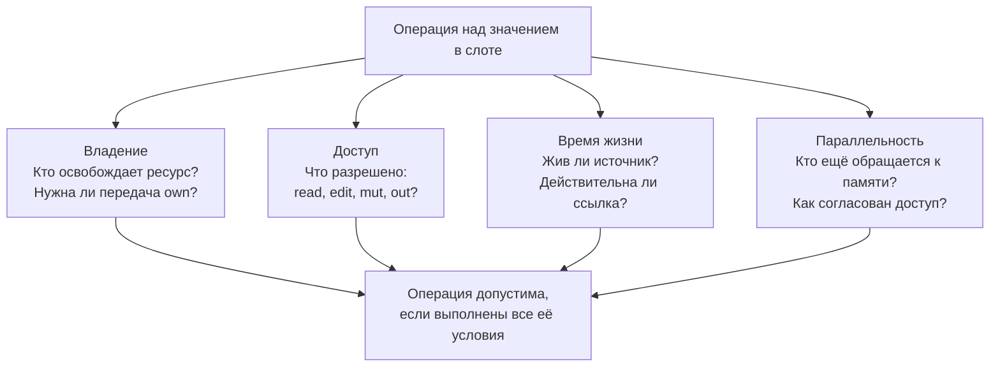

# Владение и доступ к значениям

[Документация](../README.md) · [Словарь](../glossary.md) · [Память и компоновка](../memory/README.md) · [Представления в памяти](../representations.md) · [Правила доступа к памяти](../memory/memory-rules.md)

Владение определяет, кто отвечает за освобождение ресурса. Права доступа
определяют, какие операции разрешены над ним: чтение, изменение данных,
изменение структуры памяти или заполнение ещё не записанного слота.
Заимствование предоставляет доступ без передачи владения.

Для допустимой операции нужны подходящие права, живой источник данных
и совместимость с доступом другого кода. При работе в нескольких потоках
дополнительно проверяется отсутствие гонок и соблюдение правил синхронизации.

## Основные понятия

| Понятие | Что означает |
|---|---|
| Владелец | Имеет `own`: исключительное владение — обязанность уничтожить ресурс или передать её дальше, и ссылок у других нет |
| Якорь | Имеет `anchor`: обязанность уничтожить ресурс, при которой другие держат на него невладеющие указатели |
| Слот | Логическое вместилище данных одного значения. Слот держит переменная, поле или элемент; на него указывают и псевдонимы, и ссылки внутрь значения |
| Связывание | Имя, через которое программа обращается к значению или слоту |
| Заимствование | Доступ без передачи обязанности освободить ресурс. В сигнатуре — форма `read<x.y> T` (`edit`, `mut` так же): сама часть `x.y`, одолженная; у вызывающего она связывается псевдонимом |
| Ссылка | Адрес места: переменной (`&x`), поля (`&x.y`) или элемента (`&items[0]`). Создаёт её только `&`, и `&` пишется везде, где ссылку хранят: `let r = &x`, `-> &edit<list[_]> T`, `x: &edit Int`. По имени ссылочная переменная означает своё место. Псевдоним ссылкой не служит. Ссылка внутрь значения держит его слот, как псевдоним |
| Origin | Источник слота, от которого зависит допустимость доступа |
| `take` | Явная передача владения из исходного слота |

## Общая модель

**Главное правило.** Программа, корректность работы которой с памятью FLOW доказывает, компилируется и верна, какой бы
необычной ни была её форма. Отказ называет то, что FLOW доказать не может, а не форму, которой он не ждёт. Если
другое правило этой спецификации отвергает программу, которую FLOW доказывает, действует главное правило, а то
правило пересматривают.

У одной операции есть несколько независимых условий. Наличие владельца
не означает, что ресурс можно одновременно менять из нескольких потоков,
а ссылка действительна, только пока жив её источник.



Например, чтение поля через ссылку требует читающего доступа и действительной
ссылки. Если другой поток может одновременно записать в это поле, одного
`read` недостаточно: нужен разрешённый способ совместного доступа.

## Порядок чтения

1. [Права владения и доступа](#права-владения-и-доступа) и [связывания](#слоты-и-связывания).
2. [Копирование, клонирование и передача владения](#копирование-клонирование-и-передача-владения).
3. [Параметры функций](#параметры) и [извлечение через `take`](#явное-извлечение).
4. [Где хранится ссылка](#ссылки-только-внутри-функции) и [время их допустимого использования](#что-делает-ссылку-недействительной).
5. [Параллельный доступ](#права-при-параллельном-выполнении).
6. [Управляемое хранение](#управляемое-хранение-managed) — для реализации моделей памяти.

## Права владения и доступа

В исходном коде используются следующие права:

| Право | Что разрешает | Чего само по себе не даёт |
|---|---|---|
| `read` | Читать значение | Записывать данные или передавать владение |
| `edit` | Менять значения и создавать новые слоты; записывать поле или элемент целиком, если запись не уничтожает объявленного члена множества значения | Перемещать или уничтожать объявленные члены множеств значения (строки `set` его типа) |
| `mut` | Менять данные и структуру памяти, в том числе перемещать и уничтожать члены множеств | Получать владение или обращаться к той же памяти из нескольких потоков без согласования; владение элементом `layout` даёт параметр `claim` (ниже) |
| `out` | Заполнить переменную вызывающего, которая ничего не держит: функция пишет её целиком. Параметр пишется `&out T`, аргумент — `&out x`. Менять значение, которое уже есть, — дело `edit` и `mut`. Прежнее значение, если оно есть, кончается до вызова; если внутрь него указывает псевдоним или ссылка вызывающей функции, оно живёт, пока они могут быть использованы ([аргумент `&out`](#владение-которое-функция-забирает-не-всегда)) | Читать прежнее значение |
| `own` | Исключительное владение: всё, что даёт `anchor`, и других ссылок на значение нет, кроме ссылок, которые FLOW видит и которые умирают до уничтожения или передачи | Автоматически получать любые права доступа или разрешение на совместную запись |
| `claim` | Параметр функции `layout`: всё, что даёт `mut` на элемент, и приведение элемента к `own`, когда функция доказывает, что на его память никто не указывает. `claim<p> T` называет элемент структуры параметра `p`, `claim T` — элемент неудерживаемого множества. Вызывающий пишет `claim y`, и после вызова его указатели на эту память недействительны ([право на элемент](../memory/layout/functions.md#82-право-на-элемент), правила 6–8) | Право вне параметра: поле, результат и локальная переменная `claim` не пишутся |
| `anchor` | Уничтожить значение или передать обязанность его уничтожить, пока на значение указывают невладеющие указатели `layout`. Якорь — крайняя точка времени жизни: FLOW доказывает, что ни один указатель её не переживает. Якорь у значения один в каждый момент; он передаётся через `tie` (`take` остаётся для `own`) и бывает полем, параметром, результатом или локальной переменной ([якорь](../memory/layout/owners.md#якорь-anchor)) | Исключительность: Z3 не получает факта «ничего не одолжено» |

`edit` сохраняет адреса объявленных членов множеств значения на объявленную глубину. Это позволяет менять данные,
не делая ссылки на слоты этих членов недействительными. `mut` допускает и операции,
после которых такие ссылки могут стать недействительными.

### Составляющие права

Для проверки прав компилятор раскладывает их на более мелкие составляющие.
Это внутреннее разложение прав, описанных выше:

| Составляющая | Что учитывает компилятор |
|---|---|
| `own` | Право уничтожить значение или передать обязанность уничтожения, исключительно |
| `anchor` | Право уничтожить значение или передать обязанность уничтожения, при невладеющих указателях на значение |
| `read` | Право читать содержимое |
| `write` | Право изменять содержимое |
| `split` | Право выделять независимые части владения |
| `inspect` | Право различать объекты по их идентичности без доступа к содержимому |

`edit` сочетает запись с созданием новых слотов, сохраняя объявленные члены множеств на их адресах.
`mut` допускает запись и все операции над структурой памяти, включая перенос
и уничтожение слотов ([`edit` и `mut` в `layout`](../memory/layout/operations.md#edit-и-mut-в-layout)). `out` описывает запись
в слот без значения. Слов `write`, `split` и `inspect` в языке нет: это имена внутри компилятора. Программист пишет
`read`, `edit`, `mut`, `own`, `out`, `anchor` и `claim`; запись значений даёт `edit`, изменение структуры — `mut`.
Слова права ключевые только перед типом и перед `fn`; в остальных местах это обычные имена: функция `read(index:)` допустима.

Владеющее поле выражается через `own`; компилятор выводит связь жизни значения с
содержащим его слотом из контекста и не отключает проверки перемещения.

Пометка `shared` правом не является: это свойство объявления типа
([общая память](../shared.md#пометка-shared)).

`mut` даёт полное право: запись и изменение структуры. Он не
исключительный внутри тела функции; на границе вызова пишущий параметр память ни с кем не делит
([области доступа](access-regions.md#совместимость)). Нового права `mut` не создаёт.

`edit` — режим доступа, при котором объявленные члены множеств значения не перемещаются и не уничтожаются.
Множества объявляют строки `set` типа (`set Elements: items[_]` у вектора, `set Nodes: left.Nodes, right.Nodes` у
дерева), и глубина обещания та, которую объявляют эти строки: рекурсивное множество охраняет все уровни,
`set Kids: left, right` — один, тип без множеств — ничего внутри. Всё остальное — обычное значение: его можно писать,
в том числе целиком. Создавать новые слоты тоже можно, как и записывать указатели на эти новые слоты. Ни один член
не перенесён и не уничтожен, поэтому ссылки на слоты элементов структуры остаются действительными; память внутри
значения элемента вызов `edit` изменить может (`rows[0].append(1)`, [права](access-regions.md#права)). `mut` даёт
больше: он может переместить и уничтожить члены множеств (см. «Что делает ссылку недействительной»). `edit` строже
`mut` и шире `read`; нового права он тоже не создаёт.

Поэтому `LinkedList.append` — операция `edit`: она добавляет узел и ничего не
двигает. Перестановка узлов, при которой ни один узел не перенесён и не уничтожен (разворот списка, поворот
дерева, перенос записи в начало списка давности), — тоже `edit`. `Vector.append` с ростом — операция `mut`: она
перевыделяет буфер и перемещает элементы; добавление в запас после `reserve(room:)` — `edit`
([контракты операторов](../runtime/lang-roles.md#контракты-операторов)). Добавлять в вектор в его обходе можно
только под `for x in mut v` ([итератор как структура](access-regions.md#итератор-как-структура)).

```efen
fn zero(values: edit Vector<Int>) {
    for value in edit values {
        value = 0             // допустимо: меняется значение элемента
    }
    values.append(1)          // член edit: без доказательства count < capacity — проверка при вызове
}

fn push(list: edit LinkedList<Int>) {
    list.append(1)            // допустимо: новый узел, старые остаются в своих слотах
}

fn grow(values: mut Vector<Int>) {
    values.append(1)          // допустимо: mut разрешает изменить структуру
}
```

Право `edit fn` определяет его сводка: к выходу метода каждый объявленный член множеств `self` лежит на своём адресе
и не уничтожен. Вне кода представления данных поле или элемент пишется под `edit` целиком, если прежнее значение не
может держать объявленного члена множества значения, на котором стоит право: `d.title = "x"` у `d: edit Doc`
допустимо, `s.books = Vector()` у `s: edit Shelf` со строкой `set Elements: books.Elements` — ошибка, запись
уничтожает члены `s.Elements`. Заполнить место, пустота которого доказана, можно: ничего не уничтожается
(`if n.left == null { n.left = leaf }`). Так же пишется слот опционального типа и варианта. Внутри кода представления
данных `edit fn` записывает поля-значения и невладеющие указатели, создаёт слоты (запись
в неинициализированный элемент области, новый узел в пустое владеющее поле), пишет любое значение в слот значения
элемента коллекции (поле типа `T` или слот области, который коллекция отдаёт как элемент через `at` или курсор) и
переставляет якоря через `tie`, пока каждый узел остаётся в той же структуре. Так `LinkedList.append` и разворот
списка остаются `edit fn`. Запись поверх непустого владеющего поля (`node.next = makeNode()` при непустом `node.next`) — ошибка: прежний узел остался бы без владельца. `mut`
требуют узел, отданный из структуры, выдача слота `lend`, освобождение, смена вида и перевыделение области. Полная
таблица операций — в статье о компоновке ([`edit` и `mut` в `layout`](../memory/layout/operations.md#edit-и-mut-в-layout)).

## Слоты и связывания

Слот хранит ресурс, несёт объявленные права и режим управления. Один слот могут называть несколько переменных, но
владеет значением одна: остальные служат псевдонимами и хранят заимствование
([связывание существующего значения](#связывание-существующего-значения)). Значение отдаёт владелец; `take`
псевдонима переносит его заимствование, а значение отдаёт владелец там, где его отдают дальше (правило 4). Для
`managed`-слота проверка заимствований этого не отслеживает.

Неизменяемое связывание, которое получило значение, а не слот (результат вызова, литерал, `take`), получает
`own + read`; псевдоним получает право пути (правило 1 ниже). Владеющее связывание также получает
`write`, если сам тип допускает изменение:

```efen
let file: FileHandle
```

`let` запрещает перепривязку переменной, но не обязательно изменение объекта.
Слот `immutable T` не даёт `write` ни через одно имя ([неизменяемый слот](#неизменяемый-слот-immutable-t)).
CoW-тип при записи сначала выполняет предусмотренное
типом отделение копии.

### Связывание существующего значения

`let` и `var` без `&`, `copy` и `take` связывают значение одним из двух способов, по его типу:

- тип `ImplicitlyCopyable` (`Int`, `Float`, `Bool` и другие типы модулей языка, а также любой `enum`) копируется:
  такая копия не выделяет память. Строку `conforms ImplicitlyCopyable` пишут только модули языка, и в
  пользовательском типе она вызывает ошибку; соответствие `enum` даёт компилятор
  ([перечисления](enum.md#копирование-значения));
- любой другой тип, в том числе структура из одних чисел, получает псевдоним: второе имя того же значения, а не
  копию. Тихой копии структуры в языке нет: копию даёт только `copy`, передачу владения только `take`.

Невладеющий указатель `layout` (`S.Item` без `own` и `anchor`) связывается копированием адреса, как
значение первого случая: `let q = p.next` создаёт новый указатель, а не псевдоним поля
`p.next`. Тип указателя принадлежит языку, поэтому
правило о строке `conforms ImplicitlyCopyable` остаётся в силе. Ссылочная переменная по имени означает своё место:
`let x = r` связывает значение этого места по правилу его типа (копия числа, псевдоним остального), а вторую ссылку
на то же место даёт только `&r` ([что ссылке можно](#что-ссылке-можно-и-нельзя)). Чтение слота `own` или `anchor` с элементом
`layout` без `tie` и `take` тоже даёт невладеющий указатель
([запись и тип указателя](../memory/layout/pointers.md#ссылки), правило 5).

Объект класса без `conforms ArcClass` относится ко второму случаю: `let b = a` даёт псевдоним, а не второго
владельца. У объекта класса со счётчиком `let b = a` даёт второго владельца
([управление памятью](../classes.md#управление-памятью)).

```efen
let n = item.count          // Int: копия, запись item.count = 5 её не меняет
let p = shape.origin        // Point: псевдоним значения shape.origin, не копия
let q = copy shape.origin   // своя копия Point
let t = doc.title           // String: псевдоним значения doc.title
let c = copy doc.title      // своя копия
doc.title.append("!")       // ошибка: append может перевыделить буфер строки, а t используется ниже
print(t)
```

Так же связывают образцы `let`, `if let`, `match` и `is` ([деструктуризация](../destructuring.md)).

Правила псевдонима:

1. Псевдоним хранит заимствование значения, от которого получен, с правом пути к этому значению. Псевдоним поля
   параметра `read` только читает; псевдоним поля параметра `edit` пишет значения. Запись через псевдоним, передача
   его пишущему параметру и изменение структуры через него требуют этого права. `&псевдоним` берёт то же право.
2. Псевдоним элемента коллекции, привязка `for` без слова в заголовке и переменная ветки `match` хранят
   заимствование элемента; привязка `for x in edit v` и `for x in mut v` — ссылка на элемент. После
   `take` элемента это заимствование действует и идёт за значением к новому владельцу. Запись элемента целиком даёт
   элементу новый слот, а псевдоним сохраняет
   прежнее значение (правило 5).
3. Изменение структуры значения делает псевдоним недействительным, как ссылку: вызов, который переносит или
   уничтожает слоты источника, допустим, если псевдоним после него не используется. Использование после такого
   вызова вызывает ошибку. Запись поля через недействительный псевдоним тоже считается использованием.
4. `take` псевдонима переносит его заимствование: псевдоним после этого пуст, слот остаётся у владельца. Значение
   отдаётся там, где его отдают дальше (аргумент `own`, `return`, запись в поле структуры, которая уходит из
   функции), и отдаёт его владелец. Если владелец — переменная функции и после отдачи на слот ничего не указывает,
   отдача допустима: `var p = Point(x: 1, y: 2); let q = p; consume(p: take q)` при `p`, который дальше не читают.
   Если псевдоним заимствует память вызывающего, отдача вызывает ошибку: за эту память отвечает вызывающий.
   Псевдоним, который последним остался указывать на слот (правило 5), с этой точки им владеет. Переменная `var`, которая на каждом пути
   владеет своим значением, псевдонимом не служит, и `take` его забирает. Владеет значением переменная, которая
   получила значение, а не слот: результат вызова, форму с полями, литерал, `take`, `tie` или `copy`. Переменная,
   которая владеет значением только на части путей, в конце области уничтожает его на этих путях.
   Значение типа, который не соответствует `ImplicitlyDestroyable`, расходуется на каждом таком пути, как любое
   другое. `take`, `return`, `throw`, `yield` и аргумент `own` с переменной, которая владеет значением только на части
   путей, допустимы: на остальных путях переменная заимствует, и значение отдаёт владелец этого пути по тем же
   правилам.
5. Запись целиком переменной `var`, поля или элемента даёт ей новый слот: переменная (псевдоним или владеющая),
   поле или элемент с этой строки держит новое значение. Права запись не требует и прежнее значение не меняет.
   Прежний слот теряет только эту переменную, поле или элемент. После записи:

   - **Псевдоним** прежнего значения или его части держит прежний слот и читает прежнее значение. Держит он его до
     конца своей области видимости, а не до последнего использования.
   - **Ссылка на само записанное** — на переменную, поле или элемент (`&p`, `&s.item`, `&items[0]`) — хранит его
     адрес. Прежний слот она не держит и после записи читает новое значение.
   - **Ссылка внутрь прежнего значения, взятая в этой функции** (`&p.x` при записи `p`; ссылка, взятая через
     псевдоним, `&q.x`; ссылка на элемент прежнего вектора, `&c.items[0]` при записи `c.items`), держит прежний слот,
     как псевдоним, и читает прежнее значение. Функция знает, из какого значения ссылка взята. Держит она слот, пока
     может быть использована.
   - **Параметр с источником** (`w: read<c.items[_]> T`) пришёл снаружи. Функция знает его путь, но слота он не
     держит. Если он может указывать в память, которой владеет прежнее значение (в элемент его
     коллекции), он действителен, пока прежний слот держит псевдоним или ссылка этой функции. После их конца и при
     записи без них его использование вызывает ошибку.
   - **Запись, которую делает вызванная функция** (сводка вызова пишет поле или элемент целиком). Вызванная функция
     не видит псевдонимов и ссылок вызывающего и прежнее значение уничтожает сама. Псевдоним вызывающего и его ссылка
     внутрь прежнего значения после вызова недействительны: `let p = crate.parcel; renew(crate: crate);
     inspect(parcel: p)` — ошибка в `inspect`. Ссылка на само поле (`&crate.parcel`) действительна и читает новое
     значение.
   - Генераторы и структуры над `Src`, которые держат прежний слот, остаются на нём
     ([генераторы](../generators.md)).

   Прежнее значение уничтожается, когда прежний слот больше не держит никто: кончился последний псевдоним и
   последняя ссылка внутрь значения больше не может быть использована. Если не держит никто, оно уничтожается в
   строке записи. Когда переменные, которые держали слот, кончились или записаны, а ссылка внутрь значения ещё
   может быть использована, слот держит скрытая переменная. Скрытая переменная логическая: хранить её адрес или
   вычислить его из ссылки, решает компилятор. Кто держит слот последним, компилятор находит по путям, без счётчика
   во время выполнения. Значение
   типа, который не соответствует `ImplicitlyDestroyable`, до записи расходуется, если слот не держит никто. Слот справа
   (`q = doc.title`) делает переменную псевдонимом с этой строки: запись псевдонима целиком меняет только то, на что
   он указывает, и в прежний слот не пишет.

   ```efen
   var p = Point(x: 1, y: 2)
   let q = p                  // q — псевдоним: указывает на тот же слот
   let x = &p.x               // ссылка внутрь значения: поле x первого Point
   p = Point(x: 3, y: 4)      // у p новый слот; прежний держит q
   print(q.x)                 // 1
   print(x)                   // 1: x указывает в прежний слот
   ```

   Прежний слот `p` уничтожается, когда кончается `q`. Без псевдонима прежний слот держит сама ссылка:

   ```efen
   var p = Point(x: 1, y: 2)
   let x = &p.x               // ссылка внутрь значения: держит слот первого Point
   p = Point(x: 3, y: 4)      // у p новый слот; прежний держит скрытая переменная, пока x может быть использована
   print(x)                   // 1

   let first = &c.items[0]    // ссылка на элемент вектора: держит слот этого вектора
   c.items = makeItems()      // поле держит новый вектор; прежний жив
   inspect(parcel: first)     // допустимо
   ```

   Ссылка на само поле читает новое значение:

   ```efen
   let r = &s.item            // ссылка на поле: адрес поля s.item
   s.item = Parcel(value: 2)  // поле держит новое значение
   print(r.value)             // 2
   ```

   Параметр с источником слот не держит:

   ```efen
   fn renewItems(c: mut Crate, w: read<c.items[_]> Parcel) {
       if ready() {
           let old = c.items      // псевдоним: держит прежний вектор до конца блока
           c.items = makeItems()
       }                          // old кончилась: прежний вектор уничтожен
       inspect(parcel: w)         // ошибка: w мог указывать в прежний вектор
   }
   ```
6. Получатель, который владеет, принимает значение, а не слот. Аргумент `own`, запись поля, элемента или параметра
   `own` целиком, элемент литерала массива, поле `capture` и значение в `return`, `throw` и `yield` принимают результат
   вызова, форму с полями, литерал, `take`, `tie` якоря, `copy` или значение типа без единственного владельца: число, ссылку `&r`
   (получателю, тип которого пишется с `&`), объект со счётчиком, невладеющий указатель `layout`, значение
   `ImplicitlyCopyable`. Ссылочная переменная по имени означает место, поэтому получателю `own String` пишут `copy r`. Чтение слота в такой позиции, в том числе своей
   переменной (`consume(a)`, `return doc.title`), вызывает ошибку: пишут `take` или `copy`. Поле `capture` сохраняемого
   замыкания принимает невладеющий указатель `layout`, только когда тип замыкания называет заимствование его
   структуры ([указатель вне `layout`](../memory/layout/pointers.md#указатели-вне-layout), «Запрещено»).
   Параметр без `&` (`read`, `edit`, `mut`) связан как `let` и целиком не пишется; параметр с `&` по имени означает
   место вызывающего ([параметры](#параметры)).
7. `return x`, `throw x` и `yield x` с именем локальной переменной, привязки или параметра, которое владеет
   значением, переносят значение: `own` как `take x`, а якорь `anchor` как `tie x`. Так же переносит значение
   операнд приведения `as` ([запись и тип указателя](../memory/layout/pointers.md#ссылки), правило 5). После них
   переменная не используется, а её псевдонимы недействительны. Псевдоним в такой позиции вызывает ошибку по правилу 6.

### Неизменяемый слот: `immutable T`

`immutable T` — свойство слота: значение в нём и всё, до чего оно достаёт, не меняется ни на один байт от
заморозки до уничтожения. Неизменяемость глубокая; полностью её проверяет компилятор. Какие типы допускают
заморозку (`Freezable`) и как устроен `readonly class`, описывает [неизменяемость](../immutability.md).

```efen
var hosts = Vector<String>()
hosts.append("primary")
let first = &hosts
let table: immutable Vector<String> = take hosts    // заморозка; память освободит dispose в конце области
first.append("x")                                   // ошибка: ссылка first кончилась при заморозке
table.append("y")                                   // ошибка: table — immutable Vector<String>
```

- **Заморозка `take`.** `take x` из `own T` в слот `immutable T` — отдельное событие FLOW. Оно кончает все
  ссылки, псевдонимы, ссылки в результатах и итераторы функции, которые начинаются в `x`. Ошибка, если жива
  структура, которая держит `x` или его часть, или если `x` видит живая корутина, `background`, `offload` или объект
  `shared layout`. Обычный `take` заимствования внутри значения сохраняет: они идут за значением
  ([явное извлечение](#явное-извлечение)), поэтому у заморозки своё правило. Другие точки заморозки — новое значение (конструктор, литерал, `copy`) и `const`.
- **Путь.** Путь через `immutable` тоже `immutable`: у `table: immutable Vector<String>` элемент `table[0]` —
  `immutable String`. Заимствование и ссылка, которые возвращает `read fn` с источником в замороженном значении, тоже
  `immutable`.
- **Копия.** Копия `ImplicitlyCopyable` без кучи теряет `immutable`: `var limit = config.timeout` — `Int`. `copy`
  замороженного значения даёт `own T`. `clone` замороженного значения даёт `immutable T`: клон делит данные с
  источником. Других путей от `immutable T` к `T` нет.
- **Запрещено.** Присваивание поля, метод с `edit`, `mut` или `own self`, заимствование `edit` и `mut`, аргумент `&out`,
  `take` части. `take` всего значения в другой слот `immutable T` разрешён.
- **Слот `var`.** Слот `var` типа `immutable T` перезаписывают только целиком другим замороженным значением; старое
  живёт, пока его держит псевдоним, и уничтожается, когда кончается последний из них, или в
  строке записи (правило 5 [связывания](#связывание-существующего-значения)).
- **Уничтожение.** Владелец `own immutable T` уничтожает значение и вызывает роль деструктора, в том числе
  `explicit`, когда FLOW доказал, что заимствований нет. Это единственный разрешённый `own` метод, и он последний.
  Замороженную структуру из `layout` освобождает компилятор (план и `dispose`), как у незамороженного
  значения ([освобождение структуры](../disposable.md#освобождение-структуры-disposable)).
- **Параметр.** `own immutable T` принимает замороженное значение во владение. Одолженный параметр пишут `T`: он и
  так только читается и принимает `immutable T`; запись `immutable T` у одолженного параметра — ошибка стиля.

## Копирование, клонирование и передача владения

В Efen есть три явных действия с существующим значением. Копирование
создаёт независимое значение, клонирование может разделять с источником
данные в памяти, а передача владения меняет владельца существующего ресурса.

| Действие | Запись | Что получается | Что происходит с источником | Требование |
|---|---|---|---|---|
| Глубокое копирование | `copy x` | Новое независимое значение со своими экземплярами данных, которыми владеет источник | Остаётся у прежнего владельца | `Copyable` |
| Поверхностное копирование, или клонирование | `clone x` | Копия верхнего уровня с общими данными в куче | Сохраняется; время жизни общих данных учитывает тип | `Cloneable` |
| Передача владения, или перемещение | `take x` | Тот же ресурс у нового владельца | Исходное имя больше не владеет ресурсом; опциональное поле получает `null`, элемент коллекции удаляется | `Movable` |

Для перемещения используется `take`; отдельного оператора `move` в этих
правилах нет. Передача владения не обязательно физически переносит байты:
[живая ссылка на слот может сохраняться](#явное-извлечение).

```efen
let independent = copy tree      // независимое дерево
let anotherOwner = clone handle // общие данные; тип учитывает их владельцев
let transferred = take resource // resource больше не владеет значением
```

Примеры предполагают, что типы поддерживают соответствующие контракты.
`copy` и `clone` не взаимозаменяемы. Например, для дерева без общего владения
`clone tree` недопустим. Если копия требует выделения памяти, `copy` может
выбросить `AllocationError`.

Обычное связывание `let b = a` подчиняется отдельным правилам:
`ImplicitlyCopyable` копируется неявно; для остальных типов возникает
псевдоним того же значения. У класса с подсчётом ссылок появляется второй
владелец. Подробности приведены в разделе
[«Связывание существующего значения»](#связывание-существующего-значения).

`Movable`, `Copyable` и `Cloneable` не следуют друг из друга.
`ImplicitlyCopyable` требует `Copyable` и `Cloneable`, но не даёт `Movable`.
Клонирование создаёт ещё одного владельца общих данных, но само по себе
не разрешает доступ к ним из другого потока. Это отдельно проверяется
по правилам параллельного выполнения.

Полные правила операторов описаны в статье
[о контрактах копирования и перемещения](../runtime/value-operations.md#контракты-копирования-и-перемещения).

## Параметры

Параметр без `own`, `mut`, `edit` и `&` только читается: функция не пишет в него и не
вызывает его мутирующие методы, включая переходы состояния. Обязанность
освободить значение остаётся у вызывающего. Исключение — замыкание вида `own` (`() own -> Void`): функция
вызывает его один раз через `(take f)()`, и у вызывающего аргумент считается переданным
([вид замыкания](../closure.md#права-вызова-замыкания)). Права параметра объявляет
сигнатура, а не вывод по телу: по ней видно, что функция объект не меняет.

```efen
fn checksum(buffer: Buffer) -> UInt64 {
    return hash(buffer)       // чтение допустимо
}

fn reset(buffer: Buffer) {
    buffer.clear()            // ошибка: мутирующий метод у параметра без mut
}

fn fill(buffer: mut Buffer) {
    buffer.clear()            // mut даёт полное право, включая изменение структуры
}
```

Изменение тела, которому нужны более широкие права, требует изменить сигнатуру.
Расширение прав параметра меняет публичный контракт.

Параметр без `&` — собственная переменная функции. У копируемого типа (`ImplicitlyCopyable`: числа, `Bool`, любой
`enum`) она держит копию значения при любом праве: `x: mut Int` — копия. У любого другого типа параметр —
заимствование: копия указателя на объект вызывающего; `Pointer?` держит указатель или `null`. Параметр `read`,
`edit` и `mut` без `&`, а также `self` у `fn`, `edit fn` и `mut fn`, связан как `let`: запись его целиком — ошибка
компиляции. Параметр `own` связан как `var`. `mut` даёт право менять объект, на который указывает параметр: его поля,
элементы и структуру. Время жизни объекта `mut` не меняет: функция не удерживает объект после вызова. Аргумент `mut`
пишется без знака: функция получает копию указателя, и переменная вызывающего не меняется.

Параметр с `&` — ссылка на место вызывающего: свободная (`x: &edit Int`) или связанная с другим параметром
(`x: &edit<values[_]> Int`). Аргумент пишется с `&`: `reset(x: &n)`, `&out x` у `&out T`. По имени такой параметр
означает место: `x = 0` пишет переменную вызывающего. Переменную вызывающего пишет параметр `&edit`, `&mut`, `&out`
(указатель на место, для C `int*` и `void**`) или результат функции. Подробно — [ссылка и параметр](#ссылка-и-параметр).

```efen
fn show(x: mut Int) {
    x = 1                     // ошибка: x — копия, связанная как let; число вызывающего пишет `x: &edit Int`
}

fn reset(x: &edit Int) {
    x = 0                     // пишет переменную вызывающего
}

var n = 5
reset(x: &n)                  // n == 0
```

Локальная переменная не берёт имя параметра, в том числе в образце: `var node = node` и `guard let name = name` —
ошибки. Тело замыкания и корутины — своя область: в нём имя параметра окружающей функции брать можно
(`capture completion = take completion`). Чтобы идти дальше от параметра, объявляют переменную с новым именем:

```efen
fn length(node: read Node) -> Int {
    node = node.next!        // ошибка: параметр связан как let
    var count = 1
    var cur = node           // псевдоним с новым именем
    while let next = cur.next {
        cur = next
        count += 1
    }
    return count
}
```

Явная передача владения остаётся частью сигнатуры:

```efen
fn consume(file: own FileHandle) {
    // функция принимает обязанность уничтожить file
}
```

### Владение, которое функция забирает не всегда

Параметр `own T?` со строкой `ensures taken(x) == (условие)` — владение, которое переходит к функции не всегда.
Условие стоит на результате и пишется через `==`: при ложном условии значение остаётся у вызывающего, функция не
уничтожает его и не передаёт дальше. На выходе исключением значение тоже остаётся у вызывающего; если функция
забирает его и на этом выходе, она пишет строку `ensures throws E ==> taken(x)`
([условия функции](../conditions.md#условия-функции-только-requires-и-ensures)).

```efen
fn resize(memory: own Pointer?, size: Int) -> own Pointer?
    throws AllocationError, CopyError
    ensures taken(memory) == (result != null)
    ensures throws CopyError ==> taken(memory)
{
    // allocate, copyBytes и free обозначают функции менеджера памяти
    let moved = allocate(size) ?? return null    // memory остаётся у вызывающего
    let old = take memory ?? return moved
    try {
        copyBytes(from: old, to: moved)          // CopyError: old забран, строка throws это разрешает
    } catch e: CopyError {
        free(take old)                           // на выходе через исключение возвращены оба блока
        free(take moved)
        throw e
    }
    free(take old)
    return moved
}

var block: own Pointer? = allocate(100)
if let bigger = resize(memory: block, size: 4096) {
    block = take bigger                // здесь компилятор знает, что block пуст
}
```

`&own T` — ошибка компиляции: ссылка владения не передаёт, после `&` стоит `read`, `edit`, `mut` или `out`. Функция,
которая кладёт новое значение в переменную вызывающего, получает её как
`&out`: `fn posix_memalign(memptr: &out Pointer?, alignment: Int, size: Int) -> Int32`. Функции с условным `take`
ничего не пишут в переменную вызывающего, и C видит `void*`; функция с `&out` пишет её, и C видит `void**`. Вызов:
`posix_memalign(memptr: &out block, alignment: 64, size: 4096)`.
Параметр `mut Pointer` передаёт C сам указатель.

- Компилятор проверяет каждый путь функции: на путях, где условие строки верно, значение забрано; на
  остальных — нет. Недоказанная строка `taken` — ошибка.
- Вызывающий знает точно: после успеха или `catch e: CopyError` переменная пуста, после `null` или
  `catch e: AllocationError` цела.
- `throws E` в строке `ensures throws E ==> taken(x)` называет только исключение из списка `throws` функции.
- Для результата-варианта условие называет случай: `ensures taken(x) == (result is .moved)`.

Выходной слот внешней функции объявляется одной из двух форм, голым — никогда:

- `p: &out T?` (и `self?` у метода, то есть `self: &out Self?`) — записан на каждом возврате, при отказе `null`,
  вызывающий проверяет слот;
- `p: &out T` со строкой `ensures written(p) == (условие)` (у метода — `written(self)`) — записан ровно там, где
  условие верно, на остальных путях не записан и не читается.

Так для любого сырого типа (`pid: &out Pid` и `ensures written(pid) == (result == 0)`) и для массивов:
`fds: mut [File?]` (элементы пусты перед вызовом, проверяются после) или `fds: &out [File]` со строкой
`ensures written(fds) == (result == 0)`
([конструкторы внешнего объекта](../classes.md#конструкторы-внешнего-объекта)).

**Аргумент `&out`.** `out` служит одному случаю: переменную, которая ничего не держит, заполняет вызванная функция.
Это указатель на указатель. Значение, которое уже есть, меняют через `edit` и `mut`. Право нужно на границе с C:
`void**`, `self` внешнего конструктора, результат `int*` рядом с кодом ошибки. Внутри Efen то же делает результат
или кортеж; `&out` остаётся разрешён. Буфер, который функция заполняет частично (`epoll_wait`), — `edit [T]`, а не
`&out`.

Аргумент пишется `&out x`, где `x` — переменная, поле или элемент: `fillPt(&out p)`,
`open(path: name, handle: &out fd)`. Вызов показывает, что переменная пишется целиком, как `take` показывает
перенос. Аргумент без `&out` у параметра `&out` — ошибка формы с подсказкой `&out p`. `&out` у параметра, который не
`&out`, — тоже ошибка. В сигнатуре `out T` без `&` — ошибка формы с подсказкой `&out T`. `T` — тип переменной, которую
параметр заполняет.

`&out r` у ссылочной переменной `r` заполняет место, которое называет `r`. Такое место должно быть записано на каждом
выходе функции, в том числе через исключение: место за ссылкой цело всегда. Поэтому в него пишут через `&out`, только
когда функция пишет параметр на каждом выходе; иначе заполняют локальную переменную и потом присваивают.

Переменная передаётся в любом состоянии: незаписанная, пустая после `take`, опциональная с `null` или с живым значением:
`var db: Db? = null` и затем `open(&out db)` допустимы.

Вызов с аргументом `&out` — запись переменной, поля или элемента целиком, как `p = ...` (правило 5 раздела
[«Связывание существующего значения»](#связывание-существующего-значения)), и прежнее значение живёт по тому же
правилу. Если его держит псевдоним или ссылка внутрь него, взятые в вызывающей функции, оно живёт, пока они могут
быть использованы: его держит скрытая переменная. Если его не держит никто, компилятор уничтожает его перед
вызовом, как в строке `q = ...`. Значение типа, который не соответствует `ImplicitlyDestroyable`, до вызова
расходуют, как до любой записи целиком.

В теле функции параметр `&out` на входе пуст: чтение до первой записи — ошибка. Он записан на каждом обычном
возврате или ровно там, где говорит строка `ensures written(p) == условие`. Источником результата он не бывает и
нигде не сохраняется. Там, где условный `&out` не пишет, переменная не записана и её чтение — ошибка,
в том числе у числа: после `var fd: Int = -1` и `open(path: name, handle: &out fd)` значение `-1` на пути отказа уже
не читается.

```efen
var p = Pt(x: 1, y: 2)
let y = &p.y
fillPt(&out p)         // допустимо: y держит прежний слот p
print(y)               // 2
var q = Named(title: "b")
fillNamed(&out q)      // допустимо: прежнее значение уничтожается перед вызовом, строка "b" освобождается
fillPt(p)              // ошибка формы: аргумент параметра &out пишется &out p
```

Строка бывает и у получателя: `own fn sqlite3_close -> Int32` со строкой
`ensures taken(self) == (result == SQLITE_OK)`. Такой метод вызывают на владеющем опциональном слоте без `take`
(`db.sqlite3_close()`); после вызова слот пуст ровно там, где условие верно, как у параметра `own T?` со строкой
`taken`. Безусловный `own fn` вызывается как `(take x).m()`.

Метод `own fn`, который забирает объект, но не уничтожает его (`pthread_detach`), допустим, только если объект не
держит ни одного слота Efen; значения `own` в его полях `layout` уходят с объектом.

Условная передача владения записывается через `ensures taken(x) == (result == 0)`;
условная запись — через `ensures written(x) == (result == 0)`. Блоки `{ }` после параметра
для этого не используются ([условия функций](../conditions.md#условия-функции-только-requires-и-ensures)).

## Явное извлечение

`take` передаёт `own` из опционального свойства и записывает туда `null`:

```efen
class Queue {
    var pending: own Job?

    mut fn detach -> Job? {
        return take self.pending
    }
}
```

Обычное чтение владеющего поля не копирует и не перемещает значение: оно даёт
заимствование с правами, допустимыми в точке доступа. Передача владения из поля
всегда требует явного `take`:

```efen
let borrowed = node.pointer      // заимствование
let owned = take node.pointer    // передача own
```

Compiler-known операция `replace(place, value)` сама является явным действием
передачи владения: она потребляет владеющий второй аргумент, помещает его в
`place` и возвращает прежнее владеющее значение. Поэтому отдельный `take value`
в этой форме не пишется:

```efen
let previous = replace(node.value, value)
```

Это узкая семантика `replace`, а не общее разрешение неявно передавать `own` в
обычные вызовы.

`replace` — `take` части и запись позиции целиком без пустого момента между ними. Прежнее значение получает
результат. Псевдонимы и ссылки внутрь прежнего значения действуют и указывают в него, как после `take` части. Ссылка
на саму позицию (`&s.item`) хранит адрес поля и читает новое значение, как после записи целиком
([связывание](#связывание-существующего-значения), правило 5).

```efen
let v = &read s.item.value
let item = &read s.item
let old = replace(s.item, Parcel(value: 2))
print(v)                // прежнее значение: v указывает в значение, которое теперь держит old
print(item.value)       // 2: item хранит адрес поля
print(s.item.value)     // 2
```

`take` целой локальной переменной разрешён для `Movable`. После перемещения
прежнее значение через `let` больше недоступно; `var` снова становится доступен после
присваивания нового значения. `take` псевдонима переносит его заимствование
([связывание существующего значения](#связывание-существующего-значения), правило 4).

`take` в переменную той же функции переносит указатель на значение, а само значение остаётся в функции. Ссылки и
псевдонимы внутрь значения действуют и указывают в него. Ссылка `&p` на саму переменную до новой записи `p` не
читается (`flow.moved`). Если значение уходит из функции (аргумент `own`, `return`, поле структуры, которая уходит),
ссылка внутрь него после ухода не используется: это ошибка `flow.moved`.

```efen
var p = Pt(x: 1, y: 2)
let y = &p.y
let b = take p              // значение теперь держит b; y указывает в него
print(y)                    // 2

var q = Pt(x: 1, y: 2)
let z = &q.y
consume(p: take q)          // значение ушло из функции
print(z)                    // ошибка: flow.moved
```

`take` целого параметра `mut` переносит его заимствование в переменную функции: параметр после этого пуст, а память
остаётся у вызывающего. Ошибку вызывает отдача этой памяти (аргумент `own`, `return`, запись в поле структуры,
которая уходит из функции): за неё отвечает вызывающий. Записать параметр целиком нельзя ни до `take`, ни после:
он связан как `let` ([параметры](#параметры)).

```efen
fn relay(m: mut Parcel) {
    let x = take m                // m пуст, x заимствует память вызывающего
    x.value = 2                   // допустимо: пишет объект вызывающего
    m = take x                    // ошибка: параметр mut связан как let
}

fn giveAway(m: mut Parcel) {
    let x = take m
    consume(take x)               // ошибка: память вызывающего отдать нельзя
}
```

Элемент `layout`, который функция получила параметром `claim` и вывела из
структуры, становится владеющим значением через приведение права `as own S.Item`, и `take` применяется уже к его
результату ([приведение права](../memory/layout/operations.md#приведение-права)). `take` целого параметра `claim`
тоже вызывает ошибку.

`take` поля, которое не опционально, разрешён у корня, который функция отслеживает на каждом пути: у параметра
`mut` и `own`, у локальной переменной, у псевдонима и у привязки `for`. Пустое поле принадлежит слоту, поэтому его
видят все имена этого слота. Элемент `layout` под
локальным `own` или `anchor` с забранным полем после этого только стирается
([удаление элемента](../memory/layout/operations.md#переход-к-владению-as-own), правило 4). У элемента коллекции
такой `take` не доказывается, и ошибка называет причину: доступ к другому элементу может прийтись на этот же.
Значение поля элемента забирают через `replace`, а элемент целиком — через `take v[i]`, который удаляет его из
коллекции ([ниже](#индексированный-слот)). Поле потока забирают, если до его новой записи нет точки, где
его может прочесть другой код: вызова без сводки или со сводкой, которая поле читает, приостановки, уничтожения,
которое может его читать, ленивой инициализации. Пока поле пусто, действуют три правила:

1. Поле и объект целиком не читают и не передают. Ссылка на поле и замыкание, которое захватило объект, не
   используются. Заимствования внутри забранного значения действуют и идут за ним к новому владельцу: они
   заимствуют слоты внутри значения, а не поле.
2. К выходу, на котором объект остаётся у вызывающего, поле записано снова; у привязки `for` — до конца шага, на
   каждом пути из него, включая `break` и исключение; у поля потока — до каждой точки, где его может прочесть
   другой код. Исключение одно: выход исключением,
   для которого сигнатура говорит, что поле может остаться пустым (`ensures throws E ==> taken(h.inner)`,
   [часть, пустая на выходе исключением](../conditions.md#часть-параметра-пустая-на-выходе-исключением)).
3. Локальная переменная и параметр `own` могут закончиться или получить новое значение с пустым полем, если при этом
   не выполняется деструктор или `dispose`, написанный для объекта или для значения между объектом и полем.

```efen
fn rotate(h: mut Holder) {
    let x = take h.inner          // h.inner пусто: h целиком не читают и не передают
    h.inner = wrap(take x)        // поле записано до выхода
}
```

Выход с пустым полем без строки `taken` части — ошибка в самой функции. Сообщение называет поле, выход и строку `take`
и сразу предлагает оба исправления: записать поле до выхода или объявить строку исключения.

```efen
fn refill(h: mut Holder) throws IOError {
    let old = take h.inner
    save(old)                     // ошибка: IOError выходит, h.inner пусто
    h.inner = rebuild(take old)
}
```

```text
error[flow.moved]: `h.inner` is left moved when `refill` exits by `IOError`
 --> refill.efen:3:5
  |
3 |     save(old)
  |     ^^^^^^^^^ (1) `refill` exits here by `IOError`
  |
 ::: refill.efen:2:5
  |
2 |     let old = take h.inner
  |     ^^^^^^^^^^^^^^^^^^^^^^ (2) `h.inner` is moved here
help: give it a new value before the function exits
help: or state that it may stay empty on this exit: `ensures throws IOError ==> taken(h.inner)`
```

Ссылка `&x` называет переменную, а заимствование внутри значения (`&x[0]`, псевдоним части) — слоты значения.
Что происходит со ссылкой при `take`, зависит от того, что взято и куда:

- `take x` целой переменной, в новую переменную или в существующий слот (`y = take x`): `x` после этого пуста, и
  чтение через `&x` вызывает ошибку `flow.moved`, пока `x` не записана снова; после записи ссылка читает новое
  значение. Так и у переменной, которая хранит экземпляр класса: `take x` переносит адрес экземпляра. Заимствования
  внутри забранного значения действуют и идут за ним к новому владельцу;
- `take` из опционального поля: ссылки внутрь прежнего содержимого и на само поле действуют и идут за ним к новому
  владельцу, в поле остаётся `null`;
- `take v[i]`: элемент удаляется из коллекции. Это изменение структуры: оно требует права `mut` на `v` и кончает
  ссылки в элементы `v`. `take` привязки `for` — ошибка: с `edit` или `mut` привязка — ссылка, а через ссылку не
  забирают;
- значение покидает функцию: передано в `own`-параметр, возвращено, захвачено `spawn` или стало видно коду вне
  функции вместе со структурой, в поле которой его записали (на выходе, при вызове без сводки, при приостановке).
  Умирают все ссылки внутрь него; за его память теперь отвечает получатель. Запись в поле структуры, которую
  функция держит, сама значение из функции не уводит.

```efen
var items = makeItems()
let first = &items
let head = &items[0]        // заимствование внутри значения
let moved = take items      // items пуста, значение у moved
print(head)                 // допустимо: head идёт за значением
print(first)                // ошибка flow.moved: items пуста
consume(take moved)         // fn consume(x: own Items): значение ушло из функции
print(head)                 // ошибка: значение больше не принадлежит функции
```

Структура, которая держит слот, не мешает событию, которому нужен свободный слот: уходу слота из функции,
заморозке, вызову, который меняет структуру её источника (до него доходит вызов `mut`).
Такая структура освобождается прямо перед событием всегда, и
её очистка выполняется там же: так приостановленный генератор, которому одолжен этот слот
([generators.md](../generators.md), «Уничтожение приостановленного генератора»); при вызове `mut` его `defer`
выполняется прямо перед вызовом. Использовать такую структуру после этого
события — ошибка компиляции. Без такого события она живёт до конца области. Программист этого не пишет: точку
освобождения выбирает компилятор. Запись источника целиком, `take` части и `replace` событиями не являются:
структура держит слот, а не переменную. После записи переменной целиком у неё новый слот, а структура держит
прежний и читает прежнее значение, пока жива; события над новым слотом ей не мешают.

Исключение составляет коллекция из `layout`, которая держит через тип элемента: `Vector<read<g> Vertices.Item>`,
`Vector<ListCursor<Src: l>>`. Она владеет своей областью и перед событием не уничтожается: её освобождает компилятор (план и
`dispose`) в конце области видимости. После события коллекция существует, вызов `count` допустим, а ошибку вызывает чтение её
слотов
([указатель вне layout](../memory/layout/pointers.md#указатели-вне-layout)).

`take` в уже существующий слот (`y = take x`) переносит значение в `y`: прежний слот `y` уничтожается или
остаётся у своих преемников, заимствования внутри значения действуют и идут за ним в `y`, а чтение через `&x` до
новой записи `x` вызывает ошибку `flow.moved` (главное правило, P1.4; amber DECISIONS 2026-11-22-11, 2026-11-23-07).

`take x` в слот `immutable T` — заморозка: она кончает все ссылки и псевдонимы, которые начинаются в
`x`, даже при новом слоте ([неизменяемый слот](#неизменяемый-слот-immutable-t)).

Пока на слот есть живая ссылка, `take` не переносит его память физически; это
обязательство генерации кода. Анализ CFG требует
инициализации на каждом входящем пути, а деструктор не вызывается для уже
перемещённого значения.

<a id="индексированный-слот"></a>

`take v[i]` удаляет элемент из коллекции и сдвигает следующие, у `[T]` и у `[T?]` одинаково: пустого элемента в
коллекции не остаётся. Это изменение структуры: оно требует права `mut` на `v` и кончает ссылки в элементы `v`, как
любое удаление. `take d[k]` у словаря так же удаляет запись. `take` слота области в коде `layout` оставляет слот
неинициализированным и при типе `T?` ([слоты области](../memory/layout/operations.md#частичная-инициализация-и-очистка),
правило 2).

Возможность физически перенести значение задаёт контракт `Movable`. Она не
следует из `Copyable`: явная копия создаёт новый экземпляр, а `take` передаёт
существующий. `ImplicitlyCopyable` наследует только `Copyable` и также не даёт
`Movable`.

Заимствования описывают зависимость от чужой памяти, но не добавляют байты
в сам объект. Поэтому переносимость структуры, которая держит, определяется её обычным
представлением: у класса над внешним значением — переносимостью внешнего
значения, у другого класса без счётчика — правилами значения с одним владельцем.
При передаче такой структуры через `take`, захват, поле, контейнер или вызов
его заимствования сохраняются. Подробнее — [заимствования](../models.md#заимствования).

<a id="ссылки-только-внутри-функции"></a>

## Общая память и где хранится ссылка

<a id="поля-не-делят-память"></a>

**Правило.** Два поля или два параметра указывают в одну память, только если это объявлено явно. Без объявления
поле структуры и класса владеет своим значением: чужое значение в него кладут только через `take` или `copy`. Без
объявления аргументы пишущих параметров не пересекаются. Компилятор на это опирается: вызов, который меняет одно
поле, не трогает ссылок в другое, а пишущие аргументы `a.x` и `a.y` не пересекаются без проверки.

```efen
class Index {
    var data: Vector<Item>
    var memo: Map<Key, Item>      // хранит свои Item: копии или переданные через take
}

let first = &index.data[0]
index.memo.clear()                // first жива: memo не смотрит в data
```

Объявить общую память можно двумя механизмами, и оба видны в тексте объявления:

| Механизм | Запись | Что объявлено |
|---|---|---|
| право с источником: `право<путь>` и `&право<путь>` | поле `current: read<self.children> Node?` | поле смотрит в память другого поля своего объекта ([поле-псевдоним](#поле-псевдоним)) |
| | поле `items: read<Src> Array<T>` в структуре с `Src: Origin` | поле смотрит в память источника вне структуры |
| | поле `let item: &edit<Src[_]> Int` в структуре с `Src: Origin` | поле хранит ссылку в источник вне структуры |
| | поле-замыкание `pending: Vector<holds mut<self.firstFree> () own -> Void>` | замыкание держит свой объект или его часть с этим правом ([замыкания и память](../closure.md#замыкания-и-память)) |
| | параметр `w: read<c.parcel> Parcel` рядом с `c: mut Crate` | аргумент лежит ровно в этом месте другого аргумента; тип пути равен типу параметра ([отношение между параметрами](access-regions.md#отношение-между-параметрами)) |
| | параметр `src: read<dst?> Vector<Int>` | аргумент может лежать внутри другого аргумента или вне его |
| | параметр-ссылка `x: &edit<values[_]> Int` | ссылка на место внутри другого аргумента |
| | результат `-> read<doc.title> String` (заимствование), `-> &edit<list[_]> Shape?` (ссылка) | результат смотрит в память параметра |
| `layout` | указатель `Items.Item` в описании памяти | поле смотрит на элемент множества ([компоновка](../memory/layout/README.md#справочник-правил)) |
| | поле `layout` класса с правом, `var bound: [Int32: read CString]` | слот держит внешний код ([`layout` в теле класса](../classes.md#layout-в-теле-класса)) |

Третьего механизма нет. Объект класса со счётчиком общим полем не считается: поле владеет своей ссылкой со
счётчиком, а что объект один на всех держателей, объявлено самим классом ([классы](../classes.md)). Память, которую
трогают из другого потока, помечает `shared` ([общая память](../shared.md)); это пометка о потоках, а не способ
направить два поля в одну память.

Запись, которая сделала бы поле или параметр вторым путём к чужой памяти без такого объявления, — ошибка в строке
присваивания или вызова.

Ссылка — адрес переменной, поля или элемента. Тип со ссылкой, `&право<путь> T`, пишется в параметре, результате,
локальной переменной, поле с источником, `yield` и типе функции. Хранит ссылку только поле, тип которого называет её
источник: `let item: &edit<Src[_]> Int` в структуре с `Src: Origin`, или замыкание, запись `holds` которого этот
источник называет. Копия такой структуры копирует ссылку. FLOW доказывает, что ссылка действительна в каждой точке,
где её читают: ссылка `&x` — пока жива переменная `x`, ссылка в часть — пока значение остаётся в области контроля
функции ([алгоритм FLOW](../memory/flow-algorithm.md#ссылки)). Элемент коллекции и аргумент обобщённого объявления
ссылкой не служат: их тип источника не называет.

Функция может вернуть ссылку на слот в памяти своего параметра. Для этого
источник явно записывается в сигнатуре; правила разобраны отдельно
в разделе [«Ссылка в результате функции»](#место-в-результате-функции).

Источник поля называет структура с параметром `Src: Origin`. Её поле может заимствовать `Src` с правом,
`items: read<Src> Array<T>`, если FLOW доказывает, что поле действительно везде, где его читают: память `Src`
остаётся в области контроля функции, а переменная `x` ссылки `&x` жива (абзац выше). Такое поле — заимствование
в структуре, а не ссылка: право и источник записаны в его типе. Так устроен итератор
([итератор как структура](access-regions.md#итератор-как-структура)). Без такого доказательства поле — ошибка.
Такая структура может быть и результатом функции, `-> ArrayIterator<read T, Src: list>`: тогда она
подчиняется правилам [ссылки в результате функции](#место-в-результате-функции), как ссылка в `list`. Поле, которое
держит слот `Src` целиком, а не путь внутрь него, с правом `mut` переживает изменение структуры содержимого `Src`;
выведенные из него факты (длина, адреса элементов) при этом забываются, и итератор вычисляет их заново
([итератор как структура](access-regions.md#итератор-как-структура)). С правом `read` или `edit` изменение,
которое перемещает или уничтожает слоты элементов `Src`, кончает структуру, как ссылку: список событий один для
ссылки и для любого держателя ([что делает ссылку недействительной](#что-делает-ссылку-недействительной)), и
использование структуры после изменения — ошибка ([совместимость](access-regions.md#совместимость)).

Параметров-источников у структуры может быть несколько: `ElPair<Src: Origin, Dst: Origin>`. Поле с правом на
источник `Src` хранит память только этого источника, а поле со структурой `U<P: Src, Q: Dst>` хранит там же её часть `P`.
Заимствования такой структуры считаются отдельно по каждому источнику. Запись в поле одного источника памяти,
заимствованной у другого, вызывает ошибку у записи. Результат функции называет источник для каждого параметра:
`-> ElPair<Src: x, Dst: y>`, и каждая часть результата сверяется с параметром, записанным для её источника.
Источник класса у локальной переменной не пишется: запись `var bus = Bus<items>()` для класса `Bus<Mem: Origin>`
вызывает ошибку.

Так же держит коллекция из `layout`, в типе элемента которой записан источник: `Vector<read<g> Vertices.Item>`
хранит указатели на вершины графа `g` и держит `g` с правом `read`. Исключение относится к указателю на
элемент `layout`: ссылка `&x` элементом коллекции по-прежнему не хранится. Правила такой коллекции стоят в справочнике
([указатель вне layout](../memory/layout/pointers.md#указатели-вне-layout)).

Второе исключение — поле `layout` класса, интерфейса или контракта с правом (`var bound: [Int32: read CString]`,
[`layout` в теле класса](../classes.md#layout-в-теле-класса)). Это не хранимая ссылка: в байтах объекта
поля нет, пишет его только [модель](../models.md#модель-model), и FLOW проверяет, что заимствованный слот живёт
не меньше объекта.

**Зачем нужно ограничение.** Допустимость ссылки зависит от времени жизни
и расположения её источника. Внутри одной функции компилятор видит и ссылку,
и её использование. Для доступа за пределами функции нужна явная связь
с источником: она записывается в результате функции или выражается одним
из специальных механизмов ниже.

**Зачем она нужна.** Иногда программисту нужно выразить работу со слотом, а не со значением: «текущий элемент»,
«лучший из найденных», «узел, который сейчас правим». Копия здесь не подходит, а индекс заставляет повторять путь
до слота при каждом обращении.

```efen
var cur = &items[0]
for i in 1 ..< items.count {
    if items[i].priority > cur.priority {
        cur = &items[i]        // ссылка переставлена на другой элемент
    }
}
cur.done = true                // запись в сам элемент массива
```

**Ссылка хранит адрес.** `cur` хранит адрес элемента `items[i]`: чтение `cur.priority` читает элемент,
запись `cur.done` пишет в элемент. Ссылка всегда знает, от чего она взята: от корня (`items`) и пути до слота.
Компилятор строго доказывает, что ссылка верна в каждой точке, где она используется: слот жив, его структура
не сменилась, права есть. Ссылка внутрь значения, взятая в функции, держит слот этого значения, как псевдоним: пока
она может быть использована, значение живо, даже когда его переменная кончилась или записана целиком (правило 5
[связывания](#связывание-существующего-значения)). Параметр с источником пришёл снаружи и слота не держит.

### Что ссылке можно и нельзя

Можно:

- объявить её `let` или `var` в теле функции: `let hp = &obj.hp`;
- взять ссылку на переменную, поле, элемент: `&x`, `&obj.hp`, `&items[i]`;
- переставить `var`-ссылку на другой слот: `cur = &items[i]`. Переставляет только `var` и только запись с `&`;
  `cur = v` пишет `v` в место, на которое указывает `cur`;
- взять вторую ссылку на то же место: `let s = &cur`; `&read cur` сужает право до чтения;
- связать значение места: `let x = cur` — копия числа, псевдоним значения любого другого типа;
- передать место, на которое она указывает, в вызов: `update(item: cur)`. Вызываемая функция получает право
  параметра (`mut`, `edit`, `read`) на время вызова, а не саму ссылку;
- передать саму ссылку дальше: параметру `&` — `g(p: &cur)`, результатом — `return &cur`;
- сохранить её в поле, тип которого называет источник ([выше](#ссылки-только-внутри-функции));
- держать две пишущие ссылки на один слот, если компилятор доказал, что записи через них не идут одновременно.
  Код функции последовательный, и замыкание, которое выполняется, пока вызвавший его код ждёт, этому правилу
  отвечает. Слот, захваченный тем, что выполняется параллельно (`spawn` в многопоточном контексте), второй пишущей
  ссылки не допускает: это ошибка компиляции.

Нельзя:

- поле класса или структуры, тип которого источник не называет; поле `layout` с правом — отдельный механизм
  ([исключения](#ссылки-только-внутри-функции));
- элемент коллекции, кроме коллекции из `layout` с источником в типе элемента (`Vector<read<g> Vertices.Item>`,
  [исключения](#ссылки-только-внутри-функции));
- результат функции, кроме ссылки из памяти заимствования или параметра `&`; из копии — никогда
  ([ссылка в результате функции](#место-в-результате-функции));
- псевдоним типа и аргумент обобщённого объявления, кроме той же коллекции;
- константа и глобальная переменная;
- `take` через ссылку: место за ссылкой цело всегда; `replace` и `swap` допустимы.

```efen
let x = &v[0]
let y = &x          // вторая ссылка на v[0]
var z = &v[1]
z = 5               // пишет v[1]
z = &v[2]           // z переставлена на v[2]
let n = x           // Int: копия значения v[0]
let old = take z    // ошибка: take через ссылку; пишут `replace(z, 0)`
```

`mut fn` класса над внешним значением меняет внешний объект, а не сырое значение, поэтому его вызывают и через
ссылку `edit` (`conn.statement(q)!.sqlite3_step()`, где `statement` возвращает `&edit<self.cache[_]> sqlite3_stmt?`).
Заменить сырое значение в переменной вызывающего можно через `&out`, `&mut` или результат функции; запись параметра `mut` целиком
— ошибка: параметр связан как `let` ([параметры](#параметры)). Через эту ссылку значение элемента пишется целиком
(`conn.statement(q)! = take other`): прежнее значение не держит объявленного члена множества `cache`, слот остаётся на
месте ([внешние методы](../classes.md#внешние-методы)).

### Формы

| Запись в теле | Доступ через ссылку |
|---|---|
| `&x` | право слота `x`: под параметром `read` это `read`, под `edit` это `edit`, под `mut`, под `own` и у своей переменной это `mut` (запись, включая изменение структуры слота); у привязки `for` это слово заголовка; у места `&out` после первой записи это `mut`; у псевдонима это право его заимствования |
| `&read x` | только чтение |
| `&edit x` | запись значений; там, где слот права `edit` не даёт, вызывает ошибку |
| `&out x` | только аргумент параметра `&out`: вызов пишет `x` целиком; ссылкой в теле не служит |

В заголовке `for` право пишется словом: `for x in edit v`, `for x in mut v`; `for x in &v` — ошибка
([итератор как структура](access-regions.md#итератор-как-структура)).

`out` служит правом параметра `&out`, `edit` служит правом параметра и заголовка `for`. Ссылку `edit` в теле берёт `&x` под
параметром `edit` или `&edit x`, который называет право сам. `&out x` пишется только аргументом параметра `&out`:
функция получает адрес переменной вызывающего и пишет её целиком. В других местах `&out` — ошибка: `let r = &out x`
не пишется. `&x` без слова у слота, который
только читается, даёт читающую ссылку без ошибки; ошибку вызывает запись через неё.

`&read x` запрещает запись только через эту ссылку. Он не обещает, что слот не изменится: его может изменить
владелец или другая ссылка в той же функции, и ссылка увидит новое значение.

### Ссылка и параметр

Параметр с `&` — ссылка на место вызывающего: свободная (`x: &edit Int`) или связанная с другим параметром
(`x: &edit<values[_]> Int`). Аргумент пишется с `&`: `reset(x: &n)`, `inc(values: v, x: &v[1])`; ссылочную
переменную передают дальше так же, `g(p: &r)`. Аргумент без `&` у такого параметра — ошибка формы. По имени параметр
означает место: `x = 0` пишет переменную вызывающего.

Параметр без `&` ссылки не принимает. Вызывающий может передать ему ссылочную переменную по имени: функция
получает место, на которое ссылка указывает, с правом своего параметра, а копируемый тип — копией значения.

- `&edit T`, `&mut T` и `&out T` принимают место ровно типа `T`, без подтипа: функция пишет туда `T`. `&read T` и
  заимствования принимают подтип.
- Свободная `&edit T` пишет целиком только значение, которое не владеет памятью; иначе функция пишет `&mut T`.
  Ссылка, взятая через право `edit`, даёт `mut` над значением своего места с тем же исключением, что запись целиком
  под `edit`: `put(x: &v[0], value: "a")` у `v: edit Vector<String>` допустим.
- Место за параметром-ссылкой цело на каждом выходе, в том числе через исключение. `take` через параметр-ссылку
  не пишут; `replace` и `swap` допустимы.

```efen
fn increment(counter: mut Counter) {
    counter.value = counter.value + 1   // заимствование: меняет объект вызывающего
}

fn inspect(value: Int) {        // read по умолчанию
    echo value
}

fn reset(x: &edit Int) {
    x = 0                       // пишет переменную вызывающего
}

fn inc(values: edit Vector<Int>, x: &edit<values[_]> Int) {
    x += 1                      // пишет элемент values
}

fn initialize(value: &out Int) {
    value = 0                   // пишет переменную вызывающего целиком
}

fn put<T>(x: &mut T, value: own T) {
    x = take value              // запись целиком значения, которое владеет памятью, требует &mut
}

var cur = &counters[0]
increment(counter: cur)         // increment получает counters[0] с правом mut

var n = 5
reset(x: &n)                    // n == 0
reset(x: n)                     // ошибка формы: аргумент параметра & пишется &n
inc(values: v, x: &v[1])

var total: Int
initialize(value: &out total)   // вызов пишет total целиком
```

### Машинную ссылку выбирает компилятор

Программист пишет право доступа (`read`, `edit`, `mut`, `own`, `out`) и ссылку `&`. Как это устроено
в машинном коде, решает компилятор, всегда и везде: передать значение копией или адрес слота, держать ссылку
адресом элемента или его индексом, положить значение в регистр. Внутри программы он решает по своим правилам и
замерам, на границе — по ABI. Для `@abi(c)` значение или указатель выбирает прототип C в `@c`
([библиотеки на C](../foreign.md#сгенерированный-модуль-и-пометка-fill)): `read Point` над `const struct Point*`
передаётся указателем. Без `@c`, в модуле платформы, параметр `&` — указатель на место вызывающего (`void**` для
`&out Pointer?`), параметр `mut` — указатель на объект (для `Pointer` сам указатель), остальные — значение. Смена решения компилятора никогда не меняет смысл программы: право и его
проверки одни и те же.

Единственное отступление от этого правила — метафункции, которые генерируют код. Метафункция может сама решить,
передать в сгенерированном коде значение или адрес слота: она пишет код за компилятор и отвечает за это
решение. Проверки прав и времени жизни для сгенерированного кода остаются прежними. Как метафункция записывает
это решение, пока не определено.

### Чем язык обходится без ссылок, тип которых не называет источник

- Доступ функции к слоту вызывающего — право параметра или параметр-ссылка `&`.
- Связи внутри структур данных — указатели компоновки (`Nodes.Item`, `Blocks.Item`): указатель знает своё множество, а его источник — структура, из которой он прочитан
  ([структура, источник, чистота](../memory/layout/pointers.md#структура-источник-чистота));
  компилятор проверяет, что элемент жив и права есть ([ссылки `layout`](../memory/layout/pointers.md#ссылки)).
- Сырая память — `Pointer`, только внутри компоновки памяти и с владением ([Pointer](../memory/pointer.md)).
- Ссылку на память параметра функция может вернуть результатом с правом
  ([ссылка в результате функции](#место-в-результате-функции)). Вызывающий может сохранить её в поле, тип которого
  называет источник; хранить её в коллекции нельзя, кроме коллекции из `layout` с
  источником в типе элемента ([где хранится ссылка](#ссылки-только-внутри-функции)).
  Роли [общей памяти](../shared.md#роли) ссылки не возвращают: это проекция через `as`.

**Правило на будущее.** Если понадобится доступ «по ссылке» за пределами функции там, где тип источника не
называет, для него строится отдельный безопасный механизм со своими проверками.

<a id="права-в-типе-указателя-layout"></a>

### Указатель компоновки и право

Хранимый невладеющий указатель `layout` слова права не пишет:

```efen
var tail: Items.Item? = null
```

Слово `read`, `edit` или `mut` без источника перед типом поля-указателя вызывает ошибку. `var` разрешает переприсваивать поле
`tail`. Указатель называет элемент и владения целью не даёт, а право на элемент функция берёт из своего права на
структуру, которой элемент принадлежит ([право на элемент](../memory/layout/functions.md#82-право-на-элемент)).
Поэтому в функции с параметром `list: edit List` запись `tail!.next = tie node` допустима, когда `tail!.next` равно
`null`, `node` приходит в список владением и доказан один из фактов правила 5 раздела
[«Перенос владения»](../memory/layout/operations.md#64-перенос-владения). Запись поверх якоря со значением вызывает
ошибку: прежний узел
сначала забирают через `tie`, и его уход из списка требует `mut`
([`edit` и `mut` в `layout`](../memory/layout/operations.md#edit-и-mut-в-layout)). Пишется оно и в поле с
источником `Src` структуры с параметром `Src: Origin`: `var current: read<Src> Items.Item?`
([указатель вне `layout`](../memory/layout/pointers.md#указатели-вне-layout)).

В параметре, результате и аргументе типа слово права перед `S.Item` пишется: `v: edit S.Item`,
`from: read<g> Nodes.Item`, `-> mut Items.Item?`, `Vector<read<g> Vertices.Item>`. Слово `claim` пишется только у
параметра: `block: claim<pool> SlotBlock`, `run: claim RunBlock`.

## Что делает ссылку недействительной

Ссылку делает недействительной изменение структуры памяти, на которую она указывает, а не запись значения. Структуру меняют
перевыделение области, удаление элемента, выдача слота, смена вида (см.
[«Структура, источник, чистота»](../memory/layout/pointers.md#структура-источник-чистота)). Запись `items[0] = 5` структуру не меняет: ссылка
на `items[0]` хранит адрес элемента, остаётся годной и читает новое значение
(правило 5 [связывания](#связывание-существующего-значения)).

Список событий один для ссылки и для любого держателя места: курсора, генератора, замыкания. Источники записи
`holds` — ссылки и следуют этому списку, а не правилу псевдонима.

- Запись значения ничего не кончает.
- Своя запись целиком значения, которое содержит место или может его содержать: ссылка остаётся в прежнем значении,
  и его держит скрытая переменная, пока ссылка может быть использована. Ссылка на саму записанную переменную читает
  новое значение.
- Запись целиком части аргумента, которую делает вызванная функция: псевдонимы и ссылки вызывающего внутрь
  прежнего значения — ошибка при следующем использовании.
- Объявленный член множества перемещается или уничтожается: изменение структуры под `mut`. Вызов, у которого только
  `edit`, не кончает ни одной ссылки на слот объявленного члена; ссылки внутрь обычных значений кончить может.
- Значение уходит из функции.

Компилятор выводит в сводку функции, может ли она изменить структуру памяти своих `mut`-параметров, сама или
через вызванные функции. Вывод берёт худший случай: если операция над структурой памяти (перенос, освобождение, перевыделение) есть хотя бы на одном пути,
функция меняет структуру.

Если тело не перемещает и не уничтожает ни одного объявленного члена множеств
параметра `mut` (или `self` у `mut fn`) и не делает перехода состояния, компилятор выдаёт предупреждение
`W.access.edit-suffices` и предлагает право `edit` (`edit fn`). Пометка `edit` обещает вызывающим: ссылки на слоты
объявленных членов множеств после вызова действительны. Предупреждения нет у `open fn` и `override`, у реализации метода контракта или interface и у функции, которую кладут в тип функции с параметром `mut`.

```efen
fn push(list: mut LinkedList<Int>) {
    list.append(1)
}
// warning[W.access.edit-suffices]: `list` keeps its existing slots; mark it `edit`
```

```efen
let first = &vector[0]
vector.append(7)    // ошибка: append может перевыделить область vector
print(first)

let head = list.first()!
list.append(7)      // допустимо: append списка не двигает старые узлы
print(head)
```

`Vector.append` перевыделяет память, только когда место кончилось, но для компилятора это «может», а значит
ошибка. Чтобы такой код был допустим, место берут заранее и добавляют через параметр `edit`: получатель, у
которого есть только `edit`, вызывает член `append` с правом `edit`, который ничего не перевыделяет
([контракты операторов](../runtime/lang-roles.md#контракты-операторов)).

```efen
fn pushInRoom(v: edit Vector<Int>, value: Int) {
    v[] = value              // член edit: слоты элементов остаются на своих адресах
}

vector.reserve(room: 1)
let first = &vector[0]
pushInRoom(vector, value: 7) // допустимо: вызов edit, место взято reserve(room: 1)
print(first)
```

Запись целого значения в слот опционального типа или варианта под `edit` допустима, если прежнее значение не может
держать объявленного члена множества значения, на котором стоит право; иначе нужен `mut`: `n.right = null` в дереве со
строкой `set Nodes: left.Nodes, right.Nodes` уничтожает члены `t.Nodes`. Внутри кода `layout` условие и записи,
которые остаются записью значения всегда (перечисление без данных, опциональный невладеющий указатель `layout`,
поле-псевдоним), называет правило 6 раздела
[«`edit` и `mut`»](../memory/layout/operations.md#edit-и-mut-в-layout) справочника. Такая запись — запись целиком по
правилу 5 раздела [«Связывание существующего значения»](#связывание-существующего-значения): псевдонимы
прежнего значения остаются верными и читают его, а прежнее значение уничтожается, когда кончается последний
из них; что читает ссылка, называет то же правило. Ссылка на слот, путь к которому прошёл через невладеющий указатель, после записи этого указателя остаётся
действительной.

```efen
var slot: Item? = Item(hp: 10)
if let item = slot {    // item — псевдоним содержимого
    slot = null         // в slot новое значение; прежний Item держит item
    print(item.hp)      // 10; прежний Item уничтожается, когда кончается item
}
```

<a id="ссылка-не-покидает-функцию"></a>

## Ссылка живёт не дольше источника

Ссылка, взятая в теле, живёт не дольше источника, который назван в типе, где она хранится. Из тела она выходит
только там, где тип называет её источник: результатом с источником-параметром
([ссылка в результате функции](#место-в-результате-функции)), полем структуры с `Src: Origin` и замыканием или
генератором, запись `holds` которых называет источник. Элементом коллекции и захватом корутины ссылка не выходит.

Захват ссылки в замыкании хранит корень слота и путь до него: если в теле замыкания написано `&item` или
используется ссылка из окружающей функции, замыкание видит тот слот, на который она указывает. Явный `capture`
пишет формы по общим правилам: `capture r = &item` — ссылка. Подробно — [ссылка внутри замыкания](../closure.md#ссылка-внутри-замыкания).
Для корутины `spawn` или `background` действуют те же правила и строгая проверка жизни ссылки (см.
[что корутина может взять](../closure.md#что-корутина-может-взять)); слот, который трогают и корутина, и
другой код, в многопоточной корутине делится только по правилам [общей памяти](../shared.md).

<a id="место-в-результате-функции"></a>

## Ссылка в результате функции

Функция отдаёт часть своего параметра одной из двух форм. Заимствование `read<x.y> T` (`edit`, `mut` так же) отдаёт
саму часть `x.y`, одолженную: у вызывающего она связывается псевдонимом. Ссылка `&read<x.y> T` отдаёт ровно место
`x.y`: вызывающий читает или меняет его на месте и держит между вызовами. Источник записан в результате, его не
выводит компилятор.

Ссылка явна в трёх местах, и они совпадают: в сигнатуре (`-> &edit<list[_]> Shape?`), в теле (`return &list[i]`) и в
вызове, результат которого хранят (`let s = &find(...)`). Тело заимствования пишет `return x.y` без `&`, и его вызов
`&` не пишет. Несовпадение — ошибка компиляции.

```efen
fn find(list: edit Vector<Shape>, id: Int) -> &edit<list[_]> Shape? {
    for i in 0 ..< list.count {
        if list[i].id == id {
            return &list[i]
        }
    }

    return null
}

if let shape = &find(list: shapes, id: 7) {
    shape.color = .red          // запись в сам элемент shapes
}
find(list: shapes, id: 8)!.color = .blue    // на месте вызов — место, как v[i]: & не пишется
```

Право и источник записываются в угловых скобках перед типом результата, `&` у ссылки — первым, перед правом. Та же
форма используется в параметрах, полях, локальных переменных, `yield` и типах функций.

### Формы

| Результат | Форма | Право вызывающего |
|---|---|---|
| `-> read<x> T` | заимствование | только чтение |
| `-> edit<x> T` | заимствование | запись значений; объявленные члены множеств не перемещаются и не уничтожаются |
| `-> mut<x> T` | заимствование | чтение и запись, включая изменение структуры |
| `-> &read<x> T` | ссылка ровно на место `x` | только чтение |
| `-> &edit<x> T` | ссылка ровно на место `x` | запись значений; объявленные члены множеств не перемещаются и не уничтожаются |
| `-> &mut<x> T` | ссылка ровно на место `x` | чтение и запись, включая изменение структуры |

- `x` — путь. Он начинается с параметра, `self`, параметра `Src: Origin` контракта, структуры или её стратегии, или
  с имени контекста. Шаги пути: поле, часть контракта, `!`, `[index]`, где `index` — параметр, отрезок `[a ..< b]`,
  имя множества и `[_]`. После имени множества может идти поле: `-> &edit<t.Nodes.value> Int?`. `-> read<Src> T?`
  указывает в источник, которым тип параметризован, а право результата не шире права поля на `Src`
  ([исключение для поля](#ссылки-только-внутри-функции)).
- `x[_]` — это `x.Elements`: какой-то элемент `x` по строке `set Elements` его типа, у любой коллекции:
  `-> &edit<list[_]> Shape?`.
- `[index]` доказывает, что два места различны, только на видимом `items![index]` над `Area`; в остальных случаях
  он значит `[_]`. Вычисленная позиция пишется `[_]`. В обобщённом коде это решается при каждой подстановке.
- Заглавный шаг — множество типа, если оно у типа есть, иначе контракт. Множество и контракт под одним именем у
  одного типа — ошибка.
- Источников может быть несколько, списком: `-> &edit<a, b> T`.
- `!` пишется там, где путь идёт к одному месту через опциональное значение.
- В типе поля класса или структуры `x` — `self.поле` или `self`
  ([поле-псевдоним](#поле-псевдоним)).
- `T?` — ссылка или `null`: `-> &edit<list[_]> Shape?`. Ссылка на место опционального типа пишется со скобками:
  `-> &mut<self.pending> (Job?)`.
- В методе право без источника — заимствование `self`: `fn first -> read Shape?`. Ссылка пишет путь всегда, `self`
  тоже: `-> &read<self.items[_]> Item?`. `<self>` у заимствования писать можно: `-> read<self> Shape?`.
- Право и источник стоят перед типом, как право параметра (`list: mut Vector<Shape>`). Запись после типа,
  `-> Shape? edit<list>`, — ошибка. `&` внутри скобок, `-> read<&doc.title> T`, — ошибка: `&` стоит первым,
  `-> &read<doc.title> T`.
- Заимствование копируемого типа допустимо: `-> edit<grid.cells> Int`. Тело обязано вернуть обещанное, результат —
  копия, и FLOW его не отслеживает. Тип, который держит адрес (указатель `layout`, `CString`, `Pointer`), свой источник
  сохраняет.
- Право перед указателем `layout` (`-> read Items.Item?`) остаётся правом этого указателя: это значение, а не
  ссылка ([указатель компоновки и право](#права-в-типе-указателя-layout)). Решает запись до подстановки
  аргументов обобщённого объявления: результат `-> read T?` метода `Vector<T>` — заимствование `self` и при
  `T = Items.Item`. Ссылка на поле, которое само хранит указатель компоновки, пока не записывается.

Результат-ссылка по имени означает своё место, как ссылочная переменная: `let t = &s`, где `s` — такой результат,
даёт вторую ссылку на то же место ([что ссылке можно](#что-ссылке-можно-и-нельзя)).

### Права результата

Право результата не шире права источника. Источник ссылки — заимствование или параметр `&`, но не копия:

| Источник | Допустимые результаты |
|---|---|
| параметр без права и без `own`, `&read` | `read`, `&read` |
| `edit`, `&edit` | `read`, `edit`, `&read`, `&edit` |
| `mut`, `&mut` | любые |
| параметр копируемого типа без `&` | заимствование (копия); ссылка — никакая: параметр — копия, она умирает с вызовом |
| `own` | никакие: параметр умирает с вызовом |
| `&out` | никакие: до записи у переменной нет значения |

Источником бывает и путь контекста: `-> read<Env.cache> Value?`
([права на пути контекста](../context-and-effects.md#права-на-пути-контекста)).

Метод, который возвращает заимствование или ссылку в `self` с правом `edit` или `mut`,
объявляется с соответствующим правом: `edit fn` или `mut fn`.
`read fn` с таким результатом — ошибка. После вызова `edit fn` ранее
полученные ссылки на слоты объявленных членов множеств `self` остаются действительными: члены
не перемещаются и не уничтожаются; ссылки внутрь обычных значений вызов кончить может
([доступ метода к `self`](../contracts.md#доступ-метода-к-self)).
Возврат с правом `read` сохраняет право `read` у метода.
Ссылка в другом параметре на право доступа к `self` не влияет.

<a id="место-указывает-в-память-вызывающего"></a>

### Ссылка указывает в память вызывающего

Ссылка из результата указывает в память, которую передал вызывающий. Поэтому заимствование-источник, включая
`self`, компилятор копией не передаёт, а параметр копируемого типа без `&` источником ссылки не служит: он копия, и
ссылка указывала бы в копию, которая умирает с вызовом. В обобщённом коде `a: edit T` как источник ссылки добавляет в
сводку требование «`T` не копируемый»; оно проверяется при каждой подстановке, как требование «`T` не `ThreadBound`»
([общая память](../shared.md)). Обобщённый код, которому нужна ссылка при любом `T`, пишет `a: &edit T`. Остальной
выбор машинной формы остаётся за компилятором
([машинную ссылку выбирает компилятор](#машинную-ссылку-выбирает-компилятор)).

```efen
fn pick<T>(a: &edit T, b: &edit T, first: Bool) -> &edit<a, b> T {
    if first { return &a }
    return &b
}

fn whole<T>(a: edit T) -> &edit<a> T { return &a }     // требование: T не копируемый
let r = &whole(a: n)                                   // n: Int — ошибка при этой подстановке; пишут `a: &edit T`
```

### Пока результат жив

Результат держит ссылку на память источника. Ссылку кончают события из списка
[«Что делает ссылку недействительной»](#что-делает-ссылку-недействительной): изменение структуры источника (удаление
элементов, перевыделение области), отдача источника из функции (`own`-параметр, возврат, `spawn`, поле структуры,
которую видит код вне функции). Запись источника целиком структуру не меняет: прежнее значение живёт, пока на него
указывает результат (правило 5 раздела [«Связывание существующего значения»](#связывание-существующего-значения)).
Перенос `take` в уже существующий слот (`y = take x`) и `take` из опционального поля
изменением не являются: заимствования идут за значением.
Если после такого изменения результат не используется, оно допустимо; структуру, которая держит и после него не
используется, компилятор уничтожает прямо перед ним. Использование результата после изменения — ошибка компиляции:
основная метка стоит у изменения, вторая — у использования.
`let y = take x` целой локальной переменной заимствования внутри значения сохраняет: они идут за ним в `y`
([явное извлечение](#явное-извлечение)); чтение через `&x` после этого вызывает ошибку `flow.moved`. Запись в слот, тип которого ничем не владеет и не имеет случаев с
данными, структуру не меняет. Запись опционального значения и варианта следует правилу записи целиком под `edit`
([права](#права-владения-и-доступа)), невладеющего указателя `layout` — правилу 6 раздела
[«`edit` и `mut`»](../memory/layout/operations.md#edit-и-mut-в-layout) справочника.

```efen
let shape = &find(list: shapes, id: 7)!
shapes.append(Shape(id: 8))     // ошибка: shape держит ссылку в shapes, а append может перевыделить память
shape.color = .red
```

То же правило действует, когда слот держит объект через поле `layout` ([заимствования](../models.md#заимствования)):
заимствование `read` или `edit` — как ссылка внутри функции, до снятия заимствования или уничтожения объекта.

Путь результата говорит, куда смотрит ссылка. Изменение структуры через ссылку `&mut` кончает ссылки, которые могут
лежать внутри её места. `[index]` вне видимого `items![index]` над `Area` значит `[_]`, поэтому две ссылки ниже
различия строк не доказывают:

```efen
let row = &rowAt(grid: grid, i: 2)           // -> &mut<grid.rows[i]> Vector<Int>
let cell = &cellAt(grid: grid, i: 2, j: 0)   // -> &edit<grid.rows[i][j]> Int
row.append(1)                                // может перевыделить строку, в которой cell
print(cell)                                  // ошибка: cell мог умереть
```

Заимствование числа, `-> edit<grid> Int`, — копия: такой `cell` ничего не держит, и `print(cell)` после
`row.append(1)` допустим.

Ссылки из одного источника живут одновременно при любом праве; изменение структуры через ссылку `&mut` кончает те,
что лежат внутри её места. Заимствование `self` без пути (`fn findItem(id: Int) -> read Item?`) как аргумент вызова
может пересечься со всем `self`. `show(item: doc.findItem(id: 1)!, tags: doc.tags)` допустим: оба параметра только
читают. С `fn fill(item: Item, tags: mut Vector<Tag>)` тот же вызов не компилируется по правилу 4
[проверки пересечения](access-regions.md#проверка-пересечения): результат может лежать в `doc.tags`, а вектор владеет
буфером. Путь (`-> read<self.items[_]> Item?`) сужает пересечение до `doc.items`, и вызов с `doc.tags` компилируется.

<a id="ссылка-ровно-на-слот"></a>

### Ссылка ровно на место

Ссылка в результате всегда называет ровно место: `-> &read<doc.title> T` даёт то, что в теле пишется `&doc.title`.
Заимствование `-> read<doc.title> T` отдаёт саму часть `doc.title`, а не место. Прежние формы `read<&doc.title>`
(`&` внутри скобок) и «ссылка куда-то внутрь `doc.title`» сняты. Решение Edmond 2026-11-12 остаётся в силе: что
результат — ссылка на само место, видно в прототипе, тело обязано сдержать обещание, и компилятор проверяет его; из
тела форма не выводится, потому что вердикт вызывающего не зависит от тела, которого прототип не показывает.

```efen
class Doc {
    var title: Vector<Pair>
}

fn titleOf(doc: Doc) -> &read<doc.title> Vector<Pair> {    // ровно место doc.title
    return &doc.title
}

fn firstOf(doc: Doc) -> read<doc.title> Pair {              // заимствование: часть doc.title
    return doc.title[0]
}

fn readTitleWhileTitleGrows(doc: mut Doc) -> Int {
    let title = &titleOf(doc)
    doc.title.append(Pair(x: 1, y: 1))   // можно: title — само место, читает новое значение
    return title.count
}
```

1. **Путь.** `T` — объявленный тип места; `T?` — `null` или это место. В точке вызова на место параметра
   подставляется аргумент: `grid.at(index: i)` у вектора даёт ровно слот `i`
   (`-> &Access<self.items![index]> T`), и проверка пересечения сравнивает его с другими слотами по правилу 3
   ([проверка пересечения](access-regions.md#проверка-пересечения)).

   `[_]` — место какого-то элемента; какого, сигнатура не говорит:
   `fn find(list: Vector<Shape>, id: Int) -> &read<list[_]> Shape?`. Индекс-константа не пишется: функция, которая
   возвращает `&v[0]`, объявляет `-> &read<v[_]> Pt`. Решение Edmond 2026-11-15 (amber DECISIONS 2026-11-15-01).
2. **Обещание:** каждый ненулевой `return` даёт ровно место `p.путь`: `&p.путь`, ссылочную переменную на него
   (`return &t` при `let t = &doc.title`) или `&g(...)` другой функции, которая даёт то же место. Для `[_]` — место
   любого элемента: `&p[e]` с любым индексом `e`, ссылочную переменную на такое место или `&g(...)` с `<p[_]>` или
   `<p[индекс]>` того же `p`. Другое или недоказанное — ошибка компиляции; тогда пишется заимствование.
3. **У вызывающего** результат — ссылка `&арг.путь` со всеми правилами ссылки; с `[_]` — ссылка на
   место какого-то элемента `арг`, индекс которого неизвестен. Она переживает изменение
   структуры внутри места и читает изменённое значение. После записи самого места целиком она читает новое
   значение; после записи целиком значения, которое его содержит, она указывает в прежнее значение (правило 5
   [связывания](#связывание-существующего-значения)). Умирает от ухода значения из функции; `take` самого места — по
   [строкам `take`](../memory/memory-rules.md#что-делает-ссылку-недействительной). Изменение структуры через результат
   `&mut<p.путь>` кончает ссылки внутрь места, но не другие ссылки на само место. Вызов `mut`, аргумент которого — само
   место или что-то внутри него, ссылку на место не кончает; вызов, аргумент или сводка которого пишет выше пути,
   кончает. Результат `&edit<p.путь>` элемента коллекции разрешает над значением места `mut`
   ([права](../memory/memory-rules.md#права)): изменение структуры значения кончает ссылки внутрь места и держателей
   места, но не ссылки на само место; после записи значения места целиком ссылки на само место читают новое значение
   (правило 5).
4. **Путь приходит к вызывающему в сигнатуре.** Из другого пакета он приходит в скомпилированном заголовке вместе со
   сводкой, в том числе путь через закрытое поле и с индексом-параметром. Тип функции пишет те же три формы над
   именами своих параметров: `(list: edit Vector<Shape>, id: Int) -> &edit<list[_]> Shape?`
   ([тип функции](function-type.md#ссылка-в-результате-типа-функции)). Ссылочная функция подходит типу, который
   обещает заимствование от того же параметра; обратное — ошибка.
5. **Контракт** пишет путь через `self` и свои множества: `Access fn at(index: Index) -> &Access<self[index]> Item`.
   Реализация сужает его до своего места, `-> &Access<self.items![index]> T`: то же место, не глубже.
   Переопределение сохраняет форму базового метода.
6. `&` пишется и в `yield` (`generator active(items: edit [Item]) yield &edit<items[_]> Item`), и в параметре
   (`x: &edit<values[_]> Int`), и в поле с источником (`let item: &edit<Src[_]> Int`).

На пути, где ссылка не возвращается и больше не используется, доступ по ней
заканчивается. Ветка `null` такой доступ не сохраняет. Поэтому
«найти или добавить» допустимо:

```efen
fn findOrAdd(list: mut Vector<Shape>, id: Int) -> &edit<list[_]> Shape {
    if let shape = &find(list: list, id: id) {
        return &shape
    }

    list.append(Shape(id: id))      // допустимо: на этом пути ссылка из find уже мертва
    return &list[list.count - 1]
}
```

### Зависимость от внешнего объекта

Поле `layout` `mut U` или `read U`, где `U` — класс над внешним значением, — зависимость: пока объект жив, `U`
нельзя уничтожить и отдать (`own`-параметр, возврат, `spawn`, поле структуры, которую видит код вне функции). Перенос слота объекта (`take`, запись в
поле или контейнер) зависимость не снимает: она едет с объектом. В модуле, где библиотека сама держит родителя
живым через детей (`sqlite3_close_v2`), зависимость действует так же.

### Что можно с результатом

Результат-ссылку хранят с `&` там, где его связывают или передают как ссылку: `let s = &f(...)`, `var`, `if let`,
`guard let`, `while let`, `return &f(...)`, аргумент параметра `&`. Голый вызов там — ошибка с подсказкой `&` или
`copy`. Использованный на месте, вызов — место, как `v[i]`, и `&` не пишется: `scene.shape(id: 1)!.color = .red`,
`print(scene.shape(id: 1)!.color)`. Через сохранённую ссылку читают и пишут в пределах права, передают её в вызов и
возвращают дальше. Копию значения вместо ссылки даёт `copy`: `let s = copy scene.shape(id: 3)!`
держит своё значение, и ссылка отпускается в той же инструкции. Заимствование (`-> read<x> T`) хранят без `&`:
`let t = title(doc: d)` — псевдоним.

Вернуть дальше можно, если аргумент, переданный источнику вызванной функции, лежит внутри источника, который
записан у возвращающей функции:

```efen
class Scene {
    var shapes: own Vector<Shape>

    edit fn shape(id: Int) -> &edit<self.shapes[_]> Shape? {
        return &find(list: self.shapes, id: id)     // ссылка в self.shapes
    }
}
```

Ссылочная переменная по имени означает своё место: присваивание `s = значение` пишет в место в пределах права.
Переставляет её только `var` и только запись с `&`: `s = &место` или `s = &f(...)`:

```efen
var s = &scene.shape(id: 1)!
s = &scene.shape(id: 2)!         // ссылка s переставлена на фигуру 2
s = copy scene.shape(id: 3)!     // копия фигуры 3 пишется в фигуру 2
s = scene.shape(id: 1)!          // ошибка: справа место, запись принимает значение (`copy`); переставить — `&`
let t = s                        // псевдоним значения фигуры 2: Shape не копируется неявно
let u = &s                       // вторая ссылка на фигуру 2
```

Старая ссылка умирает в момент перестановки; новая проверяется по тем же правилам, что ссылка из вызова в `let`.

Ссылка, взятая из другой ссылки, держит оба источника: пока жива внутренняя, структура источника внешней тоже не меняется.

Если источник — временное значение без имени, ссылка в него держит его слот, как ссылка в часть переменной блока
([модель слотов](../memory/flow-algorithm.md#модель-слотов)): временное значение
уничтожается там, где кончается последняя ссылка на него, а без ссылок — в конце своей инструкции
([временное значение без имени](access-regions.md#временное-значение-без-имени)):

```efen
print(makeShapes().first()!.color)          // допустимо: вектор уничтожается в конце инструкции
if let first = makeShapes().first() {       // допустимо: вектор живёт, пока жива first
    print(first.color)
}
let first = makeShapes().first()!           // допустимо: вектор живёт, пока жива first
guard let last = makeShapes().last() else { return }   // допустимо так же
```

### Ссылка в выходном параметре

`p: &out право<q> T? = null`, где `q` — другой параметр, — заимствование, записанное наружу: вызов пишет в
переменную вызывающего часть аргумента для `q`. Право не шире права `q` ([права результата](#права-результата)).
Аргумент — `&out p` с незаписанной `var p: T?`; после вызова это псевдоним части аргумента `q`, как переменная,
которую связал вызов, возвращающий заимствование, и он живёт по правилам псевдонима против аргумента `q`
([связывание](#связывание-существующего-значения), правило 3). `= null` позволяет не передавать аргумент. Сам
выходной параметр источником не бывает ([что C держит после вызова](../foreign.md#что-c-держит-после-вызова)).

```efen
var s: sqlite3_stmt? = null
var rest: CString?                          // незаписанная
let rc = sqlite3_stmt.sqlite3_prepare_v2(db: db, sql: script.cString, length: -1, self: &out s,
                                          tail: &out rest)
next = script.count - (rest?.count ?? 0)    // rest — псевдоним части script
```

### Замыкания и корутины

Замыкание, которое не сохраняют (параметр без `own`) и вызывают до возврата из вызова, захватывает слот результата так же, как
ссылку ([ссылка внутри замыкания](../closure.md#ссылка-внутри-замыкания)). Сохранённое замыкание
(параметр `own`, поле) захватывает слот результата, только когда его запись `holds` называет источник, и не
переживает его; без такой записи это ошибка компиляции. Корутина `spawn` или `background` слот результата не
захватывает никогда: она может работать, пока структура источника меняется. Невладеющий указатель `layout`
(`Items.Item`) подчиняется тому же делению. Замыкание, которое не сохраняют, хранит заимствование его структуры на
время вызова. Сохранённое замыкание захватывает указатель, только когда его тип называет это заимствование
(`holds read<list> () -> Void`), а корутина не захватывает его никогда
([указатель вне `layout`](../memory/layout/pointers.md#указатели-вне-layout),
[что корутина может взять](../closure.md#что-корутина-может-взять)).

<a id="где-места-в-результате-нет"></a>

### Где ссылки в результате нет

- Элемент коллекции и аргумент обобщённого объявления ссылку не держат. Исключение — коллекция из `layout` с
  источником в типе элемента (`Vector<read<g> Vertices.Item>`). Поле держит ссылку, только когда его тип называет
  источник: `let item: &edit<Src[_]> Int` и заимствования `read<Src> T`, `edit<Src> T` структуры с параметром
  `Src: Origin`; поле `layout` с правом — отдельный механизм
  ([где хранится ссылка](#ссылки-только-внутри-функции)). Поле-псевдоним (`read<self.children> T?`,
  [ниже](#поле-псевдоним)) ссылку не хранит: это связь с памятью своего объекта, а не ссылка и не заимствование.
- Тип функции, который не называет источник: `(Vector<Int>) -> read Int` — ошибка; источник называют именем
  параметра типа ([ссылка в результате типа функции](function-type.md#ссылка-в-результате-типа-функции)).
- `@abi(c)` без модуля библиотеки C: ссылку в результате функции C записывают только в модуле, который создан по
  заголовку. Источник там — `self` метода класса над внешним значением (`read fn sqlite3_column_text(column:
  Int32) -> read CString?`, заимствование `self`) или поле `layout` (`-> read<self.errmsg> CString`)
  ([библиотеки на C](../foreign.md#сгенерированный-модуль-и-пометка-fill)).

<a id="поле-со-связью-внутрь-своего-объекта"></a>

### Поле-псевдоним

Поле без объявленной связи владеет своим значением: чужое значение в него кладут только через `take` или `copy`.
Поле, которое указывает в память своего же объекта, объявляет это в типе источником-путём. Запись одна для класса и
для структуры. Форма с полями поле-псевдоним не называет (правило 1 ниже), поэтому у структуры, которую создаёт
форма с полями, поле-псевдоним опционально и начинается с `null`:
`var cur: read<self.xs> Node? = null`. Поле-срез, которое указывает на несколько соседних
элементов другой памяти, ещё не описано.

| Тип поля | Куда смотрит поле |
|---|---|
| `read<self.children> T?` | в поле `children` своего объекта: на само поле или на один его элемент |
| `read<self> T?` | на любой слот внутри своего объекта |

Те же формы пишутся с `edit`.

```efen
class Node {
    var children: Vector<Node>
    var current: read<self.children> Node?

    edit fn pick(i: Int) {
        current = children[i]          // значение лежит внутри self.children
    }

    mut fn removeFirst {
        children.remove(at: 0)         // источник изменился: связь кончилась
        current = null                 // поле записано заново до выхода
    }
}
```

Правила:

1. Тип поля класса не обязан быть optional. Значение извне в поле не записывают: до создания объекта в нём нет
   слота, на который поле могло бы указать. В объявленном конструкторе поле на входе не инициализировано, что бы ни
   стояло в его объявлении. Конструктор сначала записывает источник, затем поле слотом из источника, и к обычному
   выходу поле записано и указывает в источник. Чтение незаписанного поля и передача `self` дальше до его записи
   вызывают ошибку. Изменение источника после записи поля вызывает ошибку на выходе. При выходе через исключение
   объект никто не получает, и поле не проверяется. В конструкторе из полей слот поля скрыт: вызов его не называет,
   слот получает значение по умолчанию, а поле без значения по умолчанию требует объявленного конструктора.
2. Запись поля — запись значения, а не изменение структуры объекта: её делает метод `edit`. Поле — связь, а не
   заимствование: права заимствования типу оно не даёт, и объект остаётся хозяином источника.
3. Значение поля — `null`, сам источник или один его элемент. При `<self>` значение — любой слот внутри объекта.
   Значение не из источника — ошибка у записи.
4. Изменение структуры источника кончает связь. Запись источника целиком связь не кончает: у источника новый слот,
   а поле держит прежний слот и читает прежнее значение, как любое заимствование после записи целиком
   ([запись целиком одна](#связывание-существующего-значения)). Прежний слот не принадлежит источнику, а тип поля
   обещает слот внутри источника, поэтому к каждому выходу функции поле записано заново (правило 5). При `<self>` то
   же действует для любого поля объекта, кроме его полей-псевдонимов: изменение структуры поля кончает связь, запись
   поля целиком — нет; запись самого поля-псевдонима связь задаёт. Прежняя редакция кончала связь и записью
   источника целиком и отказывала программе, которую FLOW доказывает; она пересмотрена по главному правилу
   ([главное правило](#общая-модель)).
5. Функция, которая меняет источник, записывает поле заново, значением или `null`: после изменения структуры —
   до первого чтения поля, а после изменения структуры и после записи источника целиком — до каждого своего выхода,
   в том числе выхода через исключение. Иначе ошибка. Правило касается любой функции, не
   только метода, и любого пути к источнику (`s.node.children`, `ns[i].children`). Компилятор поле сам не обнуляет.
   Меняет источник та функция, которая называет его путь: вызывает его метод `mut` или передаёт его в параметр
   `mut`. Функция, получившая источник параметром, объекта не видит и за поле не отвечает. Если функции, которая
   называет путь, поле не видно или недоступно для записи, ошибка стоит в строке, где она меняет источник. Так и задумано (Edmond
   2026-11-12): тип, который добавил поле-псевдоним, даже закрытое, обязывает каждый код, меняющий источник,
   переписать поле; код, который этого не может, меняют честно. Автоматический вызов метода при изменении поля
   средствами метапрограммирования — отдельная тема.
6. Ссылка, прочитанная через поле, имеет источником объявленный источник (`self.children`), а не само поле. Поле
   принадлежит той же [части](parts.md#проверка-привязки), что и его источник; привязать его к другой части —
   ошибка в строке привязки.
7. Связь задана относительно объекта. Перемещение объекта её не кончает. Копия подчиняется
   [чистоте](../memory/layout/pointers.md#структура-источник-чистота), как любая структура: каждый указатель копии
   смотрит внутрь копии. Где соответствие очевидно, копию строит компилятор: если `t.current` — `t.children[2]`,
   то у `let u = copy t` поле `u.current` — `u.children[2]`. Где его нет (источник — связный список, дерево,
   таблица), тип без собственной копии не копируется, и `copy` — ошибка. Машинную форму связи выбирает компилятор
   ([машинную ссылку выбирает компилятор](#машинную-ссылку-выбирает-компилятор)). Тип с таким полем остаётся
   `Movable`.
8. Держание `holds mut` источника поля-псевдонима (курсор `removing()`, генератор `holds mut<n.children> generator
   yield Node`) не покидает функцию, которая его создала: через него источник меняется в той же функции, и правило 5
   действует в ней. Держатель над другими источниками выходит из функции по общим правилам `holds`.
9. Поле `read<self> T?` в типе, который привязывает части, — ошибка: такое поле смотрит во все части сразу.

```efen
fn prune(kids: mut Vector<Node>) { kids.remove(at: 0) }

prune(node.children)                   // ошибка здесь, если node.current этой функции не видно:
                                       // источник изменён, а поле записать заново некому
```

```efen
class Node2 {
    var children: Vector<Node2>
    var current: read<self.children> Node2?

    edit fn reset(other: read Node2) {
        current = other                // ошибка: other не внутри self.children
    }

    mut fn drop {
        children.remove(at: 0)
    }                                  // ошибка: children изменён, current не записан заново
}
```

Поле, которое смотрит в память вне своего объекта, записывается структурой с параметром `Src` (заимствование
`read<Src> T` или ссылка `&edit<Src[_]> T`, [где хранится ссылка](#ссылки-только-внутри-функции)) или описывается в `layout`
([ссылки в layout](../memory/layout/pointers.md#ссылки)).

### Срез в результате

Функция возвращает срез своего параметра той же записью, что ссылка на один элемент: `&`, право, путь с отрезком
`[a ..< b]` и тип среза. Срез — ряд слотов; его слоты — его элементы.

```efen
fn head(values: edit Vector<Int>, n: Int) -> &edit<values[0 ..< n]> Slice<Int> {
    return &values[0 ..< n]
}

var nums: Vector<Int> = [1, 2, 3, 4]    // вектор владеет областью: её возвращает dispose в конце области видимости
let first = &head(values: nums, n: 2)   // смотрит в nums[0] и nums[1]
first[0] = 10                           // пишет в nums
```

Два среза одного источника живут вместе и меняют значения, а изменение структуры источника (`append`) кончает
оба; срез, использованный после неё, — ошибка.

### Курсор

Курсор-номер (`Position<self>`) хранит номер элемента, ссылку даёт метод коллекции, источник — сама коллекция;
курсор-итератор возвращает ссылку из `next`. Подробно — [курсор и ссылка на элемент](access-regions.md#курсор-и-место-элемента).

### Ошибки компилятора

```efen
fn find(list: edit Vector<Shape>, id: Int) -> edit Shape?
// ошибка: право результата вне метода называет источник: `-> &edit<list[_]> Shape?` или `-> edit<list> Shape?`

fn local(id: Int) -> &read<total> Int
// ошибка: источник `total` — не параметр, не `self`, не `Src` и не путь контекста

fn grow(list: Vector<Shape>) -> &edit<list[_]> Shape?
// ошибка: list только читается, результат не может дать право edit

fn consume(list: own Vector<Shape>) -> &read<list[_]> Shape?
// ошибка: own-параметр умирает с вызовом, ссылка в нём не переживёт вызов

fn bump(x: edit Int) -> &edit<x> Int
// ошибка: x — копия (Int копируемый), ссылка в неё умерла бы с вызовом; пишут `x: &edit Int`

fn first -> &read Shape?                    // в методе
// ошибка: ссылка пишет путь, `self` тоже: `-> &read<self.shapes[_]> Shape?`

fn last(list: edit Vector<Shape>) -> edit<&list[_]> Shape?
// ошибка: `&` стоит первым, перед правом: `-> &edit<list[_]> Shape?`

fn top(list: edit Vector<Shape>) -> &edit<list[_]> Shape {
    return list[0]
}
// ошибка: сигнатура обещает ссылку, тело возвращает часть: `return &list[0]`

let s = find(list: shapes, id: 7)!          // fn find(...) -> &edit<list[_]> Shape?
// ошибка: результат-ссылку хранят с `&`: `let s = &find(...)!`, или копируют: `copy find(...)!`

fn other(list: edit Vector<Shape>, spare: Shape) -> &edit<list[_]> Shape {
    return &spare
}
// ошибка: возвращена ссылка вне источника list

fn steal(list: mut Vector<Shape>) -> own<list> Shape
// ошибка: владение слотом не передаётся; отдать элемент — `-> own Shape` через `take`

fn parse(text: String, result: out Int)
// ошибка: `out` пишется со `&`: `result: &out Int`

fn renew(c: mut Crate, w: read<c> Parcel)
// ошибка: источник рядом с пишущим параметром называет ровно место: `w: read<c.parcel> Parcel`
```

## Права как часть типа

Полное типовое выражение включает базовый тип и права. Право в типе бывает у указателя компоновки в параметре,
результате и аргументе типа ([указатель компоновки и право](#права-в-типе-указателя-layout)), поэтому параметр обобщённого объявления `T: Type` может
получить каждую из форм:

```efen
User
read Items.Item
```

Права в типовом выражении записываются словами `read`, `edit`, `mut` и `own`. `immutable` — свойство слота
([неизменяемый слот](#неизменяемый-слот-immutable-t)), `shared` — пометка объявления типа
([общая память](../shared.md#пометка-shared)); ни то, ни другое не право.

Ссылка `&право<путь> T` в этот список не входит: аргументом обобщённого объявления она не бывает, потому что хранит
ссылку только тип, который называет её источник ([где хранится ссылка](#ссылки-только-внутри-функции)).

Один обобщённый компонент может работать с ними без отдельного объявления:

```efen
fn identity<T>(value: own T) -> T {
    return take value
}
```

Значение типа-параметра имеет владельца. Форма `fn identity<T>(value: T) -> T { return value }` вызывает ошибку: она
вернула бы значение, которым владеет вызывающий. Вернуть параметр разрешают `own T` или ограничение
`T: ImplicitlyCopyable` ([обобщённые объявления](../generics.md)). Допустимые операции определяются правами
фактического `T`. Текущий набор прав конкретного слота может сужаться
вдоль потока управления, например после передачи `own`; это уточнение типа в точке программы.

<a id="права-вызова-callable"></a>

### Права вызова замыкания

Права на замыкание определяют способ его вызова. Если
тело только читает окружение, достаточно `read`; изменение захваченного слота
требует `mut`; извлечение захвата через `take` требует передать `own` всего
замыкания. Последняя форма записывается явно:

```efen
(take task)()
```

Вызов потребляет `task` целиком, даже если тело извлекает только одно поле его
окружения. Обычный `task()` не выполняет неявный `take`. Полные правила и пример
приведены в [документе о замыканиях](../closure.md#права-вызова-замыкания).


## Права при параллельном выполнении

Права `read`, `edit`, `mut`, `out` и `own` сохраняют свой смысл в любом
режиме выполнения. Когда к памяти могут обращаться несколько потоков,
проверка дополнительно учитывает совместимость их действий.

### Обычный доступ к одной памяти

| Действия разных потоков | Допустимость |
|---|---|
| Чтение и чтение | Допустимы, пока память жива и не изменяется другим доступом |
| Чтение и запись | Конфликтуют без согласования |
| Запись и запись | Конфликтуют без согласования |
| Доступ и уничтожение или перемещение затронутого слота | Конфликтуют |

Таблица относится к одной и той же памяти. Разные доказанно непересекающиеся
части можно обрабатывать независимо. Полная таблица включает переходы
состояний и приведена в разделе
[о многопоточных корутинах](access-regions.md#корутины-spawn).

`edit` сохраняет адреса объявленных членов множеств, но не устраняет гонки данных.
`mut` тоже не служит блокировкой. `own` назначает ответственного за ресурс,
но сам по себе не доказывает отсутствие чужих ссылок или заимствований.

### Что дополнительно проверяется между потоками

Для параллельного программирования используются свойства типов, ограничения
на передачу и способы синхронизации:

| Механизм | Значение для владения и доступа |
|---|---|
| Передача `own` через `take` | Передаёт ресурс новому владельцу. Компилятор отдельно проверяет допустимость использования в другом потоке и все заимствования ресурса |
| `immutable T` | Глубоко неизменяемое значение: его можно читать из нескольких потоков. Источник всё равно должен жить достаточно долго |
| `shared` | Пометка типа, предназначенного для общей памяти. Изменяемые данные доступны по правилам блокировок, атомарных операций или ролей |
| `readonly class` | Запрещает внешнее изменение объекта, но допускает скрытые записи его методов. Их совместимость проверяется по фактическому поведению |
| `shared readonly class` | Безопасность доступа к скрытому состоянию проверяется у объявления типа; отдельно действуют ограничения на подсчёт ссылок |
| `ThreadBound` | Запрещает использование значения в другом потоке, в том числе через заимствование, `offload`, поле `shared` или объект с `shared layout` |
| `shared layout` | Описывает объект, через который внешний код может обращаться к заимствованным данным параллельно. Заимствования проверяются до их снятия или завершения работы объекта |

`shared` — пометка типа, `immutable` — свойство слота, а `ThreadBound` —
ограничение типа. Они дополняют права доступа, но не заменяют `read`, `edit`
или `mut`. `let` запрещает перепривязку переменной; этого недостаточно для
безопасного совместного чтения изменяемого объекта.

Для класса с неатомарным счётчиком ссылок многопоточная передача пока
не разрешена. Правила для `shared class` с подсчётом ссылок остаются открытым
вопросом ([пометка `shared`](../shared.md#пометка-shared)).

### Как разрешается совместная запись

| Способ | Как выдаётся доступ | Граница действия |
|---|---|---|
| Блокировка | Проекция общей структуры доступна после доказанного захвата мьютекса | Доступ заканчивается при освобождении блокировки |
| Атомарные операции | Чтение выполняется через `load`, изменение — через `store`, `fetchAdd` и другие атомарные методы | Гарантии относятся к отдельным атомарным операциям; обычный доступ проверяется отдельно |
| Разделение на роли | Роль даёт доступ к своим полям или доказанно выделенному диапазону | Конфликтующие роли нельзя использовать одновременно |

Читающий параметр допускает атомарное чтение. Изменяющие атомарные методы
требуют права записи (`edit` на ячейку). Обычное присваивание атомарному типу
не становится атомарной операцией: оно допускается только при доказанном
отсутствии параллельного доступа.

```efen
shared struct Stats {
    var requests: AtomicInt
}

var stats = Stats(requests: AtomicInt(0))

with makeTaskGroup() {
    background { stats.requests.fetchAdd(1) }
    stats.requests.fetchAdd(1)       // атомарные операции совместимы
    // stats.requests += AtomicInt(1)
    // ошибка: обычная запись может пересечься с доступом корутины
}
```

Блокировки, роли и атомарные операции подробно описаны
в статье [об общей памяти](../shared.md).

<a id="корутины-и-удержания"></a>
### Корутины и заимствования

В многопоточном контексте доступы корутины считаются одновременными с доступом
остального кода на всём участке от запуска до завершения. Запрос `cancel()`
не снимает заимствования: корутина ещё может выполнять код завершения.

В однопоточном контексте корутины выполняются по очереди. В каждой точке
ожидания компилятор учитывает действия других живых корутин: изменение
структуры может сделать ссылки недействительными, а переход состояния —
отменить известные факты о состоянии. Одна и та же модель владения действует
в обоих случаях, но проверка совместимости учитывает режим выполнения.

## Управляемое хранение: `managed`

`managed` не является правом типа. Это режим конкретного слота, в котором
проверка заимствований отключена, а операции времени жизни строятся выбранной моделью
управления. Один и тот же тип может одновременно находиться в обычном слоте с
проверкой заимствований и в `managed`-слоте без неё. Слоты объектов класса со счётчиком (`conforms ArcClass`,
[классы](../classes.md#управление-памятью)) являются `managed`; наличие того же типа в другом слоте само по себе
не переносит режим. Слоты объектов класса без этой строки не `managed`.

Заимствование в структуре ([заимствования](../models.md#заимствования)) лежит только на структуре, слот которой видит
FLOW: локальная переменная, параметр, поле `own` или элемент, достижимые из них через обычные слоты. Структура,
которая держит, в `managed`-слоте (поле класса со счётчиком, элемент коллекции внутри него) при записи и на каждом выходе метода этого класса держит
только внешние объекты, названные отношением `layout` класса
([отношения в `layout` класса](../models.md#отношения-в-layout-класса)); заимствований слотов Efen на нём нет. Сам
`managed`-слот заимствовать нельзя.

В исходной программе нет модификатора `managed`. Режим задаёт `layout`
или метакод при построении HIR.

Режим не выбирает конкретный механизм управления памятью. Метакод или другое расширение компилятора может сам
построить создание, хранение, присваивание, копирование, перемещение и
освобождение значения. Подсчёт ссылок (ARC), сборка мусора (GC) и арена памяти являются возможными библиотечными
моделями, а не закрытым перечнем механизмов Efen.

Компоновка памяти может использовать `managed` для скрытых физических ячеек своих столбцов
и отображений. Это не отключает проверку доступного программе логического слота: ссылка на
элемент или его поле сохраняет источник, права и живость. Удаление или перемещение элемента делает её
недействительной, и использование ссылки после него — ошибка компиляции. Внутренний режим физического хранилища не
переносится на пользовательское связывание.

---

[Документация](../README.md) · [Контракты](../contracts.md) · [Runtime языка Efen](../runtime/README.md) · [Память](../memory/README.md)
